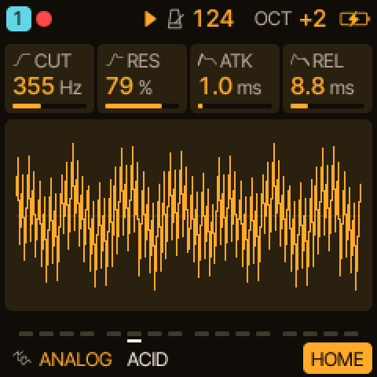
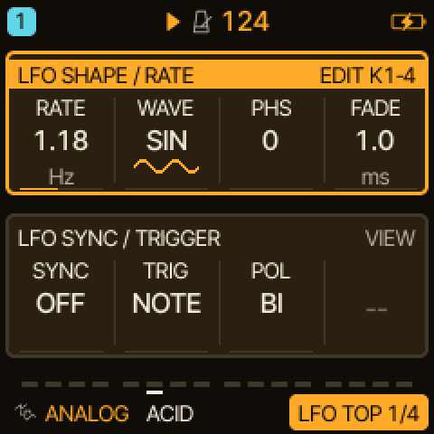
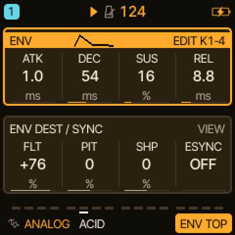
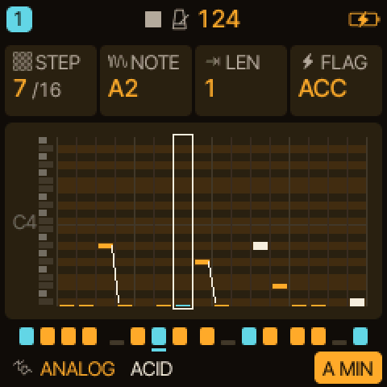
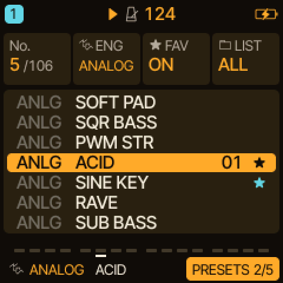
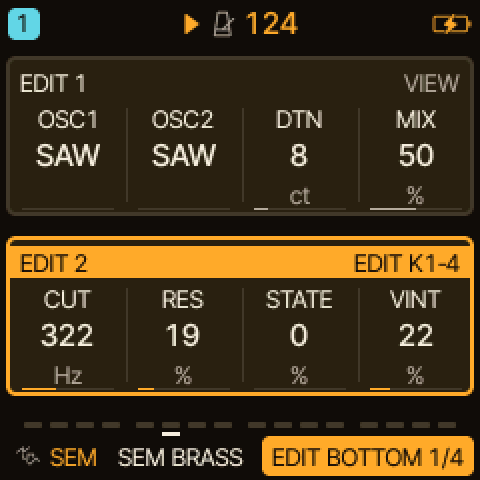
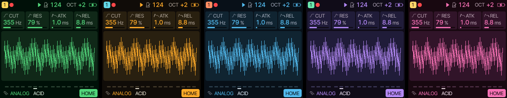

# Caravel

Multi-engine synthesizer firmware for the M-VAVE FM-1, **version 0.3.4** (development; latest public release: 0.3.3).

**[Web installer](https://bonszaimusic.github.io/caravel/webapp/installer/)** · **[Browser emulator](https://bonszaimusic.github.io/caravel/emulator/)** · **[Web editor](https://bonszaimusic.github.io/caravel/webapp/editor/)**

These links become available after the first successful GitHub Pages deployment.

Caravel is a fork of **Felucca 1.6.1** by Leo Kuroshita ([@kurogedelic](https://github.com/kurogedelic)) and
[Hügelton Instruments](https://hugelton.com), continued independently by bonszaimusic now that Felucca's active development
has ended. 0.1.0 is the first version under this name. Caravel is **not affiliated with, endorsed or supported by Hügelton
Instruments or M-VAVE**, and "Felucca" and "Hügelton Instruments" are those authors' names, used here only to say where the code
comes from. See [NOTICE](NOTICE), [LICENSING.md](LICENSING.md) and [CREDITS.md](CREDITS.md).

## Watch and listen

Sounds of the SEM and HADES engines on the FM-1 (recorded before the rename). More videos on the maintainer's channel:
[BonszaiMusic on YouTube](https://www.youtube.com/@bonszaimusic).

## A look at the screen

<table>
<tr>
<td align="center"> HOME</td>
<td align="center"> LFO: two groups, one framed</td>
<td align="center"> ENV with its pictogram</td>
</tr>
<tr>
<td align="center"> STEP and piano roll</td>
<td align="center"> PRESETS</td>
<td align="center"> SEM: oscillators and filter</td>
</tr>
</table>

The screens are drawn by the firmware's own drawing code (AMBER palette, 240 x 240 shown at 2x). MENU > COLOR has more palettes:

## Engines at a glance

| Engine | Good for |
| --- | --- |
| ANALOG | classic subtractive leads, basses, pads, plucks |
| SEM | warm pads, brass, strings, notch sweeps |
| HADES | basses, sub layers, dark leads |
| DRONE (experimental) | evolving drones, beds, bells, slow textures |
| PHASE | bright, glassy and organ-like tones, bells |
| LOFI | chiptune, 8-bit arps, bytebeat |
| TRIO | fat basses, sync and ring-mod leads |
| WHEEL | tonewheel organ |
| FM6 | electric pianos, bells, FM basses and pads |
| PHYS | mallets, plucks, hand drums, metallic textures |
| VOICE | sung vowels, choirs, vocal leads |
| SAMPLE, GRAIN, SLICE | instrument samples and your own, granular clouds, sliced loops |
| DRUM (with DRUM-X) | drum kits and percussion |
| NOISE | wind, rain, risers, effects |

What each engine is and how its controls work: [Engines at a glance](docs/engines/overview.md). Tips for good sounds with SEM, HADES and
DRONE: [Tips and tricks](docs/engines/tips.md).

## What Caravel adds to Felucca

The focus is usability and the sound experience:

- **Two parameter groups on one screen** (LFO, LFO2, ENV, ARP, VOICE, EDIT 1/2, LANES, the FX pages): the active group is framed
  and marked EDIT K1-4, a tag says whether a group is for ALL tracks or the track (T1..T4), SELECT steps through the groups, and the footer
  shows a numbered view ("LFO TOP 1/3"). SLICER, SCL and CHORD put a picture of their settings below their group, and every page frames the
  cards KNOB 1-4 edit. SELECT starts on PAGE; in the menu it walks the rows.
- **FILTER** (0.3.0): one bipolar knob per track on the INSERT 2 page, LP to the left, HP to the right, OFF in the middle; the last stage of the track's chain
  on every engine, so the sends take the filtered sound ([docs/track-filter.md](docs/track-filter.md)).
- **LATCH** (CHORD page): notes of the keys, the chord keys and MIDI IN keep sounding after release, per track ([docs/latch.md](docs/latch.md)).
  **FX HOLD**: a factory preset load keeps the track's sends and INSERT instead of replacing them.
- **Clearer sequencing:** EDIT opens the EDIT pages everywhere; the cursor step is cleared with SEQ held + F5 (CLEAR STEP,
  one undo). Euclid, DOUBLE/HALF, conditional steps and external-clock start and resync are inherited and extended.
- **Deeper modulation:** an independent LFO2 and the MOD matrix (SLEW, S&H sources, MORPH and PHS FB destinations).
- **More sound sources:** SEM, HADES, DRONE (experimental), DRUM-X, MORPH on ANALOG, PHASE and LOFI, BYTE/FLOAT waves in LOFI.
- **Per-track voice reservations** (MENU > VOICES) and a MORE page for SPREAD, MORPH and PHS FB.

The full list is in [CHANGELOG.md](CHANGELOG.md); how the features work is in [docs/](docs/README.md).

## Compatibility with Felucca

Caravel 0.1.0 changed names and text, not storage, and 0.2.0 keeps all formats too (LATCH and FX HOLD use unused slots): settings, projects, presets, the `.fwsc` package markers and the editor's
file formats are the ones of Felucca 1.6.1 and its Custom additions, so Felucca data opens in Caravel. Projects that use
Caravel-only parameters need Caravel or newer. **0.3.0 adds one track parameter (the FILTER)**: it opens everything saved before with the filter OFF, but 0.2.0
and 0.1.0 cannot open a project saved by 0.3.0 (user presets still load there, without the filter): see [docs/track-filter.md](docs/track-filter.md). The web editor and installer accept devices named Felucca as well as Caravel.
Identifiers in the source (`FELUCCA_*`, `felucca.c`, the `firmware/engines/` submodule) keep their names.

**Firmware identity:** Versioned Caravel builds from 0.3.4 use the fixed firmware identity `FM-1_999` regardless of their version. Releases through 0.3.3 used `FM-1_903`; this does not change project or preset file formats. The 0.3.4 hardware update path and return to other firmware are not yet verified.

## Installing

**USB test IDs:** the current firmware uses `1209:0001` (running) and `1209:0002` (loader).
They are not allocated to Caravel or universally unique. The pid.codes policy permits private / in-house testing only and
forbids their use on devices that will be redistributed, sold or manufactured, even if given away for free.
Do not use them outside test environments. General deployment needs suitable IDs or written authorization / clarification;
firmware-only downloads and end-user reflashing need policy clarification, not an assumption that free use is allowed.
See [NOTICE](NOTICE) and the policies for [0001](https://pid.codes/1209/0001/) and [0002](https://pid.codes/1209/0002/).

Installing custom firmware is at your own risk, without warranty to the extent permitted by law; a failed update can leave the
FM-1 unusable or need a Transporter for attempted recovery. M-VAVE's updater or the installer's **Return to official V15** can
attempt an official firmware reinstall, not guarantee factory condition, data restoration, warranty coverage or recoverability.
Keep the official package and backups of your data. Non-excludable statutory rights and liability are unaffected.
Use the [web installer](https://bonszaimusic.github.io/caravel/webapp/installer/) for browser-based updates, or
`tools/fm1_install.py` to install a package from a terminal. How to install a specific release, check it, and go back: [Installing Caravel](docs/installing.md). The web tools are in `web/` and are built into the site by
`web/make_site.py` ([BUILDING.md](BUILDING.md)).

- Build: [BUILDING.md](BUILDING.md); clone with the engines' submodule: `git clone --recurse-submodules https://github.com/bonszaimusic/caravel.git`
- Documentation of what Caravel adds: [docs/](docs/README.md); engines: [docs/engines](docs/engines/README.md)
- Sequencer documentation: [live parts, recording and FX automation](docs/sequencer/README.md)
- Felucca's manual describes the features Caravel inherits, but not Caravel's additions:
  [Installation](https://github.com/hugelton/Felucca/wiki/Installation) ·
  [Controls](https://github.com/hugelton/Felucca/wiki/Controls) · [Menu](https://github.com/hugelton/Felucca/wiki/Menu) ·
  [Engines](https://github.com/hugelton/Felucca/wiki/Engines) · [Features](https://github.com/hugelton/Felucca/wiki/Features)

## What it is

Sixteen engines with factory presets, four tracks (8 voices shared), a 64-step sequencer (chords, ties, chance, conditions,
ratchets, nudge, locks, automation, live and step recording), SEQ TOOLS, songs, effects, a MOD matrix, MIDI (USB and TRS,
per-track channels, MIDI LEARN) and USB audio.

## Inherited from Felucca

## New in 1.6.1

- **MENU > LARGE keeps one size per knob** (#251): a value no longer jumps between sizes as you turn the knob
- **Updates check the package's size on the FM-1**: a package made for another device is refused before anything is erased
- **Second core (beta), off by default:** MENU > SYSTEM > 2ND CORE > ON (BETA), then restart: the FM-1's second core
  renders some of the parts, same sound, more headroom (#247)
- **Felucca-Engines:** Felucca 1.6.1 moved ANALOG, LOFI, TRIO, WHEEL and NOISE to
  [their own MIT repository](https://github.com/hugelton/Felucca-Engines) (a git submodule here).
  Caravel uses its TRIO, WHEEL, NOISE and shared DSP, but local GPL-3.0-only, JIANT-derived ANALOG and LOFI variants in
  `firmware/src/`; the unchanged submodule variants remain MIT. Felucca itself stays GPL-3.0-only.

## New in 1.6

- **Your own UI colours:** COLOR has an eleventh value, CUSTOM, set in the web editor with a live preview on the FM-1
- **The SEQ piano roll follows the play position** when the pattern is longer than one screen
- **Conditional steps** (1:2 … 4:4, FILL), **EUCLID, DOUBLE and HALF**, **a MIDI channel per track**, PHASE FOLD, three more drum kits and humanize in the MOD matrix (1.5.5 and 1.5.6 were never released: 1.6 carries them)
- ⚠ A project with conditional steps does not open on 1.5 or 1.5.1; projects saved by 1.4 or later do not open on 1.1.5.x

All changes and what to know before going back: [Release notes](https://github.com/hugelton/Felucca/wiki/Release-Notes) · [Upgrading from 1.1.5](https://github.com/hugelton/Felucca/wiki/Upgrading-from-1.1.5).

## Support and contributing

Please report what you find in this repository's Issues (reproducible bugs, one per issue), not to Hügelton Instruments or M-VAVE.
Pull requests are welcome: see [CONTRIBUTING.md](CONTRIBUTING.md). Caravel is GPLv3 and you are free to fork it.

## AI disclaimer

Caravel-specific changes to Felucca were developed with AI coding agents (code, tests and documentation). Direction, design
decisions and acceptance are the maintainer's. The original public Felucca history through 1.6.1 is unchanged and is the work
of its authors. The initial Caravel changes are recorded as one baseline snapshot rather than as their individual
development commits.

## Credits and licence

Free software: [GPL-3.0-only](LICENSE), the Hügelton Sample Pack and local JIANT-derived ANALOG / LOFI variants included.
The unchanged [Felucca-Engines](https://github.com/hugelton/Felucca-Engines) submodule (`firmware/engines/`) remains MIT;
Caravel uses its TRIO, WHEEL, NOISE and shared DSP. Bundled fonts and ported DSP keep their own licences
([LICENSES/](LICENSES/), [LICENSING.md](LICENSING.md)). Thanks to everyone whose work and contributions are in it: [CREDITS.md](CREDITS.md).

M-VAVE and FM-1 are trademarks of their respective owners. Caravel is not affiliated with or endorsed by them or by Hügelton
Instruments.

Copyright (C) 2026 bonszaimusic (Caravel and its changes to Felucca) 
Copyright (C) 2026 Leo Kuroshita (@kurogedelic), Hügelton Instruments (Felucca 1.6.1, the base of this work)
