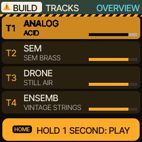

# Caravel

Multi-engine synthesizer firmware for the M-VAVE FM-1. **Caravel 1.1.0** — [release and downloads](https://github.com/bonszaimusic/caravel/releases/tag/v1.1.0). [Classic 0.13.0](https://bonszaimusic.github.io/caravel/classic/) remains available as a frozen generation.

> **New: Caravel Academy.** Interactive tutorials with the real firmware in your browser. **[Stage 1 · Strings before anything else](https://bonszaimusic.github.io/caravel/v1/emulator/#stage-1)** ([video](https://youtube.com/shorts/4a8ya1iPiTQ)) and **[Stage 2 · Lay CELL AIR underneath](https://bonszaimusic.github.io/caravel/v1/emulator/#stage-2)** ([video](https://www.youtube.com/shorts/QukahShkb2M)) are open, and so are **[Stage 3 · Give the sound a slow envelope](https://bonszaimusic.github.io/caravel/v1/emulator/#stage-3)** and **[Stage 4 · Add a little slow motion](https://bonszaimusic.github.io/caravel/v1/emulator/#stage-4)** ([one video for both](https://youtube.com/shorts/H4Z5J3FivAs)) — more stages follow together with the YouTube series.

[Browser emulator](https://bonszaimusic.github.io/caravel/v1/emulator/) · [Academy](https://bonszaimusic.github.io/caravel/v1/emulator/#stage-1) · [Web installer](https://bonszaimusic.github.io/caravel/v1/webapp/installer/) · [Web editor](https://bonszaimusic.github.io/caravel/v1/webapp/editor/) · [Tutorials](docs/tutorials/README.md) · [FAQ](docs/faq.md)

The website keeps Classic and 1.x separate. These instructions describe 1.1.0.

## Start with PLAY, shape in BUILD

Hold HOME for one second to switch views. PLAY exposes SOUND, SHAPE, MOVE, HARM, SPACE, MIX and ARP with four arcs. BUILD exposes the full sound and performance pages. Tap HOME for the LEVELS explanation in PLAY or the track overview in BUILD; EDIT selects SOUND. SAVE opens PROJECT; double-tap GLO in BUILD opens the menu. STEP, DETAIL and AUTOMATION retain their grid layout.

[First ten minutes](docs/tutorials/start-here.md) · [Controls](docs/tutorials/basics.md) · [Release notes](docs/release-100.md)

## Six engines

| Engine | Sound and starting point |
| --- | --- |
| ANALOG | Band-limited oscillators and multimode filtering; leads, basses and pads |
| PHYS | Modal, string and membrane physical models; mallets, plucks and resonances |
| SEM | Two oscillators and a continuously blended state-variable filter; warm pads and brass |
| HADES | Saw/pulse, two suboscillators, resonant bass filter, drive and BODY |
| DRONE | Coupled generators, drift and cell modes; slowly changing textures |
| ENSEMBLE | Strings, choir and dark pads with a built-in stereo ensemble |

[Engine overview](docs/engines/overview.md) · [Practical tips](docs/engines/tips.md)

Four tracks share the note/voice budget and provide envelopes, filters, ARP, modulation and effects. HARMONY supplies a progression; CHORD EXT takes extensions from that bus or real live input on T1–T4. RANDOM, JOURNEY, ELASTIC, PAIR and STASIS support performance and changing textures.

**CAPTURE records notes, not audio:** live panel keys and USB/TRS MIDI IN, including velocity and physical note lengths. With transport running, REC takes a retrospective 1/2/4/8/16/32-bar loop with LENGTH selected independently per track; another take overdubs. Four independent loops (up to 128 events each, including note-offs) are temporary RAM state and are not saved with projects. ARP/SEQ output and loop playback do not record themselves. [CAPTURE guide](docs/tutorials/capture.md)

**AFTERBURNER:** in BUILD tap FX once, then SELECT to AFTER. K1 ON, K2 TIME 10–60 s, K3 AMT, K4 DAMP. It starts OFF; settings reset on INIT/LOAD and are not saved. There is no adaptive CPU-priority controller.

## A new data generation

**Back up before updating.** Keep old backups with their matching firmware and tools. 1.0 uses FORMAT 2 projects, presets and backups; it does not import pre-1.0 data. Old data is identified rather than silently migrated. The backup handshake distinguishes LIST 1 from LIST 2. SAMPLE, GRAIN, LOFI, FM6, PHASE, VOICE, TRIO, NOISE, WHEEL and DRUM are absent, as are Song/Chain and Scope. See the [compatibility notes](docs/release-100.md).

The existing compressed performance-data limit is 3,328 bytes. A too-large project is refused with PROJECT TOO LARGE / NOT SAVED; the previous saved copy remains. Finish any pending RAM save before powering off.

## Install, build and verify

Use the [installation guide](docs/installing.md). Build instructions and the pinned toolchain are in [BUILDING.md](BUILDING.md); package construction verifies SDK hashes and provides SHA-256 manifests. Firmware and matching source have SHA-256 manifests.

The automated checks passed; a complete FM-1 audio, load, update and restore acceptance has not been documented. Host, emulator and static budget checks do not establish device interrupt deadlines, MIDI jitter, audio quality or power-cycle behavior. See [validation and hardware checklist](docs/release-100.md). For maintainers, the [release validation map](docs/RELEASE_CHECKS.md) identifies targeted checks without repeating all evidence.

The UC25HQ80 flash chip (JEDEC `0xB36014`) and Puya P25Q80 (`0x856014`) are recognized. **This project has not tested a real UC25HQ80 unit.** m-bootloader is documented as an external recovery option and is not incorporated into the firmware.

## Project and licences

Caravel is bonszaimusic's GPL-3.0-only fork of Felucca 1.6.1 by Leo Kuroshita / Hügelton Instruments. It is independent of M-VAVE and Hügelton Instruments. Preserve the notices and component licences: [LICENSE](LICENSE), [NOTICE](NOTICE), [CREDITS](CREDITS.md), [LICENSING](LICENSING.md). Historical release behavior is recorded in [CHANGELOG](CHANGELOG.md).
