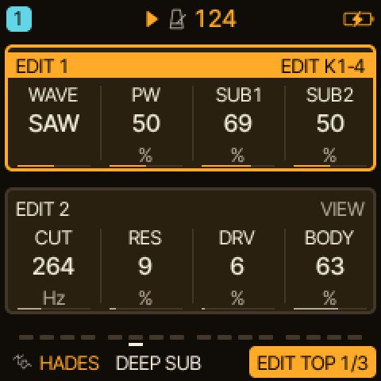
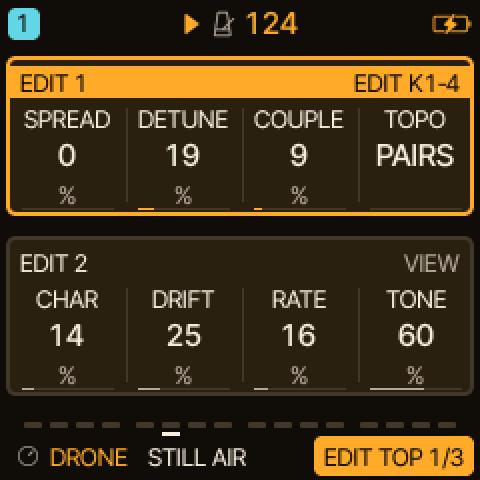

<!-- SPDX-License-Identifier: GPL-3.0-only -->
<!-- Copyright (C) 2026 bonszaimusic -->
# Tips and tricks: SEM, HADES and DRONE

Starting points for good sounds, taken from how the engines are built. They are suggestions to try and adjust by ear; the guides
([SEM](SEM_ENGINE.md), [HADES](hades-engine.md), [DRONE](../drone-engine.md), [DRONE cells](drone-cells.md)) have the full
control lists. The screenshots are the engines' EDIT pages as the firmware draws them.

**Everywhere:** EDIT 1 and EDIT 2 are two groups on one screen. The framed group is the one KNOB 1-4 edit; SELECT steps to the
other. Every engine control can be MIDI-learned, saved with the sound and, for most, locked per step or automated by the
sequencer. Slow movement from an LFO, the MOD matrix or step locks is often what makes these engines sound alive.

## SEM

SEM is two oscillators (SAW, PULSE, TRI or PWM, each chosen separately) into a state-variable filter. Its factory presets are SEM
BRASS, WARM PAD, OB STRING, ROUND BAS, NOTCH PAD, SEM LEAD, HIGH AIR and SOFT KEY; they show what the engine does well.

- **Thick pads from two oscillators:** set OSC1 and OSC2 to the same wave and detune OSC2 a few cents with DTN (it goes up to
  50). Use MIX to balance them.
- **Moving pulse width:** choose PWM for an oscillator, then send a slow triangle LFO to pulse width (SHP) with a modest depth.
  The guide's own advice is to start slow and small.
- **STATE is the filter's character:** 0 is low-pass, about half (64) is a notch, 127 is high-pass. Park it near the middle for a
  hollow, notch-filtered sound (the NOTCH PAD preset), or sweep it with an LFO or a step lock for movement. TYPE BP and HP replace
  STATE with a fixed band-pass or high-pass, which is useful for thinner layers.
- **Push the resonance:** RES does not reach self-oscillation, so high values are safe for sharper filter sweeps.
- **VINT adds life:** it gives each voice small pitch and filter differences and a slow tuning drift. Raise it for chords and pads;
  at 0 the variations are off, which suits tight unison lines and basses.
- **Chords and the voice budget:** all tracks share eight voices. Reserve voices for a pad track (MENU > VOICES, FIXED) if a busy
  arrangement steals them ([Voice reservations](../voice-reservations.md)).

## HADES

HADES is a bass engine: a main saw or pulse oscillator, two phase-locked suboscillators one and two octaves down, a resonant
three-pole low-pass, drive and a bass shelf. Presets: DEEP SUB, DARK SAW, PULSE BAS, SUB ONLY, DRIVEN, RESO BASS, DARK PLK, RAW LEAD.

- **Play it mono:** the guide suggests MONO or LEGATO for bass. LEGATO with a little glide gives slides.
- **Layer the octaves:** mix SUB1 (one octave down) and SUB2 (two octaves down) with SAW or PULSE for a stacked bass. WAVE OFF
  leaves only the subs, a clean low end under another track (the SUB ONLY preset).
- **Pulse width movement:** with WAVE on PULSE, send an LFO to pulse width for a moving bass.
- **Filter envelope plucks:** the filter uses the track's ADSR and filter-envelope amount; a short decay with no sustain gives
  plucked basses (compare DARK PLK, which uses a PULSE wave, decay and no sustain).
- **DRV and BODY last:** DRV is a soft drive after the filter, BODY a bass shelf. Set them with the track FX off, then add delay or
  reverb. BODY adds low-frequency gain, so lower the track level if the mix gets tight.
- **Register:** it is a bass engine first; for a lead try RAW LEAD and raise CUT instead of playing the low register.

## DRONE (experimental)

DRONE turns one note into four coupled sine generators. The four performance knobs are COUPLE, CHAR, DRIFT and TONE; SPREAD,
DETUNE, TOPO and RATE are on the EDIT pages.

- **Start low and quiet:** select a preset such as STILL AIR, hold a low note (the guide suggests C3) and raise COUPLE slowly.
- **Give it time:** the presets use long envelopes with high sustain. Hold the note, use sequencer ties, or set the track's **LATCH** (CHORD page, [latch.md](../latch.md)) so the notes stay on after
  you let go; a preset does not latch by itself. Movement takes seconds to develop.
- **Topology changes the character:** PAIRS, CHAIN and RING route the generators differently; changing TOPO crossfades, so it can
  be turned while a note holds. TOPO 3 to 5 (CELLPAIR, CELLCHN, CELLRING) are the cell modes below.
- **Intervals:** SPREAD opens the four generators from unison up to 1 : 5/4 : 3/2 : 2 (a just fifth and an octave); the in-between
  values are continuous. DETUNE adds slow beating (the outer generators go about 20 cents apart at the maximum).
- **Cell modes for performing:** hold a low anchor note, then briefly add other notes while the anchor stays held. New notes
  excite single cells instead of transposing the whole network; the anchor keeps cell 0. Lowering COUPLE reduces both the phase
  modulation and the neighbour suppression. Let it settle for several seconds.
- **Preset tendencies** (from the cell guide, a measurement of spectrum, not a listening verdict): CELL AIR is open and calm,
  TIDE a very slow beating tide, IRON BELLS metallic, SUB FOG a dark rumble, GLASS CHOIR a bright shimmer, STATIC harsh and wire-like.
- **Keep it low:** there is no oversampling, so high notes with strong coupling can alias. Low and mid registers sound cleaner.
- **Effects after listening:** the presets are dry so you can hear the network; add delay and reverb afterwards.

DRONE is experimental. It has been tested with the host test suite, not yet on a physical FM-1 under sustained load.

## More ideas

- Combine the three: a DRONE bed, a HADES sub and a SEM pad on separate tracks, each with its voices reserved in MENU > VOICES.
- Use LFO2 for a second, independent movement (for example the filter on one LFO and pulse width on LFO2). LFO2's
  destinations are set in the MOD matrix: see [LFO2](../modulation/LFO2.md).
- The video [Hades & SEM-Inspired Sounds](https://youtu.be/rfY23zoBgzQ) on [BonszaiMusic](https://www.youtube.com/@bonszaimusic)
  plays through sounds of two of these engines.
