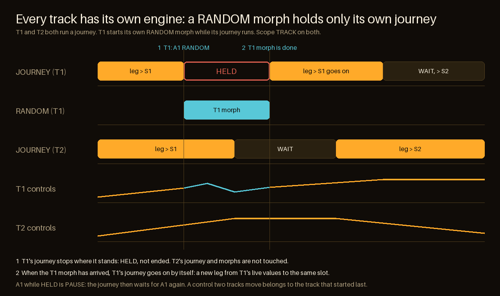

<!-- SPDX-License-Identifier: GPL-3.0-only -->
# MORPH JOURNEY

**Released in 0.8.0; tested on the host and in CI and tried on an FM-1 by the maintainer; not verified with a controller or external clock.** It chains the snapshot morphs S1–S4 into one long, hands-free movement.
It is played from the panel (the JOURNEY ACTION bank) and, if you like, from MIDI controllers. Playing a journey changes no snapshot and
no stored sound, and it ends when you stop it. What *is* kept with the project are the snapshots S1–S4 and the performance settings (BARS,
DEPTH, SCOPE, SHAPE, WAIT, direction); the running journey itself (PLAY/PAUSE, the countdown, the selected slot) is not saved, see
[Saved with the project](#saved-with-the-project).

## Play it from the panel

1. **Save snapshots in RANDOM** (HOME with ACTION on): set the sound, hold **A4** to save it into the selected slot; tap **A4** to move to
   the next slot, change the sound, hold A4 again. You need two to four snapshots (see *Slots belong to tracks* below).
2. **Tap BANK until JOURNEY** (it is the fifth bank, after LIVE). The title shows the track that owns the slot being approached, the slot and the state (`OFF`, `PLAY`, `HOLD`, `WAIT`, `PAUSE`).
3. **A1 PLAY** starts: the sound morphs to the selected snapshot, rests, moves on to the next populated slot and loops
   (S1 → S2 → S3 → S1 …). Every leg starts from the values the sound has at that moment, so nothing jumps.

| Key | JOURNEY bank |
| --- | --- |
| A1 | **PLAY** / **PAUSE** / **RESUME**: starts, freezes the movement in place, continues |
| A2 | **DIR FWD / REV**: sets the direction. The running leg finishes, then the next one goes the new way (`REVERSE AFTER S3`) |
| A3 | **NEXT Sx**: skips the rest of the leg at once and goes to the next slot in the current direction |
| A4 | tap: **WAIT** steps 0 / 1 / 2 / 4 / 8 / 16 bars (the pause after each arrival); hold: **saves** the live sound into the selected slot |

**The JOURNEY bank's SETUP chooses the tracks** (below). Everything else a journey needs is already somewhere you know:

| Value | Where | Note |
| --- | --- | --- |
| leg length | RANDOM SETUP, **K1 BARS** | the same value RANDOM uses; during a running journey a change waits for the next leg and the display shows it (likewise **K3 SCOPE**) |
| curve | RANDOM SETUP, **K4 SHAPE** | likewise shared and latched |
| WAIT | **A4 tap in the JOURNEY bank** (steps 0 / 1 / 2 / 4 / 8 / 16 bars), or a CC | journey only. **In RANDOM, A4 tap selects the next snapshot slot instead** |
| slot | RANDOM **A4 tap** (next slot), or the journey itself | the selected slot follows the journey; in the JOURNEY bank A4 tap is WAIT, so the slot is not changed there |

DEPTH and SCOPE exist only in RANDOM: a leg goes to stored values, and the controls it moves are already in the snapshot.

## Slots belong to tracks

There are **four snapshot slots for the whole project**, not four per track. A slot holds what was saved into it last: the controls pinned on the
selected track's HOME page (SCOPE TRACK; ROW: the active row only; ALL: the HOME controls of every track, up to 128 targets) with their values at
that moment, not the other tracks' state. Saving on another track into an occupied slot **replaces** it (`S1 SAVED, WAS T1`).

So that this is never a surprise, the owner is shown: the RANDOM title and the A4 label read `S1:T3`, `S2:ALL` or `S3:-` (empty), tapping A4 says
`SNAP S2 IS T1`, and in the RANDOM and JOURNEY banks the line under the keys lists all four, for example `S1:T1 S2:T1 S3:ALL S4:-`.

A journey treats every slot as a **scene**: a leg moves exactly the controls stored in its target slot and leaves everything else where it is.
S1 and S2 from T1 and S3 from T3 are one journey: at S3 only T3's controls move, T1 stands still. An `ALL` slot moves all tracks, and
**Which tracks a journey takes along** (below) can leave some out. The title names the owner of the slot being approached.

## Which tracks a journey takes along

A snapshot stores the controls pinned on the HOME page of one track, and those can belong to several tracks. **Hold BANK in the JOURNEY bank** to open
its SETUP: **K1 to K4 are TRACK 1 to TRACK 4**, turned right = `ON`, turned left = `SKIP`. A skipped track's controls are left alone by every leg;
they keep whatever value you give them. The change counts from the next leg. If every pinned track is skipped, PLAY says `ALL TRACKS SKIPPED` and
nothing moves. Hold BANK again to leave SETUP. The choice is saved with the project. (RANDOM's own morphs are not affected by it.)

## How RANDOM and JOURNEY work together

- **One set of snapshots, one selected slot.** The slot shown in RANDOM (`S2*`) is the one the journey is heading for, so you can switch to
  RANDOM, look at it, and save a new sound into it with A4-hold.
- **Saving or deleting a snapshot ends a running journey** (its set of slots changed): press PLAY to go on from the selected slot.
- **One morph engine for all tracks, so one movement at a time.** A RANDOM morph started on any track, by hand (RANDOM bank, A1) or its RETURN,
  **holds** the journey: it stops where it is (`HOLD`), and **when that morph is done it goes on by itself**, with a new leg from the live values
  to the same slot (or, if it was resting, with the rest of the pause). The picture below shows it. **A1 while held is PAUSE**: then it stays
  paused until you press A1 again. **A3 NEXT** or **A3 GO Sx** in RANDOM steer the journey to a slot at once. RANDOM's A2 FREEZE on the journey's own
  leg holds it like PAUSE does; a frozen RANDOM morph keeps the journey held.
- **What is running is always shown.** In the JOURNEY bank the title reads `JOURNEY 5/5 T1 S2 PLAY` (the owner of the slot being approached, the slot, and
  `PLAY`, `HOLD`, `WAIT`, `PAUSE` or `OFF`). In the other banks the line below the keys says `JOURNEY T1 PLAY`, `JOURNEY T1 HELD` and so on, and
  for a RANDOM morph `RANDOM T2 RUNNING`, `RETURN T2 RUNNING` or `GO SNAP T1 RUNNING`, so you can tell which track owns the one running morph.
- **The journey keeps running when you change bank**, so STASIS, PAIR and LIVE stay usable meanwhile.
- **Hands and controllers win.** A parameter you turn, or set from a MIDI CC, keeps its value for the rest of the leg; the next leg
  moves it again.
- **SETUP is one switch for the other banks.** Entering the JOURNEY bank leaves SETUP; hold BANK there to open its own (the tracks).

## Delete a snapshot

In RANDOM, hold BANK to open SETUP, select the slot with A4 tap, and **hold A4**: `SNAP S3 DELETED`. Outside SETUP, A4 hold still saves, so a
deletion cannot happen by a simple save. A slot that is already empty says `SNAP: ALREADY EMPTY`. Deleting ends a running journey. A deleted slot
is saved as empty with the project.

## Saved with the project

The performance settings are saved with each project, next to the snapshots S1–S4 (slots A–D, RESTORE LAST, USB backup, export and import):
**BARS, DEPTH, SCOPE, SHAPE, WAIT, the direction and the tracks a journey leaves out**. A project saved with BARS 16, SHAPE DRIFT and WAIT 4 sounds the same after reopening it.
If a change is still waiting for the next leg when you save, the waiting value is the one saved.

**Not saved:** a running journey, PLAY / PAUSE, the WAIT countdown, RETURN points, and the selected slot. A loaded project always starts
**stopped**, with S1 selected. Projects made before this feature get the defaults: BARS 8, DEPTH 35, TRACK, SMOOTH, WAIT 0, forward.
The storage grows by nothing (the values use bytes that earlier firmware requires to be zero), so **0.7.x firmware refuses such a project**
(`PERF PROJECT INVALID`) instead of misreading it: back up before moving between versions.

## MIDI (optional)

Start MIDI Learn (GLO + D4), go to HOME with ACTION on and pick a target: in RANDOM's SETUP K1–K4 pick BARS, DEPTH, SCOPE and SHAPE; in
either bank A1–A3 pick PLAY, DIR and NEXT, tap A4 picks WAIT (while learning, a hold of A4 learns nothing and saves nothing; outside learning, A4 tap is WAIT in the JOURNEY bank and the next slot in RANDOM).

| Target | CC behaviour |
| --- | --- |
| PLAY, DIR, NEXT | buttons: rising edge through 64 (a repeated high value or the release does not trigger again) |
| WAIT | absolute, 6 bands |
| BARS / DEPTH / SCOPE / SHAPE | absolute, 7 / 6 / 3 / 3 bands; held back while a leg moves, applied at the next leg (SCOPE resets the morph, so it must wait) |

## Limits

At least two populated snapshots, otherwise PLAY says `NEED 2 SNAPS` and nothing moves; slots of different tracks and scopes are fine. Starting replaces pending RANDOM return points, like an A3 recall. Leg lengths follow the tempo setting,
not an external MIDI clock. **Not verified:** a controller, external MIDI clock, CPU and memory under real load, long real-device runs, every engine.
