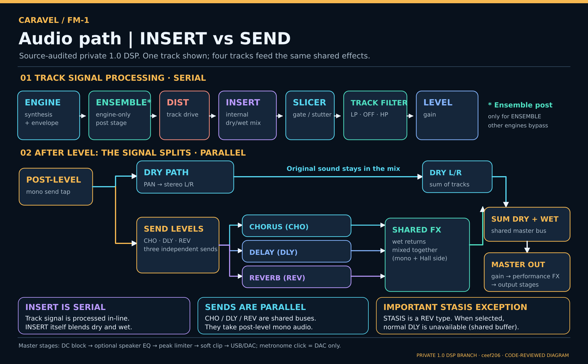

<!-- SPDX-License-Identifier: GPL-3.0-only -->
# Caravel 1.0 — Audio signal flow & synthesis engine diagrams

**Status:** Review-ready documentation drafts, not published tutorials or a released firmware specification.

These seven **English** tutorial illustrations explain the audio path and the six engines in the Caravel 1.0 / FORMAT 2 candidate. Both **PNG** (2000 × 1240 pixels) and **editable SVG** are checked in, with identical content. The drawings are instructional signal-flow schematics, not actual circuit diagrams, scope captures, or an exact representation of every modulation/math operation.

**Source baseline:** Caravel 1.0 development code reviewed on 2026-11-16. The final 1.0 source revision should be checked before publishing; exact internal source provenance is retained separately by the maintainers. **Classic 0.13.0 is different**, notably in `eng_phys.c` and `fx.c`; do not use these graphics unqualified in Classic tutorials.

## Images

| Topic | Editable vector | PNG preview | Source to recheck |
| --- | --- | --- | --- |
| Track routing, INSERT vs SEND, master | [SVG](01_audio_routing.svg) | [PNG](01_audio_routing.png) | `firmware/src/fx.c`, `audio.c` |
| SEM | [SVG](02_sem.svg) | [PNG](02_sem.png) | `firmware/src/eng_sem.c` |
| HADES | [SVG](03_hades.svg) | [PNG](03_hades.png) | `firmware/src/eng_hades.c` |
| DRONE (legacy networks & CELL modes) | [SVG](04_drone.svg) | [PNG](04_drone.png) | `firmware/src/eng_drone.c` |
| ENSEMBLE | [SVG](05_ensemble.svg) | [PNG](05_ensemble.png) | `firmware/src/eng_ensemble.c`, `fx.c` |
| ANALOG | [SVG](06_analog.svg) | [PNG](06_analog.png) | `firmware/src/eng_analog.c` |
| PHYS (MODAL, STRNG, MEMB, SYMP) | [SVG](07_phys.svg) | [PNG](07_phys.png) | `firmware/src/eng_phys.c`, `phys_dsp.c`, `phys_symp.c` |

### Overview — audio routing

## For tutorial authors and AI collaborators

- **Use the SVGs as the editable masters**; use PNGs for screenshots, handouts, social posts or renderers that cannot display SVG.
- Preserve the key distinction: **DIST** is a track-local *serial* distortion stage, not a fourth send. **INSERT** is serial but has its own internal dry/wet mix. **CHO / DLY / REV** are three shared *parallel* sends, tapped after track level and before stereo panning.
- **STASIS is one REVERB mode**, not a fourth simultaneous send; when selected it disables the normal DELAY engine because they share buffer memory.
- ENSEMBLE's built-in multi-tap processing is within the engine/track before DIST and INSERT. Its three mono taps or six stereo taps are distinct from the shared chorus bus.
- HADES: oscillator/sub sum → 3-pole LP filter → BODY bass shelf → drive. SEM: two oscillators → selectable state-variable filter; its morphing STATE filter is not the only filter type.
- DRONE uses one tracked host voice with four internally coupled generators; the topology determines the phase-modulation routes, and its CELL family has distinct gesture/ownership behavior.
- PHYS selects **one of four algorithms**; the illustrated algorithms are **not four simultaneous voices**.
- References to Oberheim SEM, Dreadbox Hades RE, SOMA LYRA-8 and classic Solina/string machines describe **conceptual inspiration only**. They are not manufacturer-endorsed, circuit-identical, or demonstrated sonic matches.
- The image legends and block arrangements are teaching simplifications. **Re-read the actual source** at the final release SHA before asserting a full implementation guarantee. The layouts do not document every stereo side path, modulation destination, special mode, limiter setting or USB/DAC routing exception.

## Release and validation boundaries

- The reviewed candidate contains **ANALOG, PHYS, SEM, HADES, DRONE and ENSEMBLE**. Older Caravel releases include more engines: do not add FM6, BODY or a separate DRONE oscillator engine to these **1.0** images.
- This is a **static source review** only. No newly run emulator audio, target firmware, browser, hardware, MIDI, USB, or listening tests are claimed for these illustrations.
- Before publishing on the future `/v1/` site: compare with the **exact released code and compiler flags**, check all parameter labels and routing, have a technical/editorial reviewer sign off, and test SVG rendering in the actual website.
- **Do not place this 1.0 candidate documentation under `/classic/`.** The public Caravel 0.13.0 distribution and GitHub Pages remain unchanged by this docs-only change.

Related code and tutorials: [Caravel documentation](../../README.md), [engine overview](../../engines/overview.md), and [FX tutorial](../filter-fx.md).

## Current 1.x candidate recheck — 2026-11-17

Rechecked against the Caravel 1.0 candidate code before
the documentation-only integration of PR #59. All fourteen original SVG/PNG
assets are preserved byte for byte. All seven PNGs were visually inspected;
SVG XML, PNG dimensions/chunk CRCs and compressed image decoding were checked.
This is a source and file review, not a browser, device or listening test.

ANALOG, PHYS, SEM, HADES, ENSEMBLE and the audio adapter retain the audited
source. DRONE now attenuates its legacy topology output by 9/16 after the soft
knee; the four-generator topology shown here is unchanged. The sympathetic
string helper uses defined unsigned shifts without changing the illustrated
model selection. The 1.0 FX code also has optional BRIGHT speaker EQ
before the limiter and routes the performance FILTER macro through the selected
track filter. DIST → INSERT → SLICER → FILTER → LEVEL and the three post-level,
pre-pan send taps still match the drawings.

The master drawing is a teaching overview: in USB LEVEL FIXED mode the DAC's
master level is applied after the USB tap, and the metronome is DAC-only.
The existing caption “optional speaker EQ” includes BRIGHT in this candidate.
These qualifications accompany the original artwork rather than changing its
historical source footer. A final release-SHA comparison, browser rendering and
publication review are still required. The drawings are not automatically
installed into Classic or the published website.
