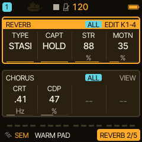
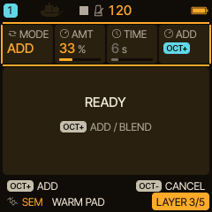
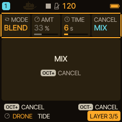
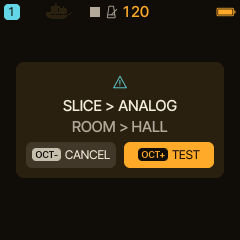
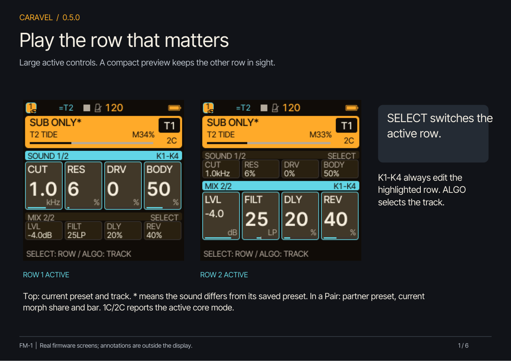
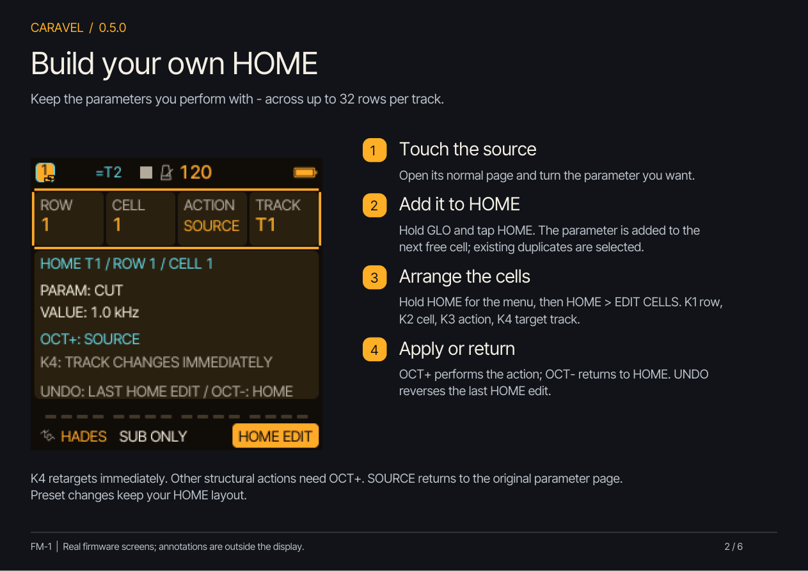
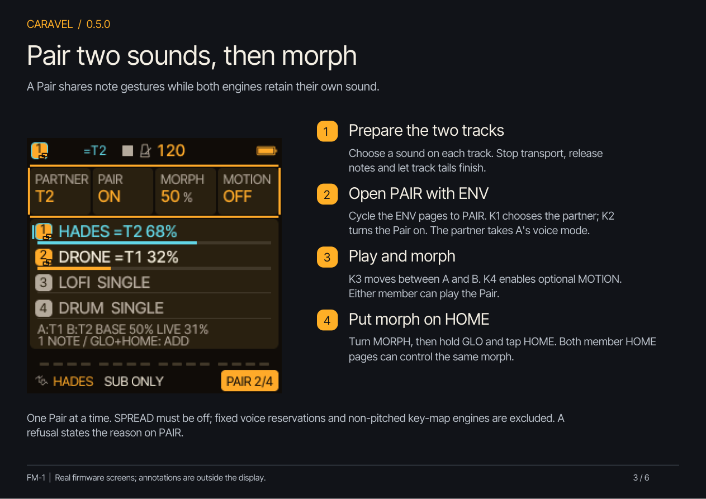
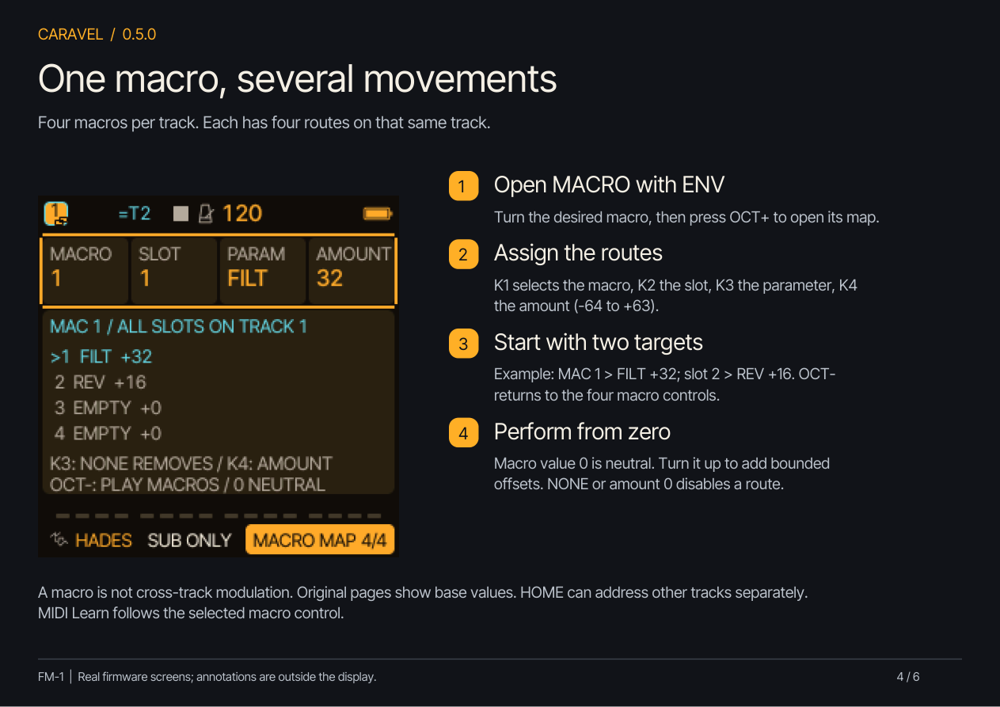
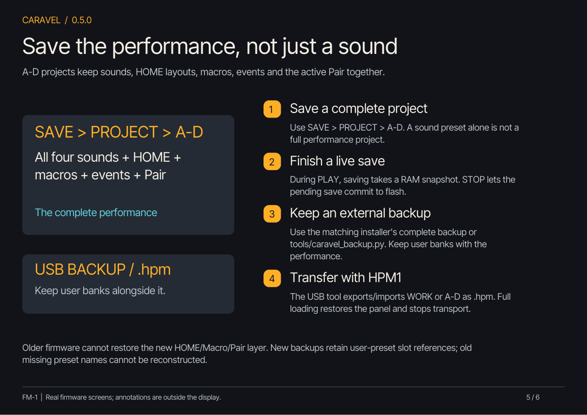
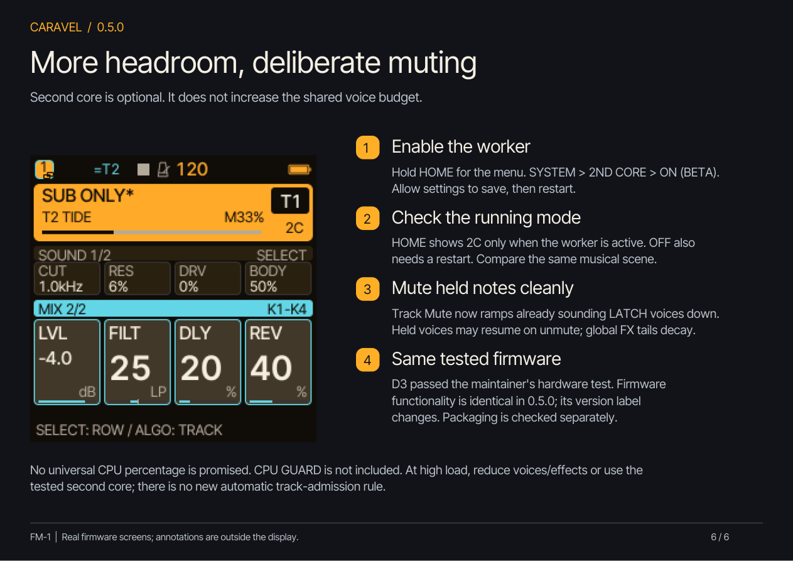

# Caravel 0.6.0 - STASIS and performance tutorials

[STASIS PDF guide](Caravel-0.6.0-STASIS-Guide.pdf) ·
[Listen to the examples](https://bonszaimusic.github.io/caravel/sounds/) ·
[Earlier six-page performance PDF](Caravel-0.5.0-Quickstart.pdf).
Every screenshot comes from the actual firmware renderer. The performance
features introduced in 0.5.0 remain available in 0.6.0.

## Capture and hold a texture

Set a track's REV send around 85-90%. Open FX > REVERB and choose TYPE STASIS.
With CAPT LIVE, play for at least about 0.6 s, then choose HOLD. The captured
sound continues after note release or after muting its source track. STR sets
foreground texture strength; MOTN animates reflection choices, filtering and
HALL damping without sweeping the grain playback speed. STOP releases HOLD.

## Add a new sound

Leave CAPT HOLD and open FX > LAYER. Choose MODE ADD and set AMT; 25% means
25% new recording plus 75% old texture. Play the new sound through REV send
for about 0.6 s, then press OCT+. MIX takes 200 ms; STORE finishes the merge
in about 0.75 s. READY means another addition is possible. Turning through
the controls never triggers recording. Layers merge and cannot be removed
individually. Both operations end with CAPT HOLD still active.

## Blend into a destination texture

Choose MODE BLEND and TIME 1-30 s (default 6 s). AMT is ignored. Play the
destination sound with REV send for about 0.6 s, then press OCT+. A snapshot
of that sound gradually replaces the old texture, then stays held. Each
press performs one transition. WAIT preserves the original while no recent
input is available. OCT+ cancels WAIT or fades MIX back to the original.
STORE completes before another operation. STOP and HOLD > LIVE release the
audible mixture normally.

## Upgrade existing projects safely

0.6.0 contains HALL and STASIS. ROOM, SPRING and the SLICE engine are omitted;
the separate SLICER track effect remains. Incompatible projects show the actual
substitutions before loading. OCT- CANCEL preserves the current working session;
OCT+ TEST loads a converted working copy. Source slots remain protected for the
session: save the audition to another slot. RESTORE LAST protects occupied slots,
so use an empty slot for its copy. Export a complete backup before upgrading.

STASIS uses the internal REV send, not external microphone or USB audio input.
Ordinary tempo DELAY is suspended while STASIS owns its buffer. Project saves
retain MODE/AMT/TIME, not captured audio; textures are volatile RAM. See the
[versioned release notes](../../RELEASE-NOTES.md) for the validation scope.

## Performance workflow

## 1. Read and play HOME

SELECT chooses the active row, K1-K4 edit it, and ALGO selects the track. The active
row grows; the other stays compact. The preset name remains at the top. A star
means the sound differs from its saved preset. Pair members also show the partner
preset and effective morph share.

## 2. Add and arrange controls

Turn a parameter on its original page. Hold GLO and tap HOME to add it. Hold HOME
for the menu, then HOME > EDIT CELLS to reorder or remove references. K1 selects
row, K2 cell, K3 action and K4 target. K4 acts immediately; OCT+ executes structural
actions and OCT- returns to HOME. SOURCE returns to the original page.

## 3. Set up Pair Morph

Prepare two eligible pitched tracks; stop, release notes and let track tails finish.
Cycle ENV to PAIR. K1 chooses the partner, K2 enables the pair, K3 morphs and K4
switches optional MOTION. The partner takes A's voice mode. SPREAD must be off,
AUTO voices must be selected and only one Pair is available. The page explains
why a request is refused. Turn MORPH and use GLO+HOME to bring it onto HOME.

## 4. Map a macro

Cycle ENV to MACRO. Turn the chosen macro and press OCT+ to open its map. K1 picks
the macro; K2 picks one of four slots; K3 chooses a continuous parameter on the
same track; K4 sets the signed amount. Example: FILT +32 and REV +16. OCT- returns
to the four macro controls. Macro value 0 is neutral. NONE or amount 0 disables a
route. Original parameter pages show base values, not the temporary macro sum.

## 5. Save the entire performance

SAVE > PROJECT > A-D keeps all tracks, HOME assignments, macro definitions/values,
performance events and Pair state. A preset keeps the sound, not the whole panel.
A save during PLAY takes a RAM snapshot; STOP commits it. Use matching tools for
complete USB backups, or tools/caravel_backup.py to transfer WORK/A-D as .hpm.
Keep user banks together with the performance. Older firmware lacks this layer.

## 6. Second core and Track Mute

SYSTEM > 2ND CORE > ON (BETA), allow settings to save, then restart. HOME's 1C/2C
reports actual operation; disabling the worker also needs a restart. Second core
does not increase the eight-voice shared budget. Track Mute now ramps already
sounding LATCH voices down; held voices may resume on unmute and global FX tails
continue to decay.

## Boundaries

Macros route within their own track; HOME can reference another track. New Macro
and Pair events use a bounded performance pool and are not shown in the native
event-list editor. Performance locks use assigned HOME cells; not every HOME target
gains automation. No freely named rows/cells, cross-track macro routes, CPU GUARD,
or V11 silent-FX experiment are included. No universal CPU percentage is promised.
The maintainer reports D3 passed hardware testing. The 0.5.0 firmware retains
that functional code and changes its version label; packaging is checked separately.
