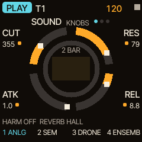
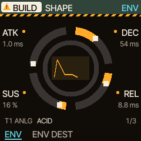

<!-- SPDX-License-Identifier: GPL-3.0-only -->
<!-- Copyright (C) 2026 bonszaimusic -->

# BUILD and PLAY

Caravel **1.0.0 candidate** · BUILD / PLAY controls.

> **In 60 seconds** Hold HOME one second for BUILD/PLAY. Tap it for the LEVELS explanation or the BUILD track overview. K1–K4 edit what the screen shows.

## 1. Two views of the same project

Hold HOME for one second to switch between BUILD and PLAY. Release HOME before playing the next gesture. PLAY exposes a few performance controls; BUILD exposes the full parameter pages. The sound and project are shared.

In PLAY, EDIT selects SOUND, ENV selects SHAPE, LFO selects MOVE, SCL selects HARM, FX selects SPACE, GLO selects MIX and ARP selects ARP. Repeated taps browse that area's groups. K1–K4 edit the four arcs. HOME tapped opens the LEVELS explanation; EDIT returns to SOUND.

## 2. BUILD navigation

HOME tapped opens the track overview. Its K1–K4 adjust track levels; ALGO changes the selected track. A page-family button opens its pages; SELECT browses within the family. SCL also switches the virtual rows of CHORD, LINK and HARMONY. SAVE opens PROJECT. Double-tap GLO for the menu.

## 3. Holds are gestures

Holding LFO while turning a knob tries a value temporarily. Release LFO to return; OCT+ accepts the change. Holding ENV and turning a knob in BUILD keeps the current page when ENV is released. FX held opens performance effects; its unlatched FILTER returns to the track filter on release. Ordinary PLAY SPACE controls remain at the values you set.

## 4. Notes and storage

The selected track receives panel keys. MIDI follows the channel routing in the MIDI menu. PLAY starts/stops transport. CAPTURE records live keys and incoming MIDI while that clock runs; REC takes a retrospective loop. STEP, DETAIL and AUTOMATION retain their grid layout in BUILD. Use PROJECT to save durable work; a CAPTURE loop is not project data.

[First ten minutes](start-here.md) · [MIDI](midi-sync.md) · [Project formats](../release-100.md)
