<!-- SPDX-License-Identifier: GPL-3.0-only -->
# Basics: tracks, sounds, pages and saving

The ideas behind every other tutorial: four tracks, the difference between an engine and a preset, how the pages are organised, and where your work is saved. Read it once; you will not need to think about it again.

> **In 60 seconds**
>
> 1. The FM-1 has **four tracks**. `ALGORITHM` selects one; the number at the top left of the display shows which.
> 2. A track has one **engine** (the kind of synthesizer) and one **preset** (a sound of that engine). `EDIT` held picks the engine, `PRESETS` picks the sound.
> 3. A page button opens a page; pressing it again steps to the next page of its family. `SELECT` steps through groups and pages.
> 4. A page shows **two groups of four**. The framed one is edited by `KNOB 1` to `KNOB 4`.
> 5. `SAVE` has pages for user sounds, the preset list and **projects A to D**. Hold `HOME` for the menu.

## 1. Four tracks

Everything you hear comes from four **tracks**. Each has its own engine, preset, sequence, arpeggiator, effects and `HOME` cards. The keys play the **selected** track; `ALGORITHM` chooses it. The chip at the top left of the display (1 to 4) names it.

The mixer shows all four at once: press `GLO`. Each track has a name (its preset), a level, a pan and a reverb send.

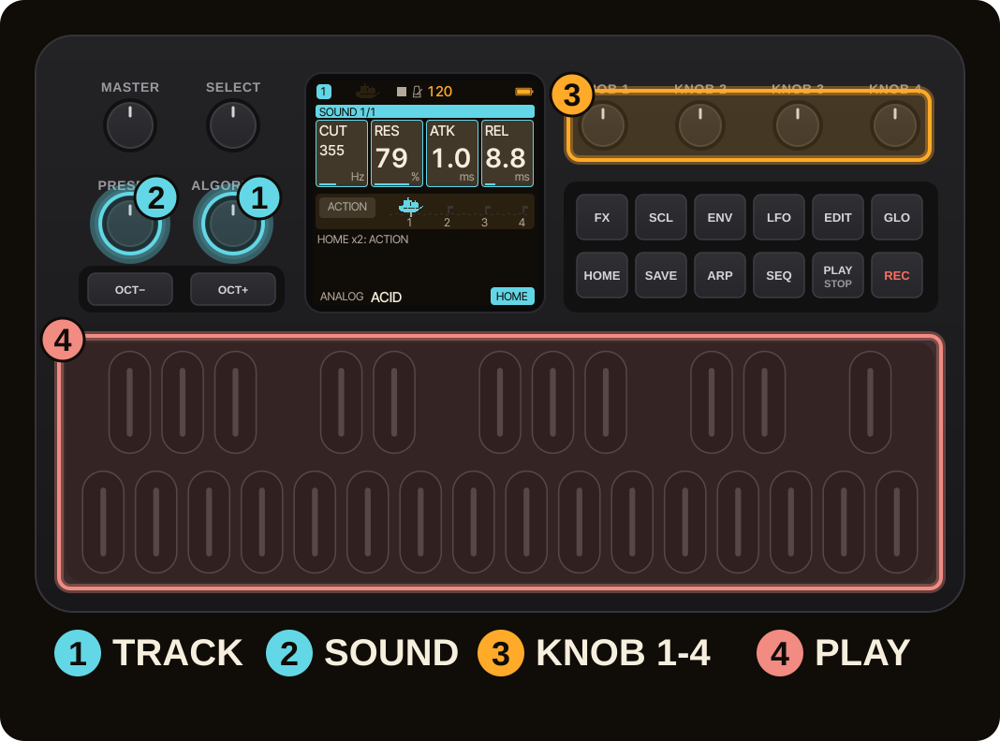

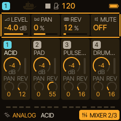

## 2. Engine and preset

An **engine** is a kind of synthesizer: ANALOG, SEM, HADES, ENSEMBLE, DRONE, FM6, DRUM and more. A **preset** is one sound of that engine: its eight engine controls, envelope and effect settings.

- Hold `EDIT` to open the engine picker. A white key chooses the engine; `KNOB 1` steps through them all.
- Turn `PRESETS` to move through the presets of the engine.
- `SAVE`, second page (PRESETS) shows all sounds in one list: `KNOB 1` is the sound number, `KNOB 2` jumps from engine to engine, `KNOB 3` (FAV) and `KNOB 4` (LIST) narrow the list.

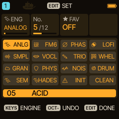

Loading a factory preset sets the track's engine controls, envelope and its effect sends, and leaves the sequence, arpeggiator, scale and level alone. **FX HOLD** (MENU > VOICES) keeps the sends and insert as they are when you change sound. Global delay, reverb, chorus, tempo and tuning are never touched by a preset.

## 3. Pages and how to move between them

The page buttons open pages: `FX`, `SCL`, `ENV`, `LFO`, `EDIT`, `GLO` in the top row, `HOME`, `SAVE`, `ARP`, `SEQ` below. Pressing the same button again steps to the next page of its **family**. The footer names where you are, for example **EDIT TOP 1/3**.

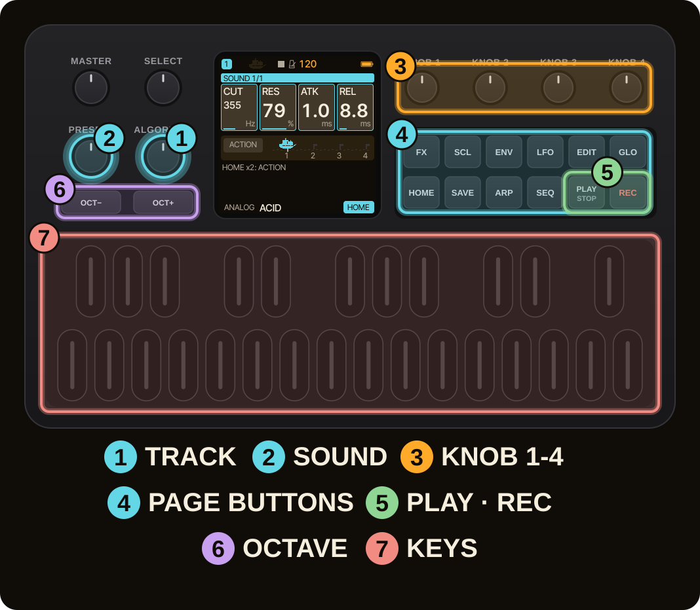

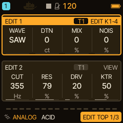

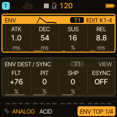

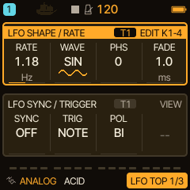

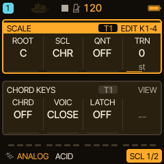

| Button | What it opens |
| --- | --- |
| `HOME` | the home page: your four chosen controls, ACTION banks |
| `EDIT` | the engine's parameters |
| `ENV`, `LFO` | envelope and LFOs with their destinations and the modulation matrix |
| `FX` | sends, delay, chorus, reverb, insert and the track filter |
| `SCL` | scale, chords, LINK and HARMONY |
| `ARP`, `SEQ` | arpeggiator and sequencer |
| `GLO` | mixer, clock and song |
| `SAVE` | user sounds, presets, phrases, projects, tools |

`SELECT` also moves: with the factory setting a turn to the right visits the top group, then the bottom group, then the next page; a turn to the left reverses it. In the menu this setting reads **NAV**.

## 4. Two groups on one screen

Most pages show two groups of four values. The group marked **EDIT K1-4** (framed in the theme colour) is the one `KNOB 1` to `KNOB 4` edit; the other is marked **VIEW**. A small tag says whom the group belongs to: **T1** to **T4** for the selected track, **ALL** for settings shared by the whole project (delay, reverb, chorus).

## 5. The menu

Hold `HOME` for the menu. `ALGORITHM` changes the tab (DISPLAY, CONTROL, AUDIO, MIDI, SYSTEM, VOICES), `PRESETS` the row, `OCT-` and `OCT+` the value, and `HOME` closes it.

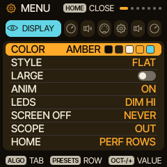

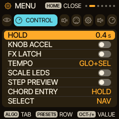

## 6. Saving: sounds, projects, undo

`SAVE` has five pages, one press each: **USER** (your own sounds), **PRESETS**, **PHRASES**, **PROJECT** (A to D) and **TOOLS**.

- **A user sound** keeps one track's sound: on USER choose a slot with `KNOB 1`, then `OCT+` saves (`EDIT` names it).
- **A project** keeps the whole piece: all four tracks with sounds, sequences, timing, automation and effects. Slots A to D; see [Start here](start-here.md).
- **Undo:** holding `SAVE` after a load gives back the previous sound (hold again to redo).
- **A complete backup** of everything on the device is made with the web editor or `tools/caravel_backup.py`; see [Help](help.md).

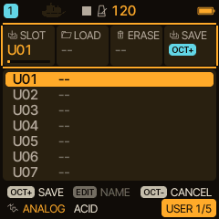

> [!TIP]
> Saving while the sequencer runs keeps the project in memory first (RAM ONLY, then STOP TO SAVE). Stop to write it to flash.

## 7. Where next

- Make a sound: [SEM](engine-sem.md), [HADES](engine-hades.md), [DRONE](engine-drone.md), [ENSEMBLE](engine-ensemble.md).
- Make a pattern: [Sequencer and arpeggiator](seq-arp.md).
- The menu in depth: [Pages, groups and the settings menu](../menus-and-pages.md).
