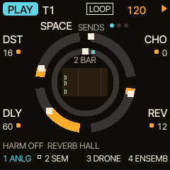

<!-- SPDX-License-Identifier: GPL-3.0-only -->
<!-- Copyright (C) 2026 bonszaimusic -->

# CAPTURE: record live notes into four loops

Caravel **1.0.0 candidate** · PLAY layer · RAM-only performance loops.

> **In 60 seconds** Start PLAY/transport, play some notes on the panel or via USB/TRS MIDI IN, then tap **REC**. That track now loops what you played. A second REC adds a new live take; tap **SEQ** to pause/resume, or hold SEQ to clear the loop.

## 1. First loop: play, then capture

Enter PLAY by holding HOME for one second. Start transport with **PLAY** (or a working external MIDI clock/START), select a track, and play a short phrase. **Tap REC** to take the recent notes retrospectively. CAPTURE creates a loop of the chosen length; you do not need to arm a conventional step-recording lane before playing.

CAPTURE records *live note input* from panel keys and incoming USB/TRS MIDI notes while the transport runs. It keeps raw pitch, velocity, note-on/off timing and track ownership. It does **not** sample audio, and it does not record ARP output, sequencer playback or its own loop output.

## 2. Choose one, two, four or eight bars

**Hold REC** to display CAPTURE. While REC is held, turn **K1** to select **1, 2, 4 or 8 bars** for the *next new loop*. Release the button after viewing the length; the view gesture itself is not a capture.

A loop's length is fixed after it has been taken. To choose another length, clear that track's loop first and then set the new length. If no valid clock is running, CAPTURE reports **NO CLOCK: PRESS PLAY**.

## 3. Overdub rather than replacing the loop

With an existing loop playing, play additional notes live and tap **REC** again. CAPTURE adds only the newer live gestures to the same loop, preserving its length. It does not copy previous overdubs or its own playback into the live input ring.

If there is no new input, the screen may show **NOTHING TO CAPTURE** or **NOTHING TO ADD** instead of inserting silence. The live buffer holds the most recent eight bars of raw input, so recording is retrospective.

## 4. Four tracks, PAIR and playback

Each of the four tracks can have its own independent CAPTURE loop. Switching the selected track does not erase the other loops. If **PAIR** is active, the pair's **owner track** holds the captured input; recording from the follower still addresses that owner's loop.

The captured notes play back through the *current* track routing. Therefore **ARP, LATCH, CHRD and HARMONY** can change what you hear without changing the raw loop. For example, record a simple three-note gesture, then change the HARMONY chord and listen to the same loop follow the new context. CAPTURE playback itself cannot teach a live CHORD EXT source.

## 5. Pause, clear and external clock

In PLAY, **tap SEQ** to pause or resume the selected loop. **Hold SEQ for approximately 700 ms** to wipe that track's loop and live history; this is destructive. Stopping transport pauses clock-driven playback and releases the loop's sounding notes. MIDI STOP and clock loss can pause loops as well; restarting transport can resume a waiting loop, but a manually paused loop stays paused until you resume it.

Do not confuse **BUILD / SEQ** (step sequencing) with **PLAY / SEQ** (CAPTURE loop pause/clear).

## 6. Understand the capacity limit

Each loop stores up to **64 events**, and a complete note normally needs **two events** (note-on and note-off). Consequently, 64 events are *not* 64 independent notes. A dense take can fill the space early. The **FULL / LOOP FULL** warning rejects an overflowing take or overdub and preserves the existing loop; CAPTURE must not create a partial set of stuck or missing note-offs.

Try a sparse motif first. If you need to change its length or simplify an overcrowded loop, clear it and capture a fresh take.

## 7. What does not survive a reboot?

CAPTURE is a live RAM performance feature. The loop is **not** saved in PROJECT, user presets, autosave or the FORMAT-2 backup. Save the underlying sounds, engine settings, ARP, HARMONY and performance configuration separately. A power-off loses the loop. Use external MIDI recording when you need a durable record of the actual notes.

This guide describes firmware behavior verified by host/emulator tests; the final release still requires FM-1 hardware, clock, latency and audio acceptance.

[Sequencer and ARP](seq-arp.md) · [HARMONY and CHORD EXT](harmony-live.md) · [MIDI routing and clock](midi-sync.md) · [PLAY and BUILD](basics.md)
