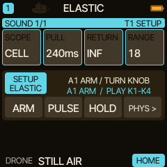
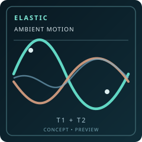

<!-- SPDX-License-Identifier: GPL-3.0-only -->
# ELASTIC: three ambient performance ideas

ELASTIC makes a sound evolve without a constantly repeating LFO. A single knob gesture can breathe across seconds; a row of linked springs creates a moving texture; and four independent tracks can keep different times. These are starting recipes, **not factory presets or recordings**. Use your ears to adjust the exact values for your own sound.

> [!IMPORTANT]
> **New in Caravel 0.13.0: ELASTIC.** Tested on the host with the real firmware code; the maintainer reports a successful test of the 0.13.0-rc1 package on an FM-1, without itemised results. The recipes below are starting points, not results anyone has recorded on a device. The [release notes](../release-0130.md) list what is and what is not tested.

> **In 60 seconds**
>
> 1. Start with a sustained DRONE note and a gentle reverb.
> 2. For a slow breathing pad, use **CELL / TONE**, low RANGE and a long RETURN.
> 3. For a restless texture, choose **ROW**, several timbre controls and moderate **COUPLE** with a fixed SEED.
> 4. For a layered performance, run a slow spring on T1 and a faster, independent spring on T2.
> 5. Record or render an A/B comparison with ELASTIC OFF and ON before adding more effects.

## 1. Breathing drone — one control, one gesture

Choose a low or middle DRONE note and hold it with LATCH, a long gate or a tied sequence. Pin **TONE** to HOME. Keep the track quiet enough that movement in the spectrum is audible without a jump in overall volume.

In the **ELASTIC** bank, open **TIMES** and set SCOPE to **CELL**. Try a medium PULL, RETURN around **10 seconds**, and a conservative RANGE. On **PHYSICS**, start with BOUNCE **1/1**, REFLECT **70%** and COUPLE **OFF**. Close SETUP, press **A1 ARM**, pick TONE and give the knob one small turn.

Listen for the timbre to move and return. Press **A2 PULSE** when the sound is nearly still. Try **A3 HOLD** for a suspended texture, then RESUME.

| Change just this | What to listen for (a starting guess, not a recorded result) |
| --- | --- |
| Longer RETURN | A slower, more open passage between gestures. |
| Smaller RANGE | Less obvious modulation; more of a subtle breathing texture. |
| Shorter BOUNCE period | Faster rhythmic movement; RETURN still sets the decay time. |
| REFLECT 0 vs 70 | Clamped versus rebounding behavior when a boundary is actually reached. |

> [!TIP]
> Do the first listen dry. Add reverb only after you can hear the shape of the movement. With a large wash, several control changes may blend into one texture.

## 2. Restless machinery — four interacting timbres

*Actual 0.13.0-rc1 P1.4 WASM renderer: the TIMES page with RETURN INF, captured from the RC1 build. This is a static frame; it shows no motion and no sound.*

For a darker, less predictable movement, build a ROW of four **supported** DRONE timbre controls, for example **COUPLE (DRONE engine)**, **CHAR**, **DRIFT** and **TONE**. The engine's COUPLE control is separate from ELASTIC's spring-coupling parameter.

In ELASTIC **TIMES**, choose **ROW**, RETURN around **20–30 seconds** and a medium RANGE. On **PHYSICS**, begin with BOUNCE **1/2 or 1/1**, REFLECT **70%**, spring **COUPLE 40%** and a chosen SEED such as **42**. These are suggested starting values, not a proven preset.

Close SETUP, press **A1 ARM** and turn K1. Without touching K2–K4, their springs can respond through the signed network. Turn spring COUPLE to OFF and compare: only the touched spring should move independently. Switch to another SEED while the coupling is OFF, then re-enable it.

The aim is *controlled complexity*: a listener should hear one timbre gesture spread into multiple small changes, not a sudden random preset switch. If the sound becomes too sharp or uneven, reduce RANGE and COUPLE before raising reverb.

> [!NOTE]
> SEED chooses a deterministic graph. It does not randomize notes, tempo or the oscillators themselves. The actual timbral outcome depends on the pinned parameters and the sound underneath.

## 3. Two-layer tide — different springs per track

Use **T1 DRONE** as a steady low bed and **T2 SEM or ENSEMBLE** as a soft upper layer. The same musical note or chord can be held on both tracks, but their ELASTIC motion is independent.

| | Track 1 — low bed | Track 2 — upper movement |
| --- | --- | --- |
| SCOPE | CELL | ROW, if four eligible cards are pinned |
| Target | A safe slow timbre parameter | Safe filter, texture or timbre controls |
| RETURN | Long, up to a minute or more | Several seconds |
| BOUNCE | 2–4 BAR | 1/2–1/1 |
| COUPLE | OFF | Optional 20–40% in ROW |

ARM T1, start a gesture, then select T2 with `ALGORITHM`, ARM it and give it a separate gesture. Return to T1 to see the different spring state. The four-track HUD can show activity while another track is selected.

Add HARMONY if you want a changing chord progression underneath. HARMONY moves pitches and note choices; ELASTIC moves supported HOME parameters. A running sequencer MOTION or step lock has priority when it owns the same parameter, so an audible spring may temporarily disappear while its display motion continues.

## 4. Save the *recipe*, not the moving moment

When you like the setup, save the project with the normal PROJECT SAVE workflow. 0.13.0 stores the **eight TIMES/PHYSICS settings per track**, including SEED and COUPLE, while the actual movement, PULSE timing and HOLD state remain temporary.

When you load the project again, the settings come back, but the springs begin at rest. Arm and perform them anew. Saving with 0.13.0 writes an HPM1 version 5 capsule that 0.12.0 and earlier do not read: back up first (see [ELASTIC first steps](elastic-first-steps.md), section 7).

## 5. Capture a useful comparison

A useful way to compare is a **short, level-matched recording or render**: first the same sound with ELASTIC disengaged, then one CELL gesture, then the same ROW gesture with COUPLE OFF and ON. If you share a native DSP render, label it as **computer-generated firmware audio**, not a recording of a physical FM-1; a recording from the device should be labeled as such. This page ships no ELASTIC audio examples.

Use identical input notes, effects and base sound when comparing a control. Do not claim click-free behavior or an FM-1 CPU budget for ELASTIC: no device results are recorded.

## 6. Where next

For exact button presses and beginner setup, see [ELASTIC: your first moving sound](elastic-first-steps.md). For the signed graph and SEED behavior, see [ELASTIC: four springs](elastic-linked-springs.md). Continue with [STASIS](home-performance.md) to capture a texture, or [HARMONY](harmony-live.md) for evolving pitches.

> [!NOTE]
> The recipes deliberately avoid exact factory preset numbers or claimed acoustic outcomes: no listening review of these recipes is recorded.
