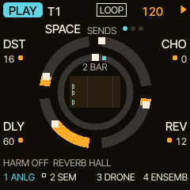

<!-- SPDX-License-Identifier: GPL-3.0-only -->
<!-- Copyright (C) 2026 bonszaimusic -->

# ELASTIC: ambient starting points

Caravel **1.0.0 candidate** · BUILD / PLAY controls.

> **In 60 seconds** Use a quiet dry patch, one moving target and a small RANGE. Add texture after balancing levels.

## 1. A slow pad

Choose SEM or ENSEMBLE. Lower the track level, soften the attack and extend release. Put one tone/filter target in the track's own set. In ELASTIC use a small RANGE and a slow BOUNCE, then add a little RETURN. Keep sends low until the dry motion is clear.

## 2. A moving bass layer

Choose HADES. Start in MONO with modest drive and little reverb. Move cutoff over a narrow RANGE; large sub and BODY settings can quickly dominate a mix. Bring the other tracks back one at a time.

## 3. A texture above a fixed note gesture

Choose DRONE or PHYS. Record a simple live-key or MIDI gesture into CAPTURE while transport runs. Use ELASTIC for timbre and STASIS for held audio texture. These layers do different jobs: CAPTURE is notes, STASIS is audio and ELASTIC is control motion.

These are starting recipes, not measured loudness matches or a listening assessment of the 1.0 candidate. Save the sound and setup as a project; the CAPTURE loop is temporary.

[First steps](elastic-first-steps.md) · [Engine tips](../engines/tips.md)
