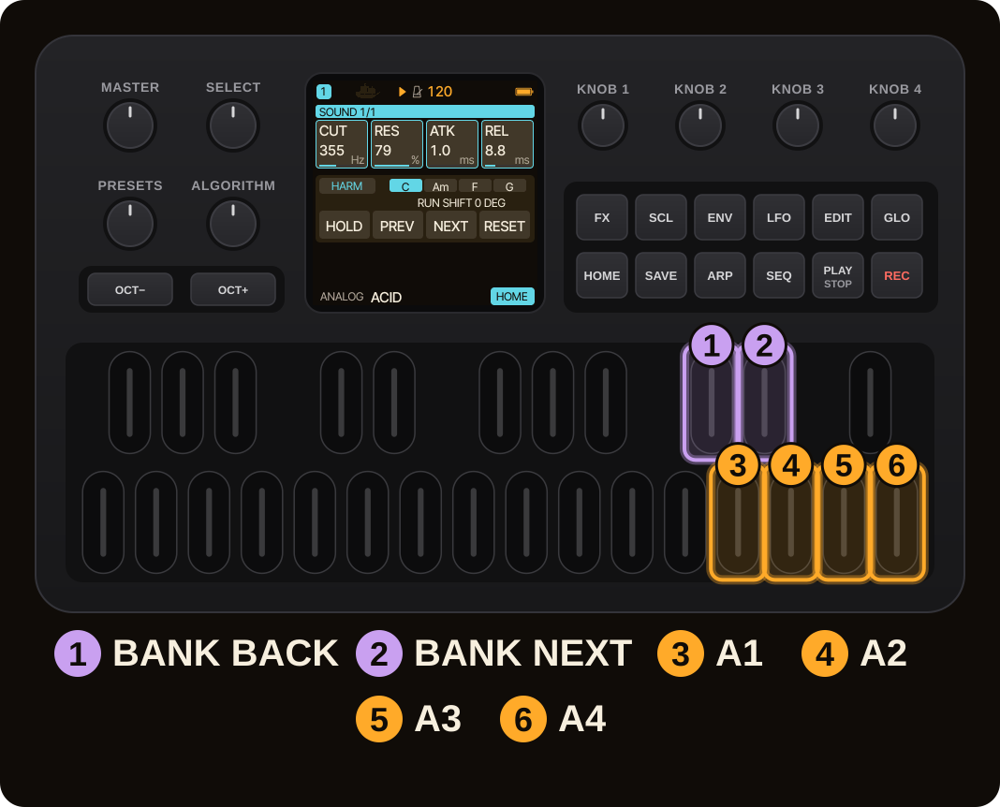
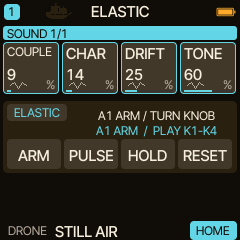
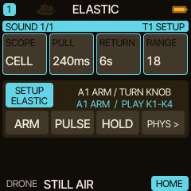
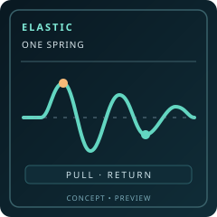
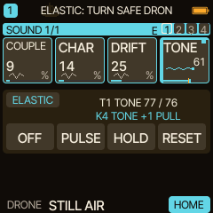
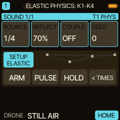

<!-- SPDX-License-Identifier: GPL-3.0-only -->
# ELASTIC: your first moving sound

ELASTIC turns a supported HOME parameter into a temporary spring. Move a knob, and the sound moves with it, then slowly swings back toward its original value. It is a live performance gesture, not an LFO or a permanent preset edit.

> [!IMPORTANT]
> **New in Caravel 0.13.0: ELASTIC, the seventh HOME ACTION bank.** It is tested on the host with the real firmware code. The maintainer reports a successful test of the 0.13.0-rc1 package on an FM-1, without itemised results; the [release notes](../release-0130.md) list what is and what is not tested. **Saving with 0.13.0 changes the project format (HPM1 v5): back up first, see section 7.**

> **In 60 seconds**
>
> 1. Select **DRONE** on T1 (other engines work too, see section 4), play a sustained note and pin **TONE** to a HOME card.
> 2. Double-tap `HOME` for ACTION, then tap `D#5` until the bank says **ELASTIC**.
> 3. Hold `D#5` for SETUP. Use **K1 SCOPE = CELL**, a moderate K4 RANGE and a slow K3 RETURN.
> 4. Hold the bank key again to leave SETUP. Press **A1 (D5) ARM**, then turn TONE to select it.
> 5. Turn TONE again: the spring moves and settles. Try **A2 (E5) PULSE**, **A3 (F5) HOLD / RESUME** and **A4 (G5) RESET**.
> 6. In SETUP press **A4** to switch to **PHYSICS**, with BOUNCE, REFLECT, COUPLE and SEED.

## 1. Make a sound worth moving

Begin with a warm, sustained sound and keep the monitoring level comfortable. DRONE works well because a slowly changing timbre is easy to hear. You can hold a note, use the track's LATCH or run a simple sequence.

Open DRONE's EDIT page and turn a safe continuous timbre parameter such as **TONE** or **CHAR**. To place it on HOME, hold `GLO` and tap `HOME` while that parameter's page is open. HOME has four assignable cards per track.

For a first experiment, avoid direct pitch, topology, sample position and engine/voice selectors. ELASTIC deliberately refuses unsupported destinations even when they look like numeric values.

See [DRONE](engine-drone.md) and [HOME performance functions](home-performance.md) to build this starting sound.

## 2. Find ELASTIC

*Actual 240×240 0.13.0-rc1 P1.4 WASM renderer; not an FM-1 hardware photo. All the firmware screens of the ELASTIC pages were captured from the RC1 build (capture hashes are in `img/elastic-rc1-captures.json`); the final 0.13.0 differs from RC1 by the version text and one table entry (the MOD DST list), which these frames are not expected to show; not checked frame by frame.*

Double-tap `HOME` to show ACTION. In 0.13.0 the forward bank order is **RANDOM → JOURNEY → HARM → STASIS → ELASTIC → PAIR → LIVE** (ELASTIC is new: 0.12.0 has six banks). Tap `D#5` for the next bank or `C#5` for the previous bank.

Hold either bank key for half a second to open ELASTIC's first SETUP page, **TIMES**. The header shows the selected track, such as `T1 SETUP`.

| Knob | Setting | What it means |
| --- | --- | --- |
| K1 | **SCOPE**: CELL / ROW | Move one chosen parameter or the eligible controls across the visible four-card row. |
| K2 | **PULL** | How quickly the spring follows the initial gesture, from about 16 ms to 45 s. |
| K3 | **RETURN** | How long it takes to settle, from a short glide up to 5 minutes, or **INF** to keep oscillating. |
| K4 | **RANGE** | How far the spring may travel from the original parameter value. |

Choose **CELL**, a moderate **RANGE** and a **RETURN** of a few seconds. The display presents an actual duration (for example `5s` or `1m30`); the last step of RETURN, past 5 minutes, is **INF**.

## 3. ARM, turn and listen

*Actual 0.13.0-rc1 P1.4 WASM renderer: TIMES page, per-track SCOPE/PULL/RETURN/RANGE.*

Hold the bank key again to leave SETUP. Press **A1 (D5)** to ARM. In CELL mode, ELASTIC asks you to turn a supported HOME knob. Turn the TONE card once to select it, then turn it again to excite a spring gesture.

The HOME card shows a bright spine, colored dot and small moving spring. **PULL** is the outward part of the motion; **RETURN** is the trip back. ELASTIC adds a temporary value during sound rendering and leaves the stored parameter setting intact.

If you see `NOT ELASTIC` (the full message reads `NOT ELASTIC: USE DRONE TIMBRE`, although other engines work too), choose a different parameter. ELASTIC uses an engine-aware list of safe targets, not every number shown on screen: see the next section.

## 4. Which controls can move

ELASTIC is not limited to DRONE. Besides the engine controls below, these per-track controls can move (named as in the source): the filter sweep (`P_FILT`), pan, the chorus, delay and reverb sends, distortion, the insert mix (not the effect type), the two filter and shape modulation amounts, and the slicer depth (not its rate or pattern). Not on the list: pitch, tempo, levels, envelope times, modes, voice and engine selectors, ARP and SEQ settings. A control also has to be a percentage, bipolar or cutoff-type control.

| Engine | Engine controls that can move |
| --- | --- |
| ANALOG | MIX, NOIS, CUT, RES, DRV, KTR |
| PHASE | DCW, ENV, SUB, FOLD |
| LOFI | CRSH, SWP, VIB (not the chip or the loop) |
| SAMPLE | DRV only (no slot, tuning or playback controls) |
| VOICE | BUZZ, BRTH, Q, RAND |
| TRIO | CUT, RES, PW |
| WHEEL | CLICK, DRV |
| GRAIN | DENS, SPRD, RAND, TONE (not SRC, POS or PTCH) |
| PHYS | STRC, BRIT, DAMP, POS, BOW, EXC |
| DRUM | TONE, DECY, SNAP, FOLD, DRV (not TUNE or ACC) |
| NOISE | COLR, FREQ, RES, DRFT, CRSH |
| FM6 | MLVL, MEG (not ALGO, DTUN or SLOT) |
| SLICE | no engine control; the common filter and effect controls only |
| SEM | MIX, CUT, RES, STATE, VINT |
| HADES | PW, SUB1, SUB2, CUT, RES, DRV, BODY |
| DRONE | COUPLE, CHAR, DRIFT, TONE |
| ENSEMBLE | MORPH, TONE, DRIFT, ENS, TEXT, MIX |

The list comes from the source (`experiments/home-perf/home_elastic_p1.h`, where it is called a control-safe pilot list, not audited on hardware): the names are the source's abbreviations, and what each of them does on a real FM-1, and how it sounds, has not been checked here. The retired DIGITAL engine has no entry.

## 5. The four performance keys

*Actual 0.13.0-rc1 P1.4 WASM renderer: CELL ARM state. ELASTIC waits for you to turn a supported HOME card before the first gesture.*

| Key | What it does |
| --- | --- |
| **A1 / D5 — ARM or OFF** | Arm the current track's spring, or disengage it. |
| **A2 / E5 — PULSE** | Excite the selected spring again without touching the knob. |
| **A3 / F5 — HOLD / RESUME** | Freeze active movement, then let it continue. |
| **A4 / G5 — RESET** | Immediately bring the motion to rest **outside SETUP**. |

In ROW mode, PULSE acts on the last touched eligible card. HOLD requires active movement. The four track arms are independent: changing the selected track does not turn off a spring already active on another track.

## 6. Add BOUNCE and REFLECT

*Actual 0.13.0-rc1 P1.4 WASM renderer: PHYSICS page defaults; COUPLE OFF mutes the graph preview.*

Hold a bank key to return to SETUP, then press **A4 (G5)**. The header changes from `T1 SETUP` to `T1 PHYS`. The encoders now control:

| Knob | Setting | What it means |
| --- | --- | --- |
| K1 | **BOUNCE** (11 steps, 1/16 to 64 BAR) | Duration of one complete oscillation, synchronized to tempo; one detent moves one step. |
| K2 | **REFLECT 0–100%**, default 70% | How firmly an excursion rebounds from a legal parameter boundary. |
| K3 | **COUPLE OFF–100%**, default OFF | Cross-influence among up to four ROW springs. No effect in CELL mode. |
| K4 | **SEED 0–255** | Reproducible connection pattern for coupled ROW springs. |

Begin with **BOUNCE 1/1**, **REFLECT 70** and **COUPLE OFF**. BOUNCE sets the full-cycle period; RETURN sets how long its amplitude decays. RETURN **INF** sustains the movement until HOLD, RESET or OFF. Tempo changes retain phase; a gesture starts immediately rather than waiting for the next bar.

BOUNCE has **eleven steps**, the default is **1/4**, and it stops at both ends instead of wrapping around (a bar is four quarter notes). The periods at 120 BPM follow from the period table in the firmware source; they are computed, not measured on a device:

| BOUNCE step | One cycle at 120 BPM |
| --- | --- |
| 1/16 | 125 ms |
| 1/8 | 250 ms |
| 1/4 (default) | 500 ms |
| 1/2 | 1 s |
| 1/1 | 2 s |
| 2 BAR | 4 s |
| 4 BAR | 8 s |
| 8 BAR | 16 s |
| 16 BAR | 32 s |
| 32 BAR | 64 s |
| 64 BAR | 128 s |

**RETURN INF needs a tempo-synced BOUNCE.** If you choose INF while BOUNCE still holds an old numeric value (from a project saved by an earlier ELASTIC test version), BOUNCE becomes **1/4** synced, and the next gesture runs in tempo mode. Old numeric BOUNCE settings otherwise keep their legacy behavior until BOUNCE is changed.

**Clock behavior:** BOUNCE follows the internal tempo or the tempo estimated from external MIDI clock. Each gesture starts immediately with its own phase; it does not wait for the next sequencer step or bar. External MIDI pulses do not directly lock the spring phase to the SEQ/ARP grid.

Press A4 in SETUP to go back to TIMES. **A4 does not RESET while SETUP is open**; exit SETUP first.

## 7. Keep your settings in a project

Caravel 0.13.0 stores **SCOPE, PULL, RETURN, RANGE, BOUNCE, REFLECT, COUPLE and SEED separately for each of the four tracks** in an HPM1 version-5 performance capsule. The *settings* come back when you load the project. The *moving spring positions, held phases and active arms do not*: they start at rest.

> [!WARNING]
> **Back up before you update to 0.13.0.** Every project you save with 0.13.0 carries an HPM1 **version 5** HOME capsule, whether or not you use ELASTIC. 0.13.0 loads versions 1 to 5, but **0.12.0 reads versions 1 to 3 only** and does not accept a version 5 capsule. Upgrading is safe; going back to 0.12.0 or earlier is not, for projects saved by 0.13.0. In a host test, 0.12.0 with a version 5 capsule boots normally, the HOME project slot looks empty, and a USB write of the capsule is refused. Reinstalling older firmware does not turn such a project back into an old one, so keep a backup from before the update. `tools/caravel_backup.py` of 0.13.0 saves and restores HPM1 capsule versions 4 and 5 byte for byte (it does not interpret the capsule); that is tested on the host, and nothing about backups was tested on a device. The web editor's and installer's backup check sizes only, not the capsule version, and have not been tried on a device that holds version 5 projects. See [Help](help.md).

## 8. What to try next

First make one slow TONE gesture, listen to it return, then experiment with short and long RETURN values. To make several sound controls move together, continue with [ELASTIC: linked springs](elastic-linked-springs.md). For musical recipes, try [ELASTIC: ambient performance ideas](elastic-ambient-recipes.md).

> [!NOTE]
> Known limits in 0.13.0: MIDI Learn is not implemented for ELASTIC's ACTION controls (`ELASTIC: NO MIDI LEARN YET`), sequencer MOTION and step locks take priority for a shared target, and click-free behavior on a real FM-1, especially at short BOUNCE periods and sharp parameter boundaries, has not been verified (there are no itemised device results). The [release notes](../release-0130.md) list the rest.
