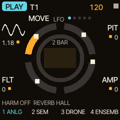

<!-- SPDX-License-Identifier: GPL-3.0-only -->
<!-- Copyright (C) 2026 bonszaimusic -->

# ELASTIC: first steps

Caravel **1.0.0 candidate** · BUILD / PLAY controls.

> **In 60 seconds** Choose MOVE / ELASTIC, arm one intended target and begin with a small RANGE.

## 1. Start gently

Enter PLAY by holding HOME one second, tap LFO for MOVE and browse to ELASTIC. In BUILD the LFO family includes SPRING and SPRINGS setup. Start with a quiet sound and one continuous target in the track's own set.

## 2. Arm a target

Use the displayed ELASTIC verbs with LFO held and D5/E5/F5/G5. Read the on-screen labels: the keys act on the shown group, rather than the old HOME ACTION bank. Arm only the targets you want to move.

## 3. Shape its motion

PULL sets the displacement, RETURN the return tendency, RANGE the allowed excursion and BOUNCE its tempo-related period. Increase one control at a time. Release or stop the action before changing engine or loading another project.

## 4. Keep the setup

Project saving keeps the ELASTIC settings, including coupling choices, rather than a running spring's instantaneous position, phase or held gesture. The factory and current target values bound the sound; a wide RANGE can still make a large audible change.

[Linked springs](elastic-linked-springs.md) · [Recipes](elastic-ambient-recipes.md) · [Performance](home-performance.md)
