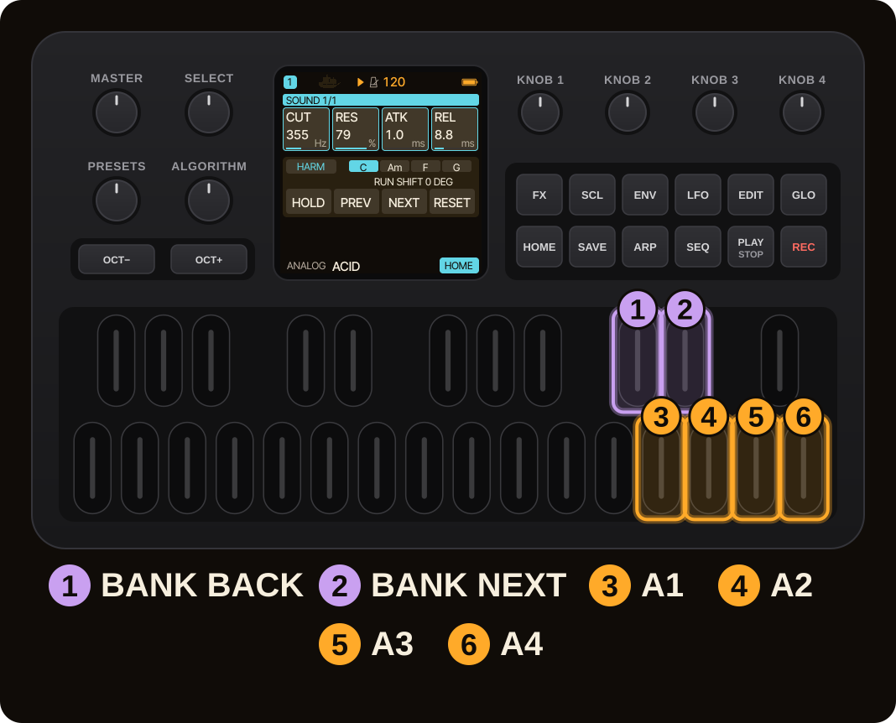
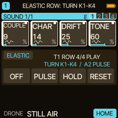
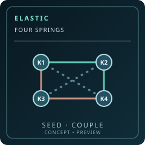
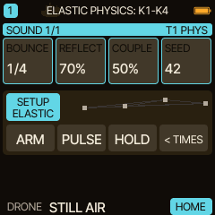
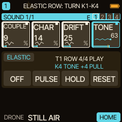
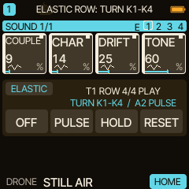
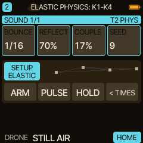

<!-- SPDX-License-Identifier: GPL-3.0-only -->
# ELASTIC: four springs, one moving texture

In ROW mode, ELASTIC can make the four eligible HOME cards of a track move as separate springs. **COUPLE** then allows one excited spring to influence the other three. A reproducible **SEED** changes how they are connected, so every movement can feel different while the same saved setting can be reproduced later.

> [!IMPORTANT]
> **New in Caravel 0.13.0: ELASTIC.** Tested on the host with the real firmware code; the maintainer reports a successful test of the 0.13.0-rc1 package on an FM-1, without itemised results. The [release notes](../release-0130.md) list what is and what is not tested.

> **In 60 seconds**
>
> 1. On T1 select DRONE and pin four supported timbre/fx controls to a HOME row.
> 2. In **ELASTIC SETUP → TIMES**, set **SCOPE ROW**, a slow RETURN and a moderate RANGE.
> 3. Leave SETUP, press **A1 ARM** and turn **K1**: its spring moves. With **COUPLE OFF**, the other cells remain independent.
> 4. Re-enter SETUP, press **A4** for **PHYSICS**, and increase **K3 COUPLE** to about 40–60%.
> 5. Leave SETUP, touch K1 again and observe how the other eligible cards respond. Try **A2 PULSE** on the last touched cell.
> 6. To try another network, bring COUPLE back to OFF, let it fade out, then change **K4 SEED**.

## 1. Build a four-card performance row

Choose four safe continuous sound controls that make a clear difference to one sustained note. For DRONE, try supported controls such as **COUPLE (engine EDIT 1)**, **CHAR**, **DRIFT** and **TONE**; the exact HOME pin assignments depend on your current layout. ELASTIC's own **COUPLE** setting is a different control: it links HOME *springs*, not DRONE's audio oscillators.

For the clearest demonstration, choose parameters that vary timbre instead of pitch or loudness, and avoid assigning an unavailable parameter to a card.

Use [HOME performance functions](home-performance.md) to pin/edit cards and [DRONE](engine-drone.md) to find its four timbre controls.

## 2. Choose ROW instead of CELL

In the ELASTIC bank hold a bank key for SETUP. On **TIMES**, set **K1 SCOPE = ROW**. Unlike CELL, ROW does not ask you to pick one knob: press A1 to arm the eligible controls on the current HOME row (up to four).

| TIMES control | A useful starting point |
| --- | --- |
| SCOPE | ROW |
| PULL | Short or medium, so your touch has an immediate response |
| RETURN | Several seconds, long enough to see the coils settle |
| RANGE | Moderate; widen only after you hear the behavior |

Leave SETUP, press **A1 ARM**, then turn **K1**. Its spring moves. Turn **K2** and it moves independently, too.

A colored spine and moving coil identify each armed card. Even a very small movement can be visible before the displayed integer changes.

## 3. Turn on spring coupling

*Actual 0.13.0-rc1 P1.4 WASM renderer: four ROW cards armed on T1; each has its own spine/coil. All the firmware screens on this page were captured from the RC1 build.*

Hold a bank key to open SETUP, then press **A4** to reach **PHYSICS**. Set **K3 COUPLE** to about **50%**. With COUPLE at zero, each ROW spring is independent. As you increase COUPLE, a movement on K1 can move a second, otherwise idle spring.

The coupling is a *control-rate relationship among HOME parameters*: it does not create additional synth voices, effect processors or a new audio modulation matrix.

| Physics control | Effect |
| --- | --- |
| BOUNCE | Tempo-synced duration of one full oscillation (1/16–64 BAR) |
| REFLECT | Boundaries may reflect instead of simply clipping |
| COUPLE | 0 to 100% of a bounded inter-spring influence |
| SEED | Stable signed connection map between the four card positions |

The extra influence is limited to a fraction of each destination spring's travel and stays within the parameter's legal range. Positive links pull one control in the same direction; negative links may push it the other way. The graph under the HOME cards displays colored links and seed-dependent node positions. It is a view of the coupling network, not a note sequencer.

## 4. Explore SEED without sudden changes

*Actual 0.13.0-rc1 P1.4 WASM renderer: COUPLE 50 %, SEED 42. The ACTION strip shows the signed four-node graph; the graph is a preview, not an extra signal source.*

To change the network, turn **K3 COUPLE to OFF** and allow its audible influence to fade away. Then change **K4 SEED** (0–255). Turning SEED while coupled springs are armed and active is blocked to prevent a sudden replacement of their connections.

Now raise COUPLE again and turn the same HOME knob. The new pattern changes which neighboring parameters respond and whether a link is positive or negative. Because SEED is deterministic, returning to the same seed and settings reproduces the same graph; the link network does **not** randomly reroll each tick.

> [!TIP]
> For a controlled A/B comparison, keep RETURN, RANGE and the same four HOME targets fixed. Compare COUPLE OFF, COUPLE 30% and COUPLE 70%, then change only SEED. Listen before adding heavy reverb.

## 5. Let tracks move independently

*Actual 0.13.0-rc1 P1.4 WASM renderer: ROW coupling graph after setting SEED 42; the motion of the springs is not frozen into a screenshot.*

ELASTIC stores its setup per track. T1 can use **ROW**, while T2 uses **CELL**; T1 can have a 5-minute RETURN, while T2 returns in a few seconds. Switch tracks with `ALGORITHM` and set up each in turn. The selected track's screen controls its own spring; the other tracks' movement can continue while you perform on T1.

**Coupling stays inside one ROW on one track.** It does not link T1 to T2, and CELL mode remains uncoupled even if its saved COUPLE number is greater than zero. The four-track ARM badges are intended to show what remains active off-screen.

## 6. Hold, reset and save

*Actual 0.13.0-rc1 P1.4 WASM renderer: four-track ARM HUD, T1 ROW selected; T2 has its own PHYS settings.*

*Actual 0.13.0-rc1 P1.4 WASM renderer: T2 PHYS page; these values are not T1's.*

Outside SETUP, **A3 HOLD** freezes the active spring motion, and **A4 RESET** immediately ends the spring excursion. On a coupled row, resetting the source also removes its cross-influence as it settles. **A1 OFF** disarms the selected track without discarding its settings.

In 0.13.0, saving the project keeps each track's TIMES and PHYSICS settings. It does **not** save arms, spring positions or HOLD states. On reload, the springs start at rest. An old v1/v2/v3 performance capsule initializes the new ELASTIC fields to their defaults.

> [!WARNING]
> Projects saved by 0.13.0 use the HPM1 **version 5** capsule, which 0.12.0 and earlier do not accept (they read versions 1 to 3). Back up before you update, and keep that backup if you may want to go back. See [ELASTIC first steps](elastic-first-steps.md), section 7, and [Help](help.md).

## 7. Where next

Try [your first moving sound](elastic-first-steps.md) for the simpler one-knob version, then use [ELASTIC: ambient performance ideas](elastic-ambient-recipes.md) for two-track textures. [HARMONY](harmony-live.md) can change the pitches while ELASTIC changes the timbres.

> [!NOTE]
> ELASTIC respects existing MOTION/step-lock ownership of a parameter. The audible coupling and visual coils are designed to track the same displacement. Not covered by itemised device results: display contrast, motion continuity, MIDI interaction, CPU2 safety and the absence of clicks.
