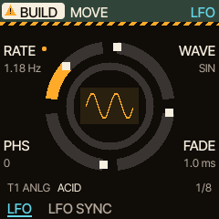

<!-- SPDX-License-Identifier: GPL-3.0-only -->
<!-- Copyright (C) 2026 bonszaimusic -->

# ELASTIC: linked springs

Caravel **1.0.0 candidate** · BUILD / PLAY controls.

> **In 60 seconds** Set up one spring first. BUILD / SPRINGS holds coupling settings; PLAY / MOVE / ELASTIC performs them.

## 1. Set up one spring first

Use [first steps](elastic-first-steps.md) before linking tracks. Keep track levels low and use one clearly audible target on each track.

## 2. Open SPRINGS in BUILD

Hold HOME one second for BUILD. Browse the LFO family to SPRINGS. COUPLE, REFLECT and SEED describe the track's spring setup; SPRING holds PULL, RETURN, RANGE and BOUNCE. Turn one setting and compare before changing another.

## 3. Perform in PLAY

Return to PLAY and choose MOVE / ELASTIC. Hold LFO to use the displayed verbs. Releasing the action and returning to an unarmed target is a useful way to compare the motion against the original sound. A stored setup does not restart the exact physical spring trajectory after reboot.

[Ambient recipes](elastic-ambient-recipes.md) · [Save and compatibility](../release-100.md)
