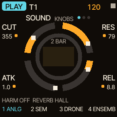

<!-- SPDX-License-Identifier: GPL-3.0-only -->
<!-- Copyright (C) 2026 bonszaimusic -->

# ANALOG in Caravel 1.0

Caravel **1.0.0 candidate** · BUILD / PLAY controls.

> **In 60 seconds** In BUILD, hold EDIT and choose ANALOG / SOFT PAD. In PLAY / SOUND, use K1 for CUT and K2 for RES; begin with low resonance and raise the track level gradually.

## 1. Select ANALOG and find its controls

Hold HOME for one second to switch to BUILD. Hold EDIT to select the ANALOG engine and a sound such as **SOFT PAD** or **SAW LEAD**. In PLAY, tap EDIT to reach SOUND. Its four default controls are **CUT, RES, ATK and REL** (K1–K4); the remaining oscillator and filter parameters are available in BUILD / EDIT and the SOUND groups.

## 2. Build a two-oscillator sound

ANALOG combines two band-limited oscillators, optional noise, drive and a resonant multimode filter. In BUILD / EDIT, start on **WAVE** with **SAW** and change **MIX** to hear how the second oscillator affects the sound. **DTN** changes its tuning, while **NOIS** adds noise. Other basic wave choices are **SQR, TRI, SIN and PWM**.

For a moving ambient bed, start with SOFT PAD, soften the attack and lengthen the release. Raise CUT slowly while keeping RES moderate. Compare the dry patch before adding chorus, delay or reverb.

## 3. Explore SYNC and SUB

The WAVE choices also include **SYNC** and **SUB**. With **SYNC**, the second oscillator is a saw synchronized to the first; the control usually shown as DTN becomes **SYNC** and sets the pitch offset for a brighter, sweeping timbre. SHP modulation can animate that sweep. In **SUB**, the second oscillator becomes a square one octave below the first; MIX is displayed as **SUB** and sets its contribution.

Try one mode at a time at a reduced track level. SUB can create much stronger low-frequency energy than a normal pad.

## 4. Shape the filter

In the engine's filter controls, **CUT** sets cutoff, **RES** controls resonance, **DRV** adds drive and **KTR** sets keyboard tracking. The separate filter **TYPE** selects low-pass, band-pass or high-pass behavior. These engine controls are distinct from the additional per-track performance FILTER macro in PLAY / SPACE.

To hear the difference, play a sustained note without FX: compare the same CUT and RES settings in the three filter types. Reduce resonance and output level before trying large sweeps.

## 5. Save a reusable patch

Use ENV / SHAPE for the envelope, then save the sound and project through PROJECT. ARP, HARMONY, CHORD EXT, FX and CAPTURE are shared track facilities; they are not additional ANALOG oscillators. The CAPTURE loop is temporary and does not persist with the project.

[ANALOG signal-flow illustration](1-0-audio-engine-diagrams/06_analog.svg) (source-reviewed teaching diagram, not a measurement) · [Six-engine overview](../engines/overview.md) · [PHYS](engine-phys.md) · [Filter and FX](filter-fx.md)
