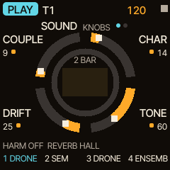

<!-- SPDX-License-Identifier: GPL-3.0-only -->
<!-- Copyright (C) 2026 bonszaimusic -->

# DRONE in Caravel 1.0

Caravel **1.0.0 candidate** · BUILD / PLAY controls.

> **In 60 seconds** Start with a quiet DRONE preset and one held note. Compare one topology change at a time.

## 1. Select the engine

In BUILD, hold EDIT to choose DRONE and a factory preset. In PLAY, EDIT selects SOUND: K1–K4 are the sound's four primary controls. Browse the EDIT groups for the other engine controls.

## 2. Listen to one change

Coupled sine generators with topology, drift, modulation and optional cell modes. Start with a quiet factory preset and a single held note. Change one topology or coupling control at a time; cell mode represents a complete gesture within one DSP host voice. Compare dry output before adding STASIS.

## 3. Play and save

ENV controls attack, decay, sustain and release. ARP, HARMONY, CHORD EXT, FX and note CAPTURE are track facilities shared with the other engines. Use the track overview or MIX to balance levels; SAVE opens PROJECT. A CAPTURE loop is not saved with that project.

[Engine reference](../engines/drone-cells.md) · [All six engines](../engines/overview.md) · [Basics](basics.md)
