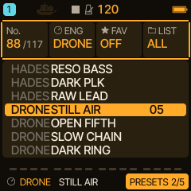
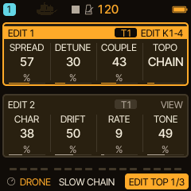
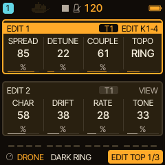
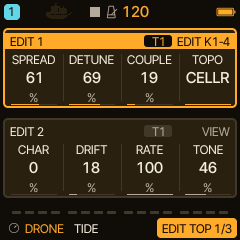

<!-- SPDX-License-Identifier: GPL-3.0-only -->
# DRONE: evolving beds and slow textures

DRONE turns one note into four coupled sine generators that slowly pull on each other. It is made for drones, beds, bells and textures that move over seconds. It is **experimental**. This page first shows how to use it, then how the sound is made.

> **In 60 seconds**
>
> 1. Choose it: hold `EDIT` and turn `KNOB 1` to **DRONE** (or use the PRESETS list), pick **STILL AIR**.
> 2. Start **low and quiet**: hold a low note such as C3 and raise **COUPLE** slowly.
> 3. Give it time: hold the note, or set the track's **LATCH** (SCL, CHORD page) so it stays on. Movement takes seconds.
> 4. Try **TOPO**: PAIRS, CHAIN, RING change the character while the note holds.
> 5. Mistakes to avoid: high notes with strong coupling (aliasing), letting go too early, adding reverb before you have heard the network.

DRONE is original DSP inspired by the idea of a coupled, slowly moving drone instrument. It is not a clone or a circuit simulation of any product.

## 1. Choose DRONE

DRONE has no key in the engine picker's grid. Hold `EDIT` and turn `KNOB 1`, one detent at a time, to the engine named **DRONE**: the list runs ANALOG, FM6, PHASE, LOFI, SAMPLE, VOICE, TRIO, WHEEL, GRAIN, PHYS, NOISE, DRUM, SEM, HADES, **DRONE**, ENSEMB and then wraps to ANALOG (checked on the host build). Or open the PRESETS page of `SAVE` and turn `KNOB 2` (ENG) to DRONE. Begin at a low monitor level.

DRONE has sixteen presets: five original (STILL AIR, OPEN FIFTH, SLOW CHAIN, DARK RING, BEAT FIELD) and eleven that use the cell modes (CELL AIR, CELL CHN, CELL RNG, GLASS CHOIR, TIDE, IRON BELLS, SUB FOG, SWARM, STATIC, RUST, MOON PULSE). The factory presets are dry, so the network is not hidden by effects.

## 2. Your first three controls

Press `EDIT`. **EDIT 1** has SPREAD, DETUNE, COUPLE and TOPO; **EDIT 2** has CHAR, DRIFT, RATE and TONE.

Select STILL AIR, hold C3 and turn:

- **COUPLE** is how strongly the four generators modulate each other. Raise it slowly from low values.
- **TOPO** chooses how they are connected: PAIRS, CHAIN or RING. It can be turned while a note holds; the change is crossfaded.
- **TONE** is a soft low-pass: dark to open.

**SPREAD** opens the four generators from unison towards the intervals 1 : 5/4 : 3/2 : 2. **DETUNE** adds slow beating. **CHAR** blends from a pure sine towards a soft, odd-harmonic shape. **DRIFT** and **RATE** set how much and how fast each generator wanders.

## 3. A tour of four presets

Each clip is a **native DSP render** of the firmware's own code, two notes held (C3 and G3), **not** a recording of an FM-1. They have not been listened to by the author of this page.

**STILL AIR**: PAIRS topology, a calm bed.

[Listen: DRONE STILL AIR](../audio/tutorials/drone-still-air.mp3)

**SLOW CHAIN**: CHAIN topology.

[Listen: DRONE SLOW CHAIN](../audio/tutorials/drone-slow-chain.mp3)

**DARK RING**: RING topology.

[Listen: DRONE DARK RING](../audio/tutorials/drone-dark-ring.mp3)

**TIDE**: a cell-mode preset, described as a very slow beating tide.

[Listen: DRONE TIDE](../audio/tutorials/drone-tide.mp3)

Video: [DRONE engine demo on YouTube](https://www.youtube.com/watch?v=N08Vx3x7fLE) (recorded on a device).

## 4. Typical mistakes

- **Letting go too early.** The presets use long envelopes with high sustain. Hold the note, use sequencer ties, or set the track's **LATCH** (SCL, CHORD page; see [LATCH](../latch.md)). The engine does not latch by itself.
- **High notes and strong coupling.** There is no oversampling, so high notes with strong coupling can alias. Low and mid registers sound cleaner.
- **Playing chords and expecting four voices.** A note transposes the **whole** instrument; DRONE is one voice with four generators, not four playable voices. The cell modes (TOPO 3 to 5) are different: hold a low anchor note, then add other notes briefly and they excite single cells.
- **Effects first.** Listen to the dry network, then add delay and reverb.
- **Expecting instant results.** Movement develops over seconds.

## 5. How the sound is made

- **Four generators, one voice.** One host voice drives four sine generators, always mixed at equal weight. A note transposes the entire network; it has one envelope, velocity and gate.
- **Coupling.** Each generator's previous output phase-modulates its neighbours. PAIRS: 0 and 1 modulate each other, 2 and 3 each other. CHAIN: 1 receives 0, 2 receives 1, 3 receives 2. RING: like CHAIN, with 0 receiving 3. The modulation is bounded to less than a quarter turn.
- **Controls:** SPREAD ratios `1, 1 + u/4, 1 + u/2, 1 + u` (u = value/127); DETUNE up to about 20 cents on the outer generators; CHAR a sine-to-soft-cubic blend; DRIFT up to about 6.8 cents with a slow triangle drift per generator (RATE, from about 0.015 Hz to 0.275 Hz); TONE a one-pole low-pass after the sum.
- **Cell modes (TOPO 3 to 5):** the opt-in cell modes described in [the cell guide](../engines/drone-cells.md).
- **Smooth by design:** changes to interval, detune, coupling and pitch move through a smoothing of about 23 ms; the drift is deterministic and bounded.

> [!NOTE]
> Hardware status: DRONE is covered by the host test suite. Listening quality and timing on a physical FM-1 under sustained load have not been verified. The reference is [the DRONE guide](../drone-engine.md); tips are in [Tips and tricks](../engines/tips.md).

## 6. Where next

- Keep the notes on with LATCH, and let a [HARMONY](harmony-live.md) progression move the bed.
- Layer a bass under it: [HADES](engine-hades.md).
- Slow modulation: [Filter, FX and modulation](filter-fx.md).
