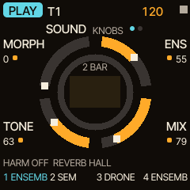

<!-- SPDX-License-Identifier: GPL-3.0-only -->
<!-- Copyright (C) 2026 bonszaimusic -->

# ENSEMBLE in Caravel 1.0

Caravel **1.0.0 candidate** · BUILD / PLAY controls.

> **In 60 seconds** Select ENSEMBLE, start with a pad, and compare ENS and SPRD against the mono sound.

## 1. Select the engine

In BUILD, hold EDIT to choose ENSEMBLE and a factory preset. In PLAY, EDIT selects SOUND: K1–K4 are the sound's four primary controls. Browse the EDIT groups for the other engine controls.

## 2. Listen to one change

Three oscillator registers, a morphing tone stage and a six-tap stereo ensemble for strings, choirs and dark pads. Start with a factory pad, then compare ENS, TONE and MIX. SPRD changes stereo width; MONO/LEGATO and SPRD zero use the mono path. A stereo-to-mono sum can change perceived level.

## 3. Play and save

ENV controls attack, decay, sustain and release. ARP, HARMONY, CHORD EXT, FX and note CAPTURE are track facilities shared with the other engines. Use the track overview or MIX to balance levels; SAVE opens PROJECT. A CAPTURE loop is not saved with that project.

[Engine reference](../engines/ensemble-engine.md) · [All six engines](../engines/overview.md) · [Basics](basics.md)
