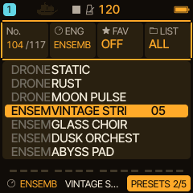
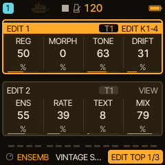
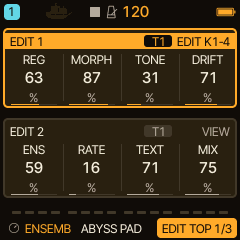
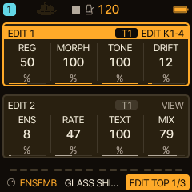

<!-- SPDX-License-Identifier: GPL-3.0-only -->
# ENSEMBLE: strings, choirs and dark pads

ENSEMBLE is Caravel's string-machine, choir and dark-pad engine. Sawtooth registers play into a slowly moving three-tap ensemble, and one control, MORPH, takes the sound from strings through a choir to a dark, rough texture. Since 0.11.0 the factory pads are in stereo. This page first shows how to use it, then how the sound is made.

> **In 60 seconds**
>
> 1. Choose it: hold `EDIT` and turn `KNOB 1` to **ENSEMB** (the last engine), pick **VINTAGE STRINGS**.
> 2. Hold a chord and turn the first three controls: **MORPH**, **ENS**, **TONE**.
> 3. Walk through the presets: VINTAGE STRINGS, GLASS CHOIR, ABYSS PAD, GLASS SHIMMER.
> 4. Mistakes to avoid: expecting the same level in mono, forgetting that MIX 0 is the dry sound, and opening a project in 0.9.0 or older.

ENSEMBLE is an original engine by bonszaimusic, not an emulation of any instrument or circuit. The display shows its name as ENSEMB.

## 1. Choose ENSEMBLE

Hold `EDIT` and turn `KNOB 1`, one detent at a time, until the engine reads **ENSEMB**; it is the last of the sixteen engines (after DRONE) and the list then wraps to ANALOG. The picker's key grid has no cell for it. In the PRESETS page of `SAVE`, `KNOB 2` (ENG) jumps to it. There are fourteen factory presets.

## 2. Your first three controls

Press `EDIT`. **EDIT 1** has the timbre (REG, MORPH, TONE, DRIFT), **EDIT 2** the ensemble (ENS, RATE, TEXT, MIX). HOME shows MORPH, ENS, TONE and MIX.

Hold a chord (for example C3, G3, E4) and turn:

- **MORPH**: 0 is strings, 64 a choir, 127 a dark, rough texture; in between it blends smoothly.
- **ENS**: how deeply the ensemble moves. At 0 it is a static comb.
- **TONE**: the brightness of strings and dark timbres, and the vowel of the choir.

The rest: **REG** mixes the registers (0 is the 8' alone, 64 adds the 4', 127 adds the 16'), **DRIFT** adds slow pitch drift and a small per-voice detune, **RATE** sets the speed of the ensemble's movement, **TEXT** adds roughness (and breath in the choir) and **MIX** blends the ensemble against the dry voices.

## 3. A tour of four presets

Each clip is a **native DSP render** of the firmware's own code, **not** a recording of an FM-1. They are not listened to by the author of this page.

**VINTAGE STRINGS**: open saw registers, slow ensemble.

[Listen: ENSEMBLE VINTAGE STRINGS](../audio/tutorials/ensemble-vintage-strings.mp3)

**GLASS CHOIR**: the choir end of MORPH, airy, a little faster ensemble.

[Listen: ENSEMBLE GLASS CHOIR](../audio/tutorials/ensemble-glass-choir.mp3)

**ABYSS PAD**: the dark end, rough, slow, a long release.

[Listen: ENSEMBLE ABYSS PAD](../audio/tutorials/ensemble-abyss-pad.mp3)

**GLASS SHIMMER**: a struck glass or bell tone (MORPH dark, TEXT full, a decaying envelope). The clip plays a short melody.

[Listen: ENSEMBLE GLASS SHIMMER](../audio/tutorials/ensemble-glass-shimmer.mp3)

## 4. Typical mistakes

- **Expecting the same level in mono.** The stereo pads have a mono sum that is about 2 to 3.5 dB lower than the mono presets, and the reverb return is lower than before. Raise REV or LEVEL if the balance matters. (Host measure; nobody has compared it on a device.)
- **MIX 0 and the ensemble disappears.** MIX 0 is the dry voices, whatever ENS and RATE say.
- **Mono where you expected stereo.** SPRD (the width, on the MORE page) at 0, and the MONO and LEGATO voice modes, give the mono ensemble. GLASS SHIMMER, ROUGH PULSE and SOLO DRIFT are mono presets by design.
- **Older firmware.** A project that uses ENSEMBLE is not read by 0.9.0 or older: the slot shows as empty there (nothing is deleted, but saving over it replaces it). Back up before going back; see [the FAQ](../faq.md#projects-that-use-ensemble).
- **Many tracks on ENSEMBLE.** The ensemble runs once per track, so its cost grows with the number of tracks using this engine.

## 5. How the sound is made

- **Three registers:** a triangle one octave down (16'), a band-limited saw (8') and a saw one octave up (4'), locked to the same phase.
- **One filter, three timbres:** a state-variable filter whose cutoff, damping and low-pass / band-pass mix follow MORPH: an open low-pass for strings, a resonant formant band with breath noise for the choir, a darker low-pass with a rough ring-modulated pulse for the dark end.
- **The ensemble:** three delay taps (6.0, 8.5 and 11.0 ms at rest) read from one ring and moved by a slow and a fast LFO 120 degrees apart. With SPRD above 0 on a POLY or UNISON part the ensemble is stereo: six taps, three per channel, with their own LFO rates.
- **Controls and the track:** all eight controls support MIDI Learn, automation and Random Morph, and are saved with projects and user presets.

> [!NOTE]
> Hardware status: host tests only. A first informal test build was installed on an FM-1 by the maintainer; no judgement of how ENSEMBLE or its presets sound has been recorded. The reference with all presets and measures is [the ENSEMBLE guide](../engines/ensemble-engine.md).

## 6. Where next

- Pair ENSEMBLE with another engine: Pair Morph in [HOME performance](home-and-stasis.md).
- Let the pad follow a progression: [HARMONY](harmony-live.md).
- Add space: [Filter, FX and modulation](filter-fx.md).
