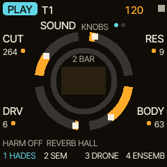

<!-- SPDX-License-Identifier: GPL-3.0-only -->
<!-- Copyright (C) 2026 bonszaimusic -->

# HADES in Caravel 1.0

Caravel **1.0.0 candidate** · BUILD / PLAY controls.

> **In 60 seconds** Choose HADES, start in MONO, and add one sub gently before drive and BODY.

## 1. Select the engine

In BUILD, hold EDIT to choose HADES and a factory preset. In PLAY, EDIT selects SOUND: K1–K4 are the sound's four primary controls. Browse the EDIT groups for the other engine controls.

## 2. Listen to one change

A bass-focused saw/pulse voice with two phase-locked suboscillators, a resonant three-pole low-pass, drive and BODY shelf. Start with one sub, moderate resonance and a low track level. Use MONO or LEGATO for a bass line, then add glide. Large SUB and BODY settings can mask the other tracks.

## 3. Play and save

ENV controls attack, decay, sustain and release. ARP, HARMONY, CHORD EXT, FX and note CAPTURE are track facilities shared with the other engines. Use the track overview or MIX to balance levels; SAVE opens PROJECT. A CAPTURE loop is not saved with that project.

[Engine reference](../engines/hades-engine.md) · [All six engines](../engines/overview.md) · [Basics](basics.md)
