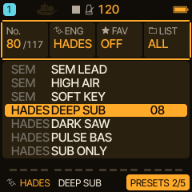
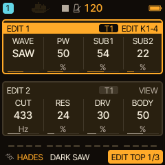
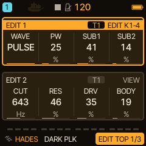
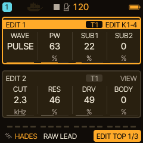

<!-- SPDX-License-Identifier: GPL-3.0-only -->
# HADES: basses, sub layers and dark leads

HADES is Caravel's bass engine: a saw or pulse oscillator with two sub-oscillators underneath, a resonant low-pass filter, drive and a bass shelf. It is made for basses, low layers and dark leads. This page first shows how to use it, then how the sound is made.

> **In 60 seconds**
>
> 1. Choose it: hold `EDIT`, press the **HADES** key (or turn `KNOB 1`).
> 2. Set the track to **MONO** or **LEGATO**, play low notes, and turn **CUT**, **SUB1** and **DRV**.
> 3. Walk through the presets: DEEP SUB, DARK SAW, DARK PLK, RAW LEAD.
> 4. Mistakes to avoid: playing chords on a bass in POLY, judging DRV and BODY with effects on, and forgetting that WAVE OFF is not silence.

HADES is an original interpretation inspired by a bass synthesizer, not a circuit-identical emulation or a port of any manufacturer's firmware. The names of the original maker and its products belong to their owners.

## 1. Choose HADES

Hold `EDIT` and press the **HADES** key, or turn `KNOB 1` while holding it. The PRESETS page of `SAVE` lists every sound.

Eight factory presets come with HADES, all dry (no effect sends) so you hear the engine itself: DEEP SUB, DARK SAW, PULSE BAS, SUB ONLY, DRIVEN, RESO BASS, DARK PLK and RAW LEAD.

## 2. Your first three controls

Press `EDIT`. **EDIT 1** has the oscillators (WAVE, PW, SUB1, SUB2), **EDIT 2** the filter and output (CUT, RES, DRV, BODY).

First set the voice mode: the track's voice mode **MONO** or **LEGATO** suits a bass (LEGATO with a little glide gives slides). Then:

- **CUT** opens and closes the low-pass filter.
- **SUB1 and SUB2** set how loud the two sub-oscillators are, one and two octaves below the played note. Mix them with the main wave for a stacked low end.
- **DRV** adds soft drive after the filter. **BODY** is a bass shelf.

**WAVE** chooses OFF, SAW or PULSE for the main oscillator; **PW** is the pulse width and **RES** the filter resonance.

## 3. A tour of four presets

Each clip is a **native DSP render** of the firmware's own code, played as a mono line, **not** a recording of an FM-1. They have not been listened to by the author of this page.

**DEEP SUB**: saw plus strong sub-oscillators, the low end of the family.

[Listen: HADES DEEP SUB](../audio/tutorials/hades-deep-sub.mp3)

**DARK SAW**: a saw bass with less sub, more resonance and more drive than DEEP SUB (compare the two screens).

[Listen: HADES DARK SAW](../audio/tutorials/hades-dark-saw.mp3)

**DARK PLK**: a plucked bass: PULSE wave, a decay and no sustain.

[Listen: HADES DARK PLK](../audio/tutorials/hades-dark-plk.mp3)

**RAW LEAD**: a lead rather than a bass. Raise CUT and play higher, as in the clip's melody.

[Listen: HADES RAW LEAD](../audio/tutorials/hades-raw-lead.mp3)

## 4. Typical mistakes

- **Chords on a bass.** POLY mode uses the normal shared voice budget (eight voices for all tracks). A bass sounds tighter in MONO or LEGATO.
- **Judging DRV and BODY with effects on.** Set them with the track's effects off, then add delay or reverb. BODY adds low-frequency gain, so lower the track level if the mix gets tight.
- **Thinking WAVE OFF is silence.** It is not: the two sub-oscillators stay. The SUB ONLY preset is exactly this, a clean low end under another track.
- **Expecting self-oscillation.** The filter is bounded below self-oscillation.
- **Using the low register for a lead.** Use RAW LEAD and raise CUT instead.

## 5. How the sound is made

- **Main oscillator:** a saw or pulse wave (WAVE) with pulse-width modulation: send an LFO to SHP for PWM.
- **Two sub-oscillators:** phase-locked to the main one, one and two octaves below the note you play (SUB1, SUB2).
- **Filter:** a resonant three-pole low-pass (CUT, RES), whose cutoff the track's filter envelope and FLT modulation also move.
- **Output stage:** a soft drive after the filter (DRV) and a low-frequency shelf (BODY).
- **The rest is the normal track:** the ADSR, filter-envelope amount, glide, LFOs, modulation matrix and effects are the shared facilities. All eight controls support MIDI Learn and automation.

What it does not do: it is not a circuit-identical model, it has no audio-rate patching, and it does not model the original hardware's separate envelopes; the track's own envelope facilities are used.

> [!NOTE]
> Hardware status: host tests only; no physical FM-1 acceptance under multiple tracks and effects. The reference is [the HADES guide](../engines/hades-engine.md); tips are in [Tips and tricks](../engines/tips.md).

## 6. Where next

- Pair a bass with a pad: [SEM](engine-sem.md) or [ENSEMBLE](engine-ensemble.md).
- Move the filter with an LFO or an envelope: [Filter, FX and modulation](filter-fx.md).
- Make the bass follow a progression: [HARMONY](harmony-live.md).
