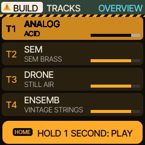

<!-- SPDX-License-Identifier: GPL-3.0-only -->
<!-- Copyright (C) 2026 bonszaimusic -->

# PHYS in Caravel 1.0

Caravel **1.0.0 candidate** · BUILD / PLAY controls.

> **In 60 seconds** In BUILD, hold EDIT, choose PHYS / MARIMBA or PLUCK, and play short notes. In PLAY / SOUND, K1–K4 adjust STRC, BRIT, DAMP and POS.

## 1. Start with one physical model

PHYS models the behavior of resonating objects rather than stacking ordinary subtractive oscillators. Hold HOME for BUILD, then hold EDIT to select **PHYS** and a starting preset: **MARIMBA** for a struck tone or **PLUCK** for a string. In PLAY, EDIT selects SOUND and exposes **STRC, BRIT, DAMP and POS** on K1–K4. BUILD / EDIT exposes **MODEL** and the remaining excitation controls.

## 2. Compare the four MODEL choices

PHYS chooses **one** model per voice; these are not four layers sounding simultaneously.

| MODEL | What it does | First experiment |
| --- | --- | --- |
| **MODAL** | A bank of resonators for bells, bars and struck metal | Choose MARIMBA; move STRC to change the relationship of the partials |
| **STRNG** | A plucked, feedback-based string | Choose PLUCK; try BRIT and DAMP before adding FX |
| **MEMB** | A struck membrane with a drumhead-like spectrum | Start from HAND DRUM; compare HARM and BEND |
| **SYMP** | A plucked string exciting three sympathetic strings | Choose HARP; compare CHRD and SYMP amount |

The **MEMB** model is part of PHYS. It does not imply that the removed standalone DRUM engine is included in the 1.0 profile.

## 3. Learn the common controls

**STRC** changes physical structure or overtone spacing; **BRIT** affects attack and high-frequency energy; **DAMP** sets the model's natural ringing time; **POS** changes where the object is excited. **ACC** responds to velocity, and **EXC** mixes the excitation itself into the output. In MODAL and STRNG, **BOW** can sustain resonances with repeated excitation.

These parameters interact. For example, a long DAMP does not guarantee a long audible note if the track's ADSR release is short. Start without reverb, change one parameter, then use ENV / SHAPE to fit the note into the arrangement.

## 4. Use the model-specific controls

In **MEMB**, the control normally named STRC is shown as **HARM** and changes the membrane's harmonic character; **BEND** adds a falling pitch after a strike. In **SYMP**, **CHRD** selects the intervals of the sympathetic strings (including ROOT-based tuning), **SYMP** controls how strongly they ring, and **BUZZ** changes the main string's bridge-like character.

For a dark ambient texture, try HARP or DRONE STRING with moderate DAMP, low track level and a restrained reverb send. For a rhythmic sound without a drum engine, start with MARIMBA or HAND DRUM and sequence sparse notes.

## 5. Understand voices and storage

The engine currently uses up to **three PHYS voices per track**. Dense held notes or simultaneous layers can compete for those voices. ARP, CHORD EXT and CAPTURE act on note input through the shared track system, not as separate physical-model voices.

SAVE opens PROJECT for durable sound and performance settings. A live CAPTURE loop is not saved in the project or a FORMAT-2 backup.

[PHYS model illustration](1-0-audio-engine-diagrams/07_phys.svg) (source-reviewed teaching diagram) · [Six-engine overview](../engines/overview.md) · [ANALOG](engine-analog.md) · [Sequencer and ARP](seq-arp.md)
