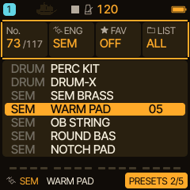
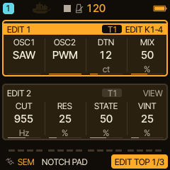

<!-- SPDX-License-Identifier: GPL-3.0-only -->
# SEM: warm pads, brass and notch sweeps

SEM is Caravel's two-oscillator virtual-analogue engine with a filter that can sweep from low-pass through a notch to high-pass. It is good for warm pads, brass, strings, soft keys and hollow notch sounds. This page first shows how to use it, then how the sound is made.

> **In 60 seconds**
>
> 1. Choose it: hold `EDIT` and press the **SEM** key (or turn `KNOB 1`), or use the PRESETS list.
> 2. Play a chord and turn the three controls that matter first: **CUT**, **STATE**, **DTN**.
> 3. Walk through the presets: WARM PAD, SEM BRASS, NOTCH PAD, ROUND BAS (more below).
> 4. Mistakes to avoid: expecting the filter to self-oscillate, forgetting that STATE does nothing in BP and HP, and playing more voices than the eight all tracks share.

SEM is an original interpretation inspired by a classic polyphonic analogue synthesizer, not a circuit-identical emulation. The names of the original maker and its products belong to their owners.

## 1. Choose SEM

Hold `EDIT`: the engine picker opens and a white key chooses the engine (the SEM cell is in the picker's grid). `KNOB 1` steps through the engines while `EDIT` is held, and the PRESETS page of `SAVE` lists every sound with `KNOB 2` jumping from engine to engine.

Eight factory presets come with SEM: SEM BRASS, WARM PAD, OB STRING, ROUND BAS, NOTCH PAD, SEM LEAD, HIGH AIR and SOFT KEY.

## 2. Your first three controls

Press `EDIT`. The page shows two groups of four: **EDIT 1** (the oscillators: OSC1, OSC2, DTN, MIX) and **EDIT 2** (the filter: CUT, RES, STATE, VINT). The framed group is the one `KNOB 1` to `KNOB 4` edit; `SELECT` moves to the other.

Hold a chord and turn these three:

- **CUT** is the filter's cutoff: closed is dark and soft, open is bright.
- **STATE** is the filter's character. 0 is a low-pass, about the middle (raw 64, shown as about 50 %) is a **notch**, 127 is a high-pass. Park it near the middle for a hollow sound, or sweep it for movement.
- **DTN** detunes oscillator 2 against oscillator 1 by 0 to 50 cents. A few cents on two identical waves make a pad thick.

The other controls: **MIX** balances the two oscillators, **RES** adds resonance, **VINT** adds small differences between voices (at 0 they are off) and **OSC1 / OSC2** each choose SAW, PULSE, TRI or PWM.

## 3. A tour of four presets

Each clip is a **native DSP render**: the firmware's own code computed on a computer with MIDI notes as input, **not** a recording of an FM-1. They are loaded with their factory sends and have not been listened to by the author of this page; judge them by ear.

**WARM PAD**: two saws, slightly detuned, a slow attack. The classic starting point.

[Listen: SEM WARM PAD](../audio/tutorials/sem-warm-pad.mp3)

**SEM BRASS**: a much faster attack and more resonance than WARM PAD (design values from the preset table).

[Listen: SEM BRASS](../audio/tutorials/sem-brass.mp3)

**NOTCH PAD**: OSC2 on PWM and STATE at the middle (raw 64), so the filter is a notch.

[Listen: SEM NOTCH PAD](../audio/tutorials/sem-notch-pad.mp3)

**ROUND BAS**: a round bass with OSC1 on PULSE. The clip plays it as a mono line (the track's voice mode set to MONO).

[Listen: SEM ROUND BAS](../audio/tutorials/sem-round-bas.mp3)

## 4. Typical mistakes

- **"Turn RES up until it whistles."** RES does not reach self-oscillation, so high values are safe but never ring on their own.
- **STATE does nothing.** On the SEM MODE page TYPE chooses **STATE**, **BP** (band-pass) or **HP** (high-pass). STATE only works with TYPE STATE.
- **The pad disappears in a busy mix.** All four tracks share eight voices. Reserve voices for the pad track in MENU > VOICES.
- **HOME shows UNAVAIL after switching engine.** HOME cards pinned to another engine's parameters are not available on SEM; each track keeps its own HOME cards.
- **Slow movement is missing.** SEM sounds alive when something moves: a slow LFO on the filter or pulse width, or a step lock. For PWM choose PWM for an oscillator and send a slow triangle LFO to SHP with a modest amount.

## 5. How the sound is made

- **Two oscillators.** Each has its own waveform (SAW, PULSE with 50 % width, TRI or PWM) and OSC2 is detuned by DTN. MIX crossfades them. For PWM the pulse width is moved by SHP from the LFO, the envelope or the modulation matrix.
- **A 12 dB per octave state-variable filter.** STATE blends continuously from low-pass through a notch to high-pass. TYPE BP and HP are fixed band-pass and high-pass modes in which STATE is inactive. STATE changes are smoothed so they do not click.
- **Vintage variation.** VINT gives every voice small pitch and filter differences and a slow local tuning drift, as a real analogue instrument would have. At 0 the variation is off, which suits tight unison lines.
- **The rest is the normal track.** The ADSR, filter envelope, LFOs, MOD matrix, ARP and FX are the facilities every engine shares, and the eight controls support MIDI Learn and sequencer automation.

> [!NOTE]
> Hardware status: the engine is covered by the host test suite. It has not been accepted on a physical FM-1 under sustained load. The full reference is in [the SEM guide](../engines/SEM_ENGINE.md); tips are in [Tips and tricks](../engines/tips.md).

## 6. Where next

- Put a slow LFO on the filter: [Filter, FX and modulation](filter-fx.md).
- Play chords that follow a progression: [HARMONY](harmony-live.md).
- Layer SEM with a bass and a drone: [HADES](engine-hades.md) and [DRONE](engine-drone.md).
