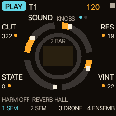

<!-- SPDX-License-Identifier: GPL-3.0-only -->
<!-- Copyright (C) 2026 bonszaimusic -->

# SEM in Caravel 1.0

Caravel **1.0.0 candidate** · BUILD / PLAY controls.

> **In 60 seconds** Choose SEM in BUILD. Start with a soft pad and move CUT and STATE separately; balance the dry level first.

## 1. Select the engine

In BUILD, hold EDIT to choose SEM and a factory preset. In PLAY, EDIT selects SOUND: K1–K4 are the sound's four primary controls. Browse the EDIT groups for the other engine controls.

## 2. Listen to one change

Two detuned oscillators, pulse-width movement and a state-variable filter that blends low-pass, notch and high-pass. Start with a soft preset, open CUT slowly and compare STATE with resonance kept moderate. VINT adds variation; build a stable dry patch before adding sends.

## 3. Play and save

ENV controls attack, decay, sustain and release. ARP, HARMONY, CHORD EXT, FX and note CAPTURE are track facilities shared with the other engines. Use the track overview or MIX to balance levels; SAVE opens PROJECT. A CAPTURE loop is not saved with that project.

[Engine reference](../engines/SEM_ENGINE.md) · [All six engines](../engines/overview.md) · [Basics](basics.md)
