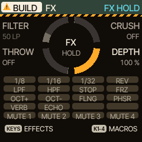

<!-- SPDX-License-Identifier: GPL-3.0-only -->
<!-- Copyright (C) 2026 bonszaimusic -->

# Filter, FX and momentary changes

Caravel **1.0.0 candidate** · BUILD / PLAY controls.

> **In 60 seconds** Dim FILTER means the stored track filter; bright means the macro. An unlatched FX hold returns it on release.

## 1. Shape the selected track

In BUILD, EDIT exposes the sound engine's filter; the separate track filter is a stored parameter. Negative values apply low-pass, positive values high-pass and zero is off. FX opens sends, inserts and the shared delay/reverb settings. Start with moderate sends and levels.

## 2. Read the FILTER value

Hold FX to open the performance layer. FILTER now shows the **effective filter of the selected track**, with LP/HP and amount. A dim value means the stored track filter is in charge; a bright value means the temporary performance macro is in charge. OFF means the effective value is zero.

The first turn starts at the track value. Returning to that starting value releases the macro. An unlatched FX hold releases FILTER when FX is let go, in BUILD and PLAY. FX LATCH retains the held effect. The macro never writes the track's stored filter. If you select another track with the macro active, the macro applies to that track.

## 3. Ordinary PLAY edits

Tap FX for SPACE. SENDS, FILTER and STASIS are its groups. The ordinary FILTER arc stays where you put it after a page change; it is a performance value, not a saved track-filter edit. To save a filter sound, edit the track parameter in BUILD.

## 4. Try changes temporarily

Hold LFO, turn a knob and listen. Releasing LFO returns the value; OCT+ accepts it. Use small changes first. STASIS holds audio texture, whereas CAPTURE records note gestures: they are separate features.

[STASIS and performance](home-performance.md) · [Basics](basics.md)
