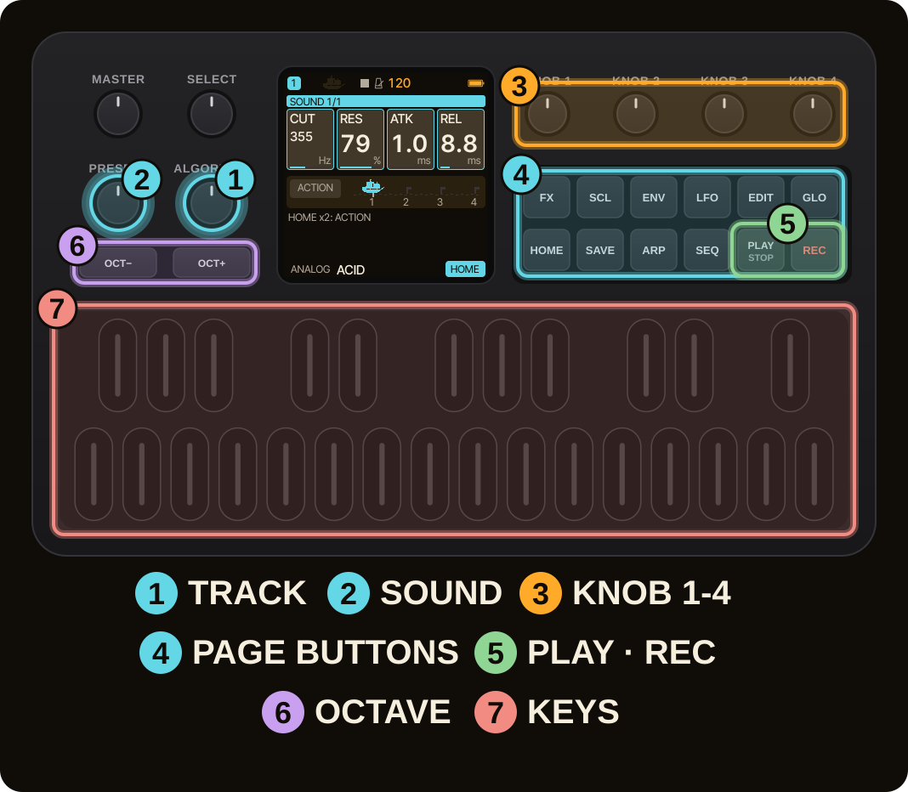
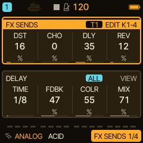
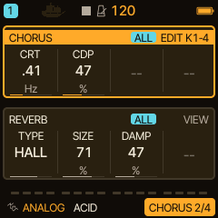
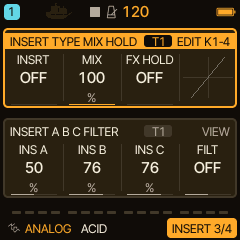
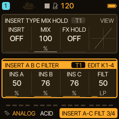
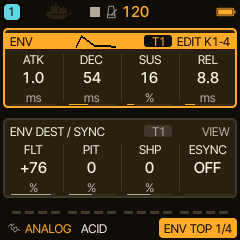
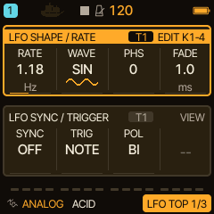
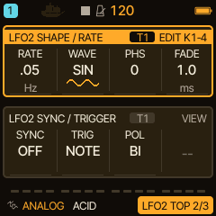

<!-- SPDX-License-Identifier: GPL-3.0-only -->
# Filter, FX and modulation

How a sound is shaped after the engine: a one-knob filter on every track, the effects (sends, delay, chorus, reverb, insert), and the envelope and LFOs that make parameters move.

> **In 60 seconds**
>
> 1. `FX` opens the effects. The first page has the track's four **sends** (DST, CHO, DLY, REV) and the shared delay.
> 2. The **track filter** is the **FILT** card on the INSERT page (lower group, `KNOB 4`): left is a low-pass, the middle is OFF, right is a high-pass.
> 3. Delay, chorus and reverb are **shared** by all tracks (the ALL badge); the sends say how much of each track goes to them.
> 4. `ENV` shapes loudness and where the envelope also goes; `LFO` moves a parameter in a cycle.
> 5. Pages that show T1 to T4 belong to the selected track; ALL pages belong to the whole project.

## 1. Sends and the shared effects

Press `FX`. The top group is the selected track's **FX SENDS**: DST (the track's own distortion), CHO (chorus), DLY (delay) and REV (reverb). The lower group, tagged ALL, is the **DELAY** shared by every track: TIME, FDBK, COLR and MIX. Turn `SELECT` to continue through the family: DELAY, CHORUS, REVERB, INSERT, SLICER.

A track's sends say **how much** of the track goes to the one shared delay, reverb and chorus. Loading a factory preset sets the sends unless FX HOLD is on (MENU > VOICES).

## 2. The track filter

The track's **FILTER** is one knob: left of the middle is a **low-pass**, right of it a **high-pass**, the middle is **OFF**. It is the **FILT** card of the INSERT view (`FX`, `SELECT` to INSERT, the lower group, `KNOB 4`). It works on every engine, including those without a filter of their own.

| FILT | what you hear |
| --- | --- |
| LP 25 % | the track dulled, -3 dB at about 4.6 kHz |
| LP 50 % | -3 dB at about 1.4 kHz |
| LP 100 % | -3 dB at about 120 Hz |
| HP 25 % | bass taken away, -3 dB at about 103 Hz |
| HP 50 % | -3 dB at about 353 Hz |
| HP 100 % | -3 dB at about 3.8 kHz |

The slope is 12 dB per octave and there is **no resonance**: the filter cannot ring or howl. It is the last stage of the track's own chain (voices, DIST, INSERT, SLICER, FILTER, then level, pan and the sends), so the sends take the filtered sound: a high-passed track sends a high-passed signal into the reverb. At OFF nothing runs and the track is bit for bit what it was.

You can record FILT as automation, lock it on a step, or learn a CC to it (MIDI Learn: CC 0 is full low-pass, 127 full high-pass, the middle OFF).

## 3. Envelope and LFO

Press `ENV`: the top group is the **ENV** (ATK, DEC, SUS, REL) with a small picture of its shape; the lower group is **ENV DEST / SYNC**: how much the envelope also moves the filter (FLT), the pitch (PIT) and the pulse width (SHP).

Press `LFO` for the **LFO**: RATE, WAVE (SIN, TRI, SAW, SQR, S&H), PHS and FADE above, SYNC, TRIG and POL below. A page further are **LFO2**, a second independent LFO, and the **MOD matrix** where you choose a source, a destination and an amount for up to four slots.

> [!TIP]
> Slow movement is what makes SEM, HADES and DRONE sound alive: a slow triangle LFO on the filter or the pulse width, a step lock, or an envelope amount on the cutoff. See [Tips and tricks](../engines/tips.md) and [LFO2](../modulation/LFO2.md).

## 4. Insert, slicer and STASIS

The **INSERT** upper group has the insert TYPE, its MIX and **FX HOLD**; INS A, INS B and INS C are the type's own controls. The **SLICER** gates or stutters the track in a step pattern. The reverb's **STASIS** type captures the REV send into a texture you can hold: see [HOME performance](home-performance.md).

## 5. Where next

- [HOME performance functions](home-performance.md): change controls over time with Random Morph and Journey.
- [MIDI and sync](midi-sync.md): move any of these controls from a controller.
- Reference: [Pages, groups and the settings menu](../menus-and-pages.md), [Track filter](../track-filter.md).
