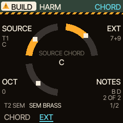

<!-- SPDX-License-Identifier: GPL-3.0-only -->
<!-- Copyright (C) 2026 bonszaimusic -->

# HARMONY and live CHORD EXT

Caravel **1.0.0 candidate** · BUILD / PLAY controls.

> **In 60 seconds** On CHORD row two choose HARM or T1–T4, then EXT and OCT. A source supplies harmony; play the follower to hear it.

## 1. Use a progression

In BUILD, tap SCL and use SELECT to find HARMONY. Set up the bus progression and turn HARMONY on. FOLLOW lets an ordinary track follow that bus. CHRD BUS expands a key into the bus chord. The bus itself does not start a track.

## 2. Give a track extensions

On CHORD, select its second row with SCL or SELECT. K1 selects SOURCE: **OFF / HARM / T1 / T2 / T3 / T4**. K2 selects EXT: **7 / 7+9 / 7+9+13**. K3 places the result −2 to +2 octaves. K4 shows the resulting notes and is read-only.

HARM uses the bus chord. T1–T4 use real keys or incoming MIDI played on that source track. Play a complete chord there, then play a note, ARP or sequence on the follower. A source changes the follower's available notes; it never starts a silent follower. EXT overrides the follower's CHRD/FOLLOW mapping while enabled, preserving their stored settings.

## 3. Read the status

WAIT means no usable live chord yet; WAIT BUS means HARMONY is off. AMBIG / KEPT keeps the previous recognized chord. N/A identifies an ineligible source, including a self-source, another EXT follower or a PAIR follower. A muted source can still conduct.

Live input collects Note-Ons over a gap of about 30 ms, with a roughly 100 ms hard cap. Release and sustain do not clear the remembered chord. Held notes from a previous chord are not added to a new gesture: a legato change with only two new notes may be ambiguous. ARP, SEQ and CAPTURE output do not teach a live source.

## 4. Retrigger or wait

RETRIG **OFF / HARM / SCALE / BOTH** controls held notes. HARM/BOTH rebuild eligible held voices when the chord context changes, for all tracks; ARP and SEQ use the new context on their next event. Source change and project load reset live memory to WAIT. STOP/panic discards an unfinished gesture and silences playing owners without making remembered harmony start notes.

[CAPTURE and ARP](seq-arp.md) · [MIDI](midi-sync.md)
