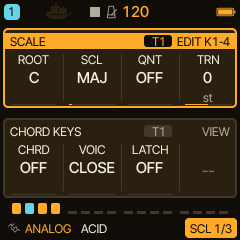
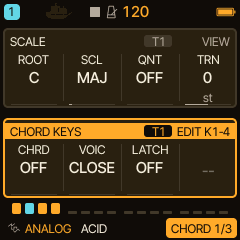
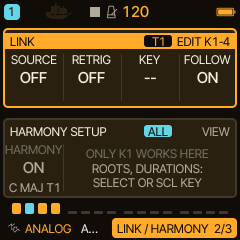
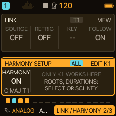
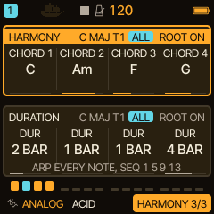
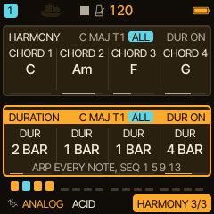
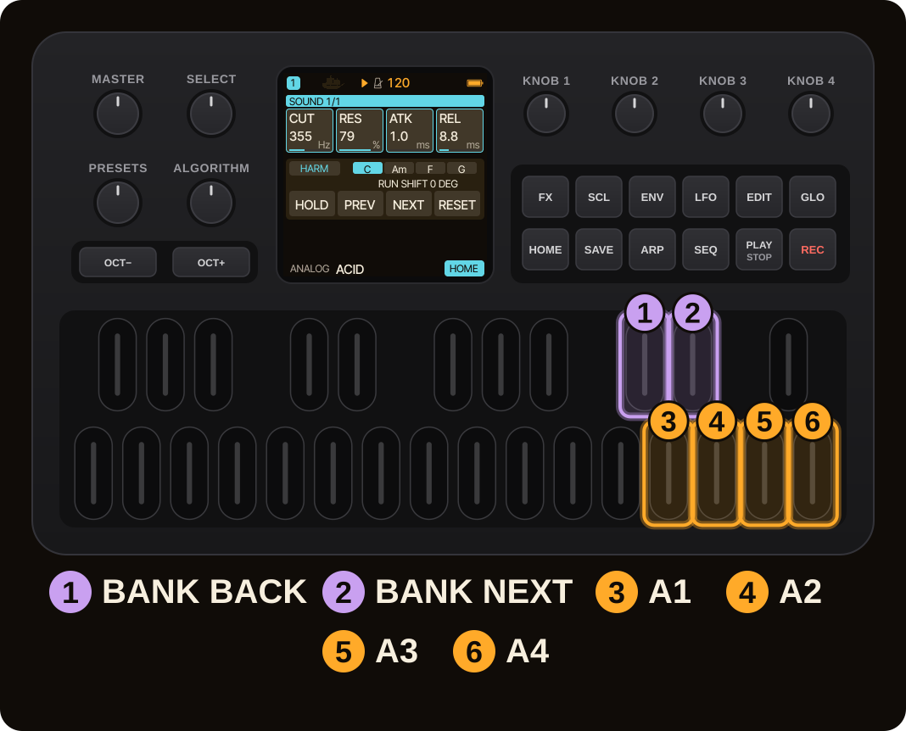
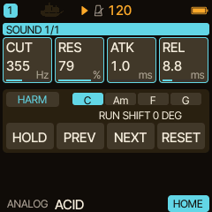
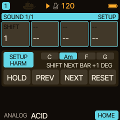

<!-- SPDX-License-Identifier: GPL-3.0-only -->
# HARMONY: one chord progression for all your tracks

Harmony gives the FM-1 a chord progression that your tracks can follow: the sequencer's strong steps, every arpeggiator step and the keys you play are moved onto the current chord, and you steer the progression live with four keys. This page sets it up, shows the HARM bank, and adds LATCH.

> **New in 0.12.0.** Harmony, the HOME ACTION keys and the HARM bank are validated on the host (tests and renders). The maintainer reported a good first device test of an earlier test package on 2026-11-09 without itemised results; the later fixes of 0.12.0 have not been tested on a device, and physical FM-1 acceptance of every detail is still pending.

> **In 60 seconds**
>
> 1. Open `SCL` and turn `SELECT` row by row to **HARMONY SETUP**; turn `KNOB 1` to switch the bus on.
> 2. On **HARMONY** set four chord roots and how many bars each lasts (1, 2, 4 or 8).
> 3. On **LINK** check **FOLLOW** (`KNOB 4`) for each track: ON follows the bus, OFF ignores it. After power-on every track follows.
> 4. Double-tap `HOME`, then `D#5` until the bank reads **HARM**. `D5` HOLD, `E5` PREV, `F5` NEXT, `G5` RESET.
> 5. Hold the bank key `C#5` for SETUP; `KNOB 1` is **SHIFT**, the whole progression moved by scale degrees.
> 6. Set **LATCH** on the CHORD page to keep notes sounding hands-free.

## 1. The idea

The **Harmony bus** counts the transport's bars, not a metronome in the audio: the internal BPM clock or the external MIDI clock, whichever the sequencer uses. Its bar line starts with PLAY and BAR RESET; an external clock's own bar sync does not realign it, and a tempo change in the middle of a bar can shift it against the pattern until the next PLAY or BAR RESET. It holds four chords, each lasting 1, 2, 4 or 8 bars. A track that **follows** the bus plays the current chord's tones where it would play a scale note: the sequencer's strong steps (steps 1, 5, 9, 13), every arpeggiator step and your live keys, which are snapped to the nearest chord tone. Drum lanes, kits, slices and other engines that map the keys themselves are never moved.

## 2. Prepare the progression

The pages are rows on the **SCL** button's pages. Press `SCL`, then turn `SELECT` one detent per row:

**SCALE, CHORD, LINK, HARMONY SETUP, HARMONY ROOTS, DURATIONS.**

Turn left to go backwards. (`SELECT` moves between rows while the SELECT setting is NAV, the factory setting; with another setting use the `SCL` button, which steps through the same rows and wraps to SCALE.) HARMONY SETUP is always reachable, even when the bus is off; ROOTS and DURATIONS appear after you switch the bus on.

On the **HARMONY SETUP** row, turn `KNOB 1` to the right: the bus is on. Only `KNOB 1` works on this row.

Then set the four **roots** (a turn moves along the scale degrees of track 1's scale; each name shows the chord built on that root, C, Am, F, G in C major) and the four **durations**. If track 1's scale is still the default **CHR**, the bus is built on the major scale of track 1's ROOT, so the roots C, A, F, G read C, Am, F, G.

The roots and durations are **global** (the ALL badge) and name the key the bus is built in from track 1's ROOT and SCALE (for example C MAJ T1). The line under the DURATION cards says what Harmony does per note source: ARP every note, SEQ steps 1 5 9 13, and with SHIFT the shift in degrees. A root stored outside the scale (an older project, or a scale changed later) plays and shows as the scale note below it; the stored value is not rewritten.

## 3. Let tracks follow

On the **LINK** row the track switch is **FOLLOW** (`KNOB 4`: right ON, left OFF) and the bus itself is **HARMONY**. After a cold boot every track has FOLLOW on (measured on the host build); switch it off on a track that should ignore the bus. On the CHORD page **CHRD BUS** makes a key play the whole current bus chord at the octave nearest the key. A held bus chord changes with the bus when **RETRIG** on the LINK row is CHORD or BOTH.

A track whose CHRD is BUS but which has no bus (HARMONY off, or FOLLOW off) plays its own in-key triad; its CHRD card says **OWN DIA3**.

## 4. Play the HARM bank

Double-tap `HOME` to switch ACTION on. Tap `D#5` (next bank) until the chip reads **HARM**. (In 0.13.0 there are seven banks: ELASTIC sits between STASIS and PAIR, and HARM stays right after JOURNEY.) The four chords are shown with the current one highlighted; below them a status line shows what is queued for the next bar or the run state.

| Action | Effect |
| --- | --- |
| A1 (D5) HOLD / RESUME | Hold the current harmony while rhythm and ARP keep running. RESUME starts the next chord at the next transport bar. |
| A2 (E5) PREV | Queue the previous chord, wrapping from chord 1 to chord 4. |
| A3 (F5) NEXT | Queue the next chord, wrapping from chord 4 to chord 1. |
| A4 (G5) RESET | At the next bar, return to chord 1, clear HOLD and set SHIFT to zero. |

PREV, NEXT, RESET and SHIFT take effect at the next **transport bar line**; the most recent PREV, NEXT or RESET request replaces any earlier one. An explicit jump starts that chord's full configured duration. Press HOLD again before a queued RESUME to cancel it. When the transport is stopped, changes apply immediately without starting any notes.

The status line spells out the state: PREV BAR, NEXT BAR, RESUME: NEXT BAR, RESET: CHORD 1, SHIFT 0, RUN or HOLD, and the SHIFT in degrees. In the other banks, and with ACTION off, a line under the bank (for example HARM HOLD) keeps the state in view.

## 5. SHIFT

Hold either bank key for 500 ms to open the bank's **SETUP**. `KNOB 1` is **SHIFT**: it queues a shift of the whole progression by -7 to +7 scale degrees within track 1's scale. Zero is the original. SHIFT changes scale degrees, not the octave: C, Am, F, G in C major becomes Dm, B dim, G, Am at +1. The other knobs are unused. Hold the bank key again to close SETUP.

The overlay is global; FOLLOW still decides which tracks take part. Changing bank keeps the overlay active, so STASIS and HARM work together. Return to HARM and use RESET to restore the original progression.

HOLD, queued movement and SHIFT are temporary: they are not stored in the roots, durations or the project. A new PLAY, BAR RESET, loading a project, or switching the bus off and on clears the overlay. Stop and Continue keep it.

## 6. LATCH: notes that keep sounding

On the **CHORD** page (SCL, then `SELECT` to CHORD), `KNOB 3` is **LATCH** for the selected track.

| Value | What it does |
| --- | --- |
| OFF | A note ends with its key. |
| NEW | Notes stay on after release. A key pressed while no other key is held ends the latched set and starts a new one: change chords hands-free. |
| STACK | Notes stay on and new ones are added. Pressing a key (or chord) whose notes all sound latched ends exactly those notes. |

With the HARM bank, LATCH makes a pad that changes chord with the bus: set CHRD to BUS and RETRIG to CHORD, latch a key and let HARM move the chord (this combination of settings is derived from the guides, not tested on its own). Press `OCT-` and `OCT+` together to let go of everything latched on the track. More in [LATCH](../latch.md).

> [!NOTE]
> Known limits: the bar line of the bus is not realigned by an external clock's own bar sync, and a tempo change in the middle of a bar can shift it until the next PLAY or BAR RESET; with three or more overlapping latched BUS chords an older chord's toggle is not exact; a key held across a bar line is not covered by tests; no ThreadSanitizer run and no worst-case timing measurement.

## 7. MIDI Learn

Switch MIDI Learn on (`GLO` + D4), then press A1 to A4 in HARM to select HOLD, PREV, NEXT or RESET, turn SETUP `KNOB 1` to select SHIFT, send the controller CC and finish Learn. The four buttons trigger on a low-to-high crossing (below 64 to 64 or above). SHIFT is absolute: 0 is -7, 64 is zero, 127 is +7. Learned HARM controls work while another bank is visible. They control the internal Harmony bus; Harmony does not add MIDI OUT for ARP or sequencer notes.

## 8. Where next

- [HOME performance functions](home-performance.md) for the other banks.
- [MIDI and sync](midi-sync.md), [Sequencer and arpeggiator](seq-arp.md), [DRONE](engine-drone.md) beds that follow the progression.
