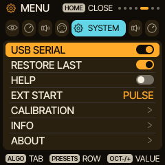

<!-- SPDX-License-Identifier: GPL-3.0-only -->
# Help: when something does not work, and the way back

Where to look first, how to back up, how to update, how to return to the stock firmware, and what Caravel does not do (yet).

> **In 60 seconds**
>
> 1. **Back up before you change anything:** the web editor's *Complete backup*, or `python3 tools/caravel_backup.py save session.zip`.
> 2. **The browser does not find the FM-1?** Use Chrome or Edge, a USB **data** cable, close other MIDI programs, then read the [FAQ](../faq.md).
> 3. **Return to the stock firmware** with the installer's *Return to official V15* and M-VAVE's own `FM-1.fwsc`. Error -5 has its own FAQ entry.
> 4. **A project looks empty after going back to an older version?** Nothing is deleted; see the FAQ entry for that version.

## 1. Where to look first

The [Troubleshooting & FAQ](../faq.md) is organised by what you see:

| What you see | FAQ entry |
| --- | --- |
| Windows reports an unknown USB device | USB device not recognized |
| The computer sees MIDI but the browser says FM-1 not found | FM-1 not found |
| Another installer does not find the unit | Changing firmware |
| Return to official firmware stops with Update Failed -5 | Stock return error -5 |
| A project slot is empty after going back to an older Caravel | Projects saved by 0.8.0 or 0.9.0, Projects that use ENSEMBLE |
| You need M-Flasher or m-bootloader | Recovery tools |

On the device, the SYSTEM tab of the menu (hold `HOME`) has **INFO**, **ABOUT** and **HELP** entries (not opened for this page).

## 2. Back up

- **Web editor:** open the [web editor](https://bonszaimusic.github.io/caravel/webapp/editor/) with the FM-1 connected and use *Complete backup*, *Save backup*. The button is greyed out when the connected firmware does not report backup support.
- **Terminal:** `python3 tools/caravel_backup.py save session.zip` (needs Python 3 with `mido` and `python-rtmidi`; close other MIDI programs first). The ZIP holds the current project, A to D, settings and MIDI Learn, user presets, FM6 patches and user samples. `restore` puts it back (it stops playback; an interrupted restore can be incomplete, the backup file stays intact). `export` and `import` move a single project as an `.hpm` file. **Projects saved by 0.13.0** carry an HPM1 version 5 HOME capsule. The tool of 0.13.0 saves and restores HPM1 capsule versions 4 and 5 byte for byte (it does not interpret the capsule); that is tested on the host, not on a device. Earlier copies of the tool knew versions 1 to 3 only and stop with `Invalid HPM1 capsule` on a device that holds such projects (see the [FAQ](../faq.md#things-to-know-in-0130)). The web editor's and installer's backup check sizes only, not the capsule version, and have not been tried on a device that holds version 5 projects.
- Keep backups on your computer, not on the FM-1, and do not unplug or switch off while the FM-1 is writing.

## 3. Update

The [web installer](https://bonszaimusic.github.io/caravel/webapp/installer/) installs the package of the published release. Before the Install button is enabled it checks the package size and SHA-256 and the device identity; it will not start or resume an update with a package that fails. These checks do not protect against a power cut or an interrupted USB transfer while writing. If an update is cut off the FM-1 stays in update mode; run the install again to finish it. The command-line installer is `python3 tools/fm1_install.py caravel-X.Y.Z.fwsc`; it makes no backup.

Projects made with newer features need newer firmware. **A project saved by 0.13.0 uses the HPM1 version 5 capsule, which 0.12.0 and earlier do not accept**: updating to 0.13.0 is safe, going back is not for those projects, and in a host test 0.12.0 boots normally, shows the HOME project slot as empty and refuses a USB write of the capsule. For earlier format changes, older firmware shows a slot as empty rather than misreading it, and saving over that slot there replaces it. Back up before going back to an older version.

## 4. The way back to the stock firmware

1. Download the official `FM-1.fwsc` from M-VAVE ([m-vave.com/download](https://www.m-vave.com/download)); do not modify it.
2. In the web installer open **Return to official V15** and choose the file. The browser checks it locally against the known V15 file.
3. Press **Back up and return to official V15**; the installer exports a complete backup first, you confirm it is saved, and then it installs V15.

Caravel projects do not open in V15. Reinstalling the official firmware does not guarantee the factory state, your data or your warranty. If the update stops with **-5**, read [Stock return error -5](../faq.md#stock-return-error--5).

## 5. Known limits

- **Hardware acceptance** of Caravel on a real FM-1 is still pending for most features: host tests and the browser emulator are not hardware measurements. Pages of this tutorial set mark what is tested only on the host.
- **DRONE is experimental.** Listening quality and timing under sustained load are not verified on a device.
- **The Harmony bus is new in 0.12.0.** It is validated on the host and had one reported good device test of an earlier test package without itemised results; its known limits are on the [HARMONY](harmony-live.md) page.
- **ELASTIC and the smaller sample set are new in 0.13.0.** ELASTIC is tested on the host with the real firmware code; the maintainer reports a successful test of the 0.13.0-rc1 package on an FM-1, without itemised results. Click-free behavior, clock behavior with Stop and Start on a device, and how PIANO and FLUTE now sound have not been verified here. ELASTIC cannot be MIDI-learned. See the [release notes](../release-0130.md) and [ELASTIC first steps](elastic-first-steps.md).
- **The firmware's USB IDs are shared test IDs.** See [Installing Caravel](../installing.md) and [NOTICE](../../NOTICE).
- **Installing custom firmware is at your own risk,** and a failed update can leave the FM-1 unusable. The FAQ lists recovery tools, which are community projects and not guaranteed.

## 6. Report a problem

Open an [issue](https://github.com/bonszaimusic/caravel/issues/new/choose) with the Caravel version, your computer and browser, the cable and port, and what you tried. The FAQ lists what to include and what not to attach (no raw flash dumps or private projects).
