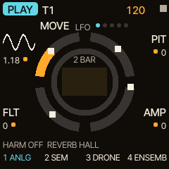
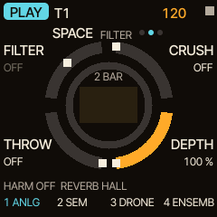

<!-- SPDX-License-Identifier: GPL-3.0-only -->
<!-- Copyright (C) 2026 bonszaimusic -->

# Performance in PLAY and BUILD

Caravel **1.0.0 candidate** · BUILD / PLAY controls.

> **In 60 seconds** PLAY exposes SPACE and MOVE. Browse the group, then hold LFO and read the D5/E5/F5/G5 verb labels.

## 1. Find the current controls

HOME held for one second switches BUILD/PLAY. HOME tapped opens the LEVELS explanation in PLAY or the track overview in BUILD. The old HOME ACTION-bank navigation is not the 1.0 performance workflow.

## 2. MOVE

Tap LFO in PLAY to reach MOVE, then browse LFO, RANDOM, JOURNEY, ELASTIC and PAIR. The screen shows the current group's controls. Hold LFO and use D5, E5, F5 or G5 for the four displayed verbs. Their labels depend on the current group; check them before triggering an action. BUILD has the deeper setup pages.

RANDOM changes the targets in the track's own performance set. JOURNEY moves between that track's snapshots. ELASTIC moves armed targets as springs. PAIR combines two compatible tracks; its owner handles notes and CAPTURE. Project loads set SPREAD to zero on both PAIR members.

## 3. SPACE and STASIS

Tap FX for SPACE and browse the currently available effects. STASIS holds an audio texture; CAPTURE separately holds note gestures. The private STASIS 2.0 preview adds a bounded REGION and distinct FREEZE / long-press NEW SOURCE controls. Older installed firmware may use different controls; follow the labels on your device. Start with low levels, then compare dry and wet sound.

## 4. Save durable settings

SAVE opens PROJECT. A project includes sound and performance settings, while CAPTURE loops, temporary FX macros and running spring positions are not durable data. A too-large compressed project is refused with PROJECT TOO LARGE / NOT SAVED; the previous saved copy remains.

[CAPTURE](capture.md) · [ELASTIC](elastic-first-steps.md) · [Snapshots and Journey](random-morph-journey.md) · [Filter](filter-fx.md)
