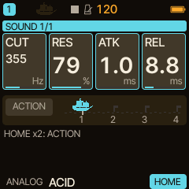
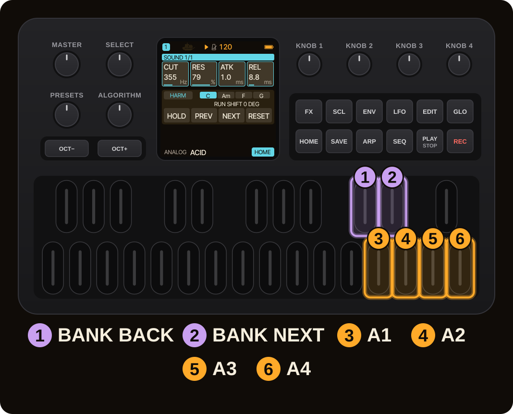
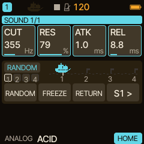
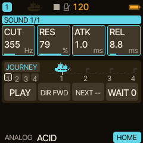
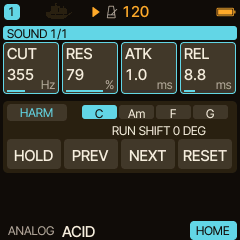
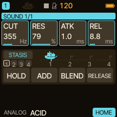
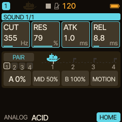
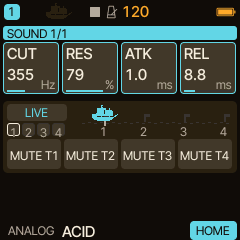

<!-- SPDX-License-Identifier: GPL-3.0-only -->
# HOME performance functions

HOME is the performance page: four big cards you choose, and underneath them the **ACTION banks**, four keys that do things to your sound while you play. This page is the map; the lessons for each function are linked from it.

> **In 60 seconds**
>
> 1. **Double-tap `HOME`** to switch ACTION on. The four keys D5, E5, F5, G5 are now **A1 to A4**.
> 2. **C#5** steps to the previous bank, **D#5** to the next: RANDOM, JOURNEY, HARM, STASIS, PAIR, LIVE, then round again.
> 3. Hold either bank key for half a second for the bank's **SETUP**.
> 4. Everything else stays playable: F#5 and all other keys play normally. With ACTION off, all keys play.

## 1. Put the controls you want on HOME

HOME shows four cards of the selected track. Turn a parameter on its own page, then hold `GLO` and tap `HOME` to add it. Each track has its own HOME cards; a card whose parameter the track's engine does not have shows UNAVAIL. Hold `HOME` for the menu; **EDIT CELLS** there reorders or removes cards. The full walk-through, with Pair Morph and macros, is [HOME, Pair Morph, macros and saving](home-and-stasis.md).

## 2. Switch ACTION on and move between banks

Double-tap `HOME`: the bank chip and four action keys appear under the cards. The keys sit on fixed physical positions, whatever the octave, transpose or scale.

| Key | Function |
| --- | --- |
| C#5 | previous bank |
| D#5 | next bank |
| D5, E5, F5, G5 | A1, A2, A3, A4 |

The forward order is **RANDOM, JOURNEY, HARM, STASIS, PAIR, LIVE**. Tap a bank key to change bank; hold it for 500 ms to open that bank's SETUP. A held note keeps its normal release when you switch ACTION on.

## 3. The six banks

**RANDOM** moves the controls on your HOME page: A1 RANDOM drifts every control to a nearby random value, A2 FREEZE holds the movement, A3 RETURN brings them back (or morphs to the selected snapshot), A4 selects or saves a snapshot slot (S1 to S4). Hold A4 to save the sound into the slot. Lesson: [Random Morph and Morph Journey](https://bonszaimusic.github.io/caravel/tutorials/random-morph-journey/) ([source](random-morph-journey.md)).

**JOURNEY** chains your snapshots into one slow, hands-free movement: A1 PLAY / PAUSE, A2 direction, A3 NEXT, A4 WAIT (the rest between legs). Same lesson as above.

**HARM** steers the chord progression of the Harmony bus: A1 HOLD, A2 PREV, A3 NEXT, A4 RESET, with SHIFT in its setup. Lesson: [HARMONY](harmony-live.md).

**STASIS** has the labels HOLD, ADD, BLEND and RELEASE. STASIS itself lives in the reverb: a captured texture of your REV send that can be held, added to and blended into a new one. The lessons with real screens are [STASIS: HOLD, ADD and BLEND](https://bonszaimusic.github.io/caravel/tutorials/stasis/) and the [sound examples](https://bonszaimusic.github.io/caravel/sounds/). Not checked for this page: exactly what each STASIS bank key triggers; follow the lessons.

**PAIR** has A 0 %, MID 50 %, B 100 % and MOTION: Pair Morph plays two engines from the same notes and blends between them. The setup (partner, enable, morph, motion) is on the ENV page; see [Pair Morph in HOME, Pair Morph, macros](home-and-stasis.md). The key labels are as printed; their exact effect was not checked for this page.

**LIVE** has MUTE T1 to MUTE T4, one key per track.

## 4. Control it from a controller

Any ACTION key or setup knob can be learned by MIDI Learn (`GLO` + D4): see [MIDI and sync](midi-sync.md). The learned control keeps working while another bank is on screen.

## 5. A ready-made performance

The [STASIS performance setup](https://bonszaimusic.github.io/caravel/performance/) is a downloadable HOME project from the feature Short: two paired SEM tracks, a driven DRONE, MIDI notes and a play guide.

> [!NOTE]
> HOME ACTION and HARM are new in 0.12.0. They are validated on the host; the maintainer reported a good first device test of an earlier test package on 2026-11-09 without itemised results (not an itemised acceptance, and the later 0.12.0 fixes have not been tested on a device). Details in [HARMONY](harmony-live.md).

## 6. Where next

- [Random Morph and Morph Journey](random-morph-journey.md), [STASIS lessons](home-and-stasis.md), [HARMONY](harmony-live.md).
