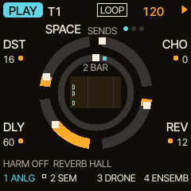

<!-- SPDX-License-Identifier: GPL-3.0-only -->
<!-- Copyright (C) 2026 bonszaimusic -->

# MIDI input, learn and sync

Caravel **1.0.0 candidate** · BUILD / PLAY controls.

> **In 60 seconds** Choose track channels in BUILD. USB and TRS notes can feed CAPTURE while transport runs; pedal CC is not recorded.

## 1. Route incoming notes

Connect USB MIDI or TRS MIDI IN. In BUILD, double-tap GLO to open the menu and inspect each track's MIDI channel and routing. Panel keys play the selected track; a configured MIDI channel can play a different track. Check the channel before changing a preset.

## 2. Capture MIDI notes

With transport running, incoming USB and TRS notes feed CAPTURE's live ring on their receiving track. Velocity and physical Note-Off are retained, including Note-On with velocity zero as a release. A sustain pedal can hold the live sound after physical Note-Off; the loop records the physical note length and does not record the pedal itself. CAPTURE playback never records itself.

## 3. Learn controllers

Existing learned MIDI CC assignments work in PLAY and change their real parameters. New learning is entered in BUILD using GLO held and D4. Select the parameter to learn, then move the controller. Channel-mode messages, sustain and other reserved controls keep their defined MIDI meaning.

## 4. Clock and recovery

Choose internal, USB or TRS clock in the menu. An external clock must send START/CONTINUE and clock pulses; STOP pauses playback. Lost external clock stops transport rather than leaving loop notes running. A host simulation is not a guarantee about a particular MIDI interface's jitter: test the actual controller and tempo you intend to use.

[HARMONY and live sources](harmony-live.md) · [Troubleshooting](../faq.md)
