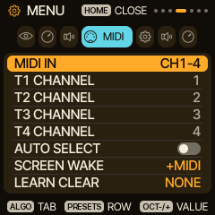
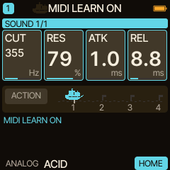
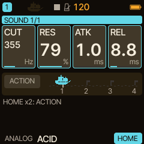
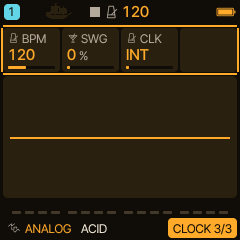
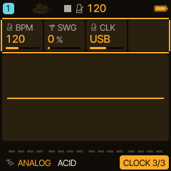
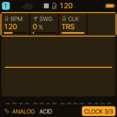

<!-- SPDX-License-Identifier: GPL-3.0-only -->
# MIDI and sync

Play the FM-1 from a keyboard or computer, move its controls from a controller, and run it with an external clock.

> **In 60 seconds**
>
> 1. **MIDI IN** and the channel of each track are on the **MIDI** tab of the menu (hold `HOME`).
> 2. **MIDI Learn:** `GLO` + `D4`, turn a knob on the FM-1, move a control on your controller. Press `GLO` + `D4` again to finish.
> 3. **Clock:** `GLO`, `SELECT` to the CLOCK page, `KNOB 3` chooses **INT**, **USB** or **TRS**.
> 4. With an external clock, `GLO` + `PLAY` restarts everything on the next bar.

## 1. Channels and routing

Hold `HOME` for the menu and use `ALGORITHM` to choose the **MIDI** tab. **MIDI IN** decides how incoming channels are used; the factory setting is CH1-4, where MIDI channels 1 to 4 play tracks 1 to 4. **T1 CHANNEL** to **T4 CHANNEL** set each track's channel.

## 2. MIDI Learn

1. Press `GLO` and tap `D4` (the key labelled **LEARN** on the GLO map). The display says **MIDI LEARN ON**.
2. Turn a knob on the FM-1 (a HOME card, an EDIT value): that selects what to learn.
3. Move a control on your controller. The display says what was learned, for example **CC20 -> T1 CUT**.
4. Press `GLO` + `D4` again to finish. The CC now moves that parameter.

This was measured on the host by sending CC 20 values through the firmware's MIDI input: after the mapping, CC 20 at 100 set CUT to 4.2 kHz and at 10 to 49 Hz. With ACTION on you can also learn the action keys and setup knobs in the banks (RANDOM, JOURNEY, HARM); see [HARMONY](harmony-live.md) and [Morph Journey](../morph-journey.md). The menu's MIDI tab has **LEARN CLEAR** to remove mappings.

## 3. Clock: internal, USB or TRS

Press `GLO` and turn `SELECT` to the **CLOCK** page: **BPM**, **SWG** (swing) and **CLK**, the clock source. Turn `KNOB 3` to choose **INT** (the internal clock), **USB** or **TRS** (the MIDI input jack).

With USB or TRS selected the sequencers and arpeggiators follow the incoming clock and Start/Stop. Useful gestures (from [the external clock guide](../sequencer/external-clock.md)):

- **Hold `GLO` and press `PLAY`:** restart all four sequencers and ARPs on the next counted 4/4 bar (while running this is a resync; while stopped it arms START: NEXT BAR). A bar needs a MIDI Start to have been seen; otherwise the screen says WAIT MIDI START.
- **Hold `GLO` and tap F4:** restart at the next incoming clock pulse, for joining a running master by hand.
- **MENU > SYSTEM > EXT START:** PULSE (the default) or BAR for a plain PLAY from stop.

With the internal clock, `GLO` + `PLAY` restarts from the top and F4 is tap tempo.

> [!NOTE]
> Timing is covered by host simulations (twenty-minute runs at several tempos stayed within 2 ms of the incoming pulse count). Hardware timing and listening acceptance on a real FM-1 is pending.

## 4. Where next

- [HARMONY](harmony-live.md) and [HOME performance functions](home-performance.md) can be driven by learned controllers.
- Trouble with USB or MIDI ports: [Help](help.md).
