<!-- SPDX-License-Identifier: GPL-3.0-only -->
# Random Morph and Morph Journey - tutorial

**Status:** development branch for 0.9.0 (not released). It describes per-track snapshot sets and one morph engine per track; 0.8.0 had four slots and one engine for the whole project. Tested on the host with the real firmware; not yet tried on hardware; a controller has not been verified. Every screen is the actual firmware renderer (HOME with ACTION on, SEM track), not a drawing.
The same tutorials, in one place: [README](../../README.md#tutorials) · [all tutorials](README.md) · [reference: MORPH JOURNEY](../morph-journey.md).

Random Morph moves the controls on your HOME page, by hand or to a stored sound. Morph Journey chains those moves into one long, hands-free
movement through up to four sounds. You need **HOME with a few controls on it** (hold GLO and tap HOME on a parameter's page to add it) and
**ACTION switched on** (double-tap HOME). BANK steps through the ACTION banks: RANDOM, STASIS, PAIR, LIVE and JOURNEY.

## 1. Save a sound into a slot

Make a sound you like with the HOME knobs. In the **RANDOM** bank, **hold A4** to save it into the selected slot; **tap A4** to select the next
slot (S1 to S4); change the sound and hold A4 again. A star (`S1*`) marks a slot that holds a sound. Two to four slots are enough.

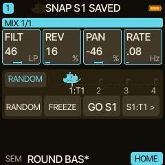

A snapshot remembers the controls pinned on the HOME page of the selected **track** (SCOPE TRACK) and their values, up to 32 of them, and only that track's own controls. It is saved with the project (slots A to D).

**Every track has its own four slots.** S1 of T1 and S1 of T2 are different sounds; the star (`S1*`) and the buoys of the sea chart show the slots of the selected track. With SCOPE ALL (RANDOM SETUP, K3) a hold of A4 saves every track's own slot at once (`SNAP S1 SAVED: 2 TRACKS`).

## 2. Morph to a slot

Select a slot and tap **A3 (GO Sx)**. The controls glide from where they are to the stored values; nothing jumps. **A2** freezes the
movement in place and resumes it. **A1 (RANDOM)** is the other kind of move: every control drifts to a random value near where it is (how far: DEPTH, below).

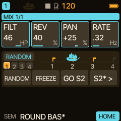

## 3. Set how it moves (RANDOM SETUP)

Hold **BANK** to switch SETUP on. K1 to K4 now set the morph:

| Knob | Setting | Values |
| --- | --- | --- |
| K1 | **BARS**: how long a move takes | 1, 2, 4, 8, 16, 32, 64 bars |
| K2 | **DEPTH**: how far a random move may go | 10, 25, 35, 50, 75, 100 % |
| K3 | **SCOPE**: what moves | ROW, TRACK, ALL |
| K4 | **SHAPE**: the curve | LINEAR, SMOOTH, DRIFT (three slightly different paths with the same ends) |

Hold BANK again to leave SETUP. BARS, DEPTH, SCOPE and SHAPE are saved with each project, so the performance sounds the same after reopening it.

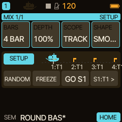

**Delete a slot:** in this SETUP, select the slot with A4 tap and **hold A4**. `SNAP S4 DELETED`. Outside SETUP the same hold saves, so a
save can never delete by accident. A deleted slot is empty again (and saved so with the project).

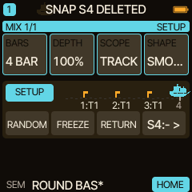

## 4. Start a journey

Tap **BANK** once: the chip left of the sea chart reads **JOURNEY** (the bank right after RANDOM). The caravel on the chart is the journey: it lies at anchor while the journey is off, waiting or paused, and sails from buoy to buoy while a leg moves. A1 reads `PLAY`, `PAUSE` or `RESUME`.

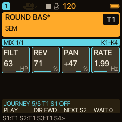

Tap **A1 (PLAY)**. The sound morphs to the selected slot, rests, moves on to the next slot that holds a sound, and loops
(S1, S2, S3, S1 ...). Each leg starts from the values the sound has at that moment. The leg length is the **BARS** value from RANDOM SETUP,
the curve is its **SHAPE**. A journey plays the slots of the **selected track** and needs two to four filled slots on it; empty slots are skipped.

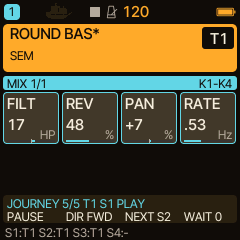

| Key | What it does in the JOURNEY bank |
| --- | --- |
| A1 | **PLAY**, then **PAUSE** (freezes the movement), then **RESUME** |
| A2 | **DIR FWD / REV**: the running leg finishes, the next one goes the new way |
| A3 | **NEXT Sx**: skip the rest of the leg and go on at once |
| A4 | tap: **WAIT** (the rest after each arrival: 0, 1, 2, 4, 8 or 16 bars); hold: **save** the live sound into the selected slot of the selected track |

## 5. Rest between legs, change direction

Tap **A4** to set a **WAIT**: the journey then stays on each sound for that long. The caravel lies at anchor while it rests.

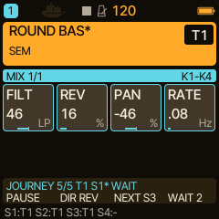

Tap **A2** to reverse. The message says when it happens: **REVERSE AFTER S1** means the leg to S1 finishes first.

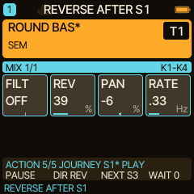

## 6. A journey for each track, and the JOURNEY SETUP

Select the track (T1 to T4) before you press PLAY: the journey plays **that track's** four slots, and the sea chart shows them. Saving or deleting a slot on that track ends its journey; the slots of the other tracks are not touched. **Every track has its own engine and its own settings** (BARS, DEPTH, SCOPE, SHAPE, WAIT, direction), so you can start a journey on T2 while T1's keeps sailing, each with its own length, curve and rests. The sea chart and the keys always show the selected track.

**Which tracks run is always visible**: the four small boxes under the bank chip are the tracks T1 to T4. Filled in the accent colour: that track's journey sails or rests; outlined: its journey is paused or held; filled in the theme colour: a RANDOM morph or a GO moves it; grey: nothing runs. The selected track has a bright frame (and the chart and keys show it). The screen below shows T2 selected and sailing while T1's journey is held by its own RANDOM morph.

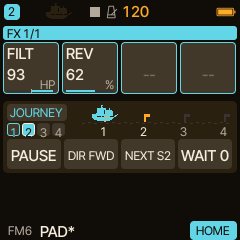

Hold **BANK** in the JOURNEY bank for its own SETUP: **K1 SCOPE** `THIS` or `ALL` (with ALL, PLAY, PAUSE and NEXT act on every track's journey, each on its own slots), **K2 TRANSP** `FREE`, `CONT` or `START`. FREE keeps time in milliseconds as before. CONT counts the sequencer's own bars: a **Stop freezes the leg and its WAIT**, a tempo change speeds it up, and an external MIDI clock is followed. START is CONT and also **begins the journey again at every Start**.

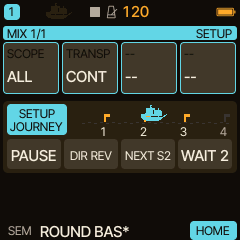

## 7. A RANDOM morph on the same track while a journey runs

Each track has **its own morph engine**, so morphs and journeys of different tracks run side by side: a RANDOM morph on T2 does not touch T1's journey. A RANDOM morph on the **same track** as a running journey does hold it: the journey stops where it is, and the caravel stays where it was (at anchor). When that
morph has arrived, the journey **goes on by itself** with a new leg from where its track stands to the same slot. Press **A1 while it is held**
and it pauses instead: it then waits for A1.

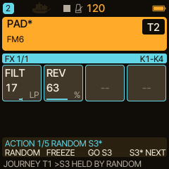

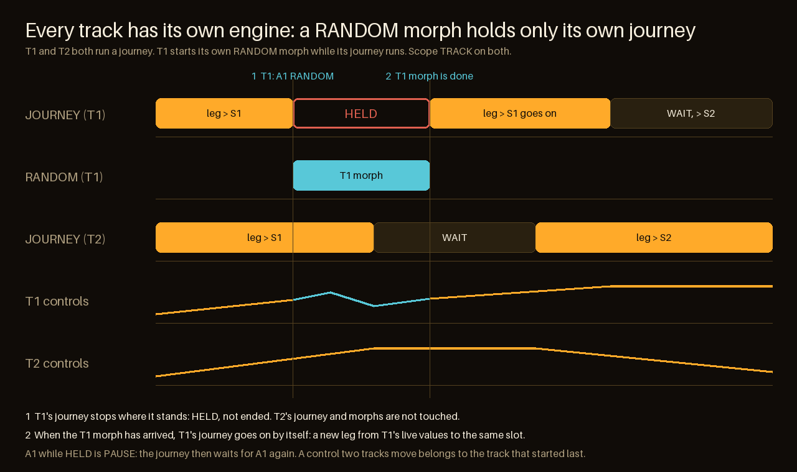

If two tracks move the same control (for example a control that is pinned on both HOME pages), the one that **started last** owns it; the other lets go until it starts again.

SCOPE ALL (RANDOM SETUP, K3) makes the RANDOM keys act on **every track at once**, each on its own HOME controls and with its own BARS: A1 starts, A2 freezes, A3 returns or morphs every track to its own slot.

## Good to know

- **The journey keeps running when you change bank.** Use STASIS, PAIR or LIVE meanwhile; come back to JOURNEY to steer.
- **Saving or deleting a snapshot of the journey's track ends a journey.** PLAY starts again from the selected slot. A RANDOM morph on the same track only **holds** it (step 7).
- **RANDOM's A3 (GO Sx) and the JOURNEY bank's A3 (NEXT) steer a running journey** to that slot at once and it goes on from there. **A paused journey stays paused**: GO is then a plain morph, and PLAY afterwards goes on with the journey's own leg from where the sound stands.
- **Hands win.** A knob you turn, or a MIDI CC, keeps its value for the rest of the leg; the next leg moves it again.
- **BARS, SCOPE and SHAPE changed during a journey wait for the next leg**, so a running leg keeps its speed. The display shows the waiting value.
- **A loaded project starts stopped** with S1 selected. Projects from before 0.8.0 get the defaults (BARS 8, DEPTH 35, TRACK, SMOOTH, WAIT 0, forward). Projects from 0.7.1 to 0.8.0 are migrated: each stored target moves into the slot of its own track, at most 32 per slot (more are dropped, and the load says so).
  Going back is one way only: **0.8.0 does not read a project saved by 0.9.0 and shows that slot as empty** (nothing is deleted, 0.9.0 reads it again; saving over it in 0.8.0 replaces it), so back up before moving between versions.
- **Tempo:** leg lengths follow the tempo setting, not an external MIDI clock.
- **MIDI:** every control above can be learned (MIDI LEARN: GLO + D4, then press the key or knob). See [MORPH JOURNEY](../morph-journey.md#midi-optional).

## If PLAY does nothing

`NEED 2 SNAPS`: the selected track needs a second filled slot. The buoys of the sea chart show that track's four slots (a filled buoy has a sound); select another track to see its slots.

*Screens are generated by `tools/morph_tutorial_frames.py`.*
