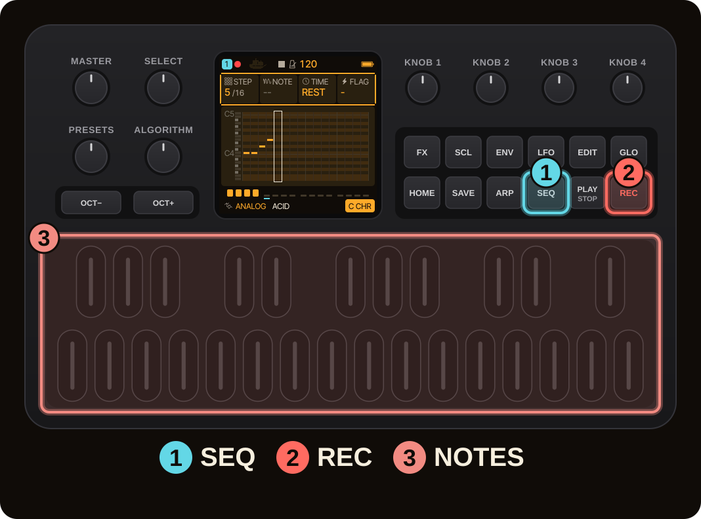
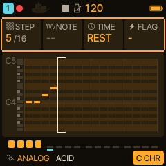
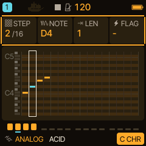
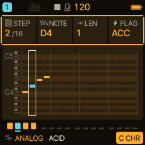
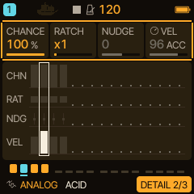
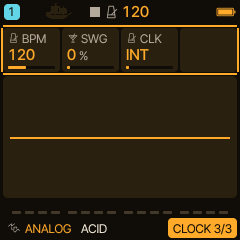
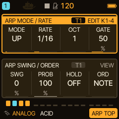

<!-- SPDX-License-Identifier: GPL-3.0-only -->
# Sequencer and arpeggiator

Every track has a step sequencer and an arpeggiator. This page shows how to enter and edit steps, record while a pattern plays, keep parts A to D, and let the arpeggiator turn held notes into a line.

> **In 60 seconds**
>
> 1. `SEQ` opens the STEP page. `REC` arms step entry: each key writes a note at the cursor and moves one step on.
> 2. `KNOB 1` moves the cursor; the other three cards edit the step (NOTE, LEN, FLAG). `SEQ` again opens DETAIL (CHANCE, RATCH, NUDGE, VEL).
> 3. `PLAY` starts all four tracks. Tempo is on the GLO > CLOCK page.
> 4. Hold `SEQ` and tap `REC` to record steps while the pattern keeps playing.
> 5. `ARP` opens the arpeggiator: MODE UP turns held keys into a rising line.

## 1. Enter steps

Press `SEQ` for the STEP page of the selected track, press `REC`, and play keys. Each key press writes a note at the cursor and moves one step on (the default 16 steps). Press `REC` again to switch step entry off.

The four cards at the top: **STEP** (the cursor), **NOTE**, **LEN** and **FLAG**. Turn `KNOB 1` to move the cursor to another step.

## 2. Edit a step

With the cursor on a step, `KNOB 2` changes its note, `KNOB 3` its length in steps (LEN) and `KNOB 4` its flag (for example ACC, an accent). Press `SEQ` again for the **DETAIL** page, which edits the same step with four more cards: **CHANCE** (how likely the step plays), **RATCH** (repeats within the step), **NUDGE** (timing offset) and **VEL** (velocity).

> [!NOTE]
> A drum track shows a step grid instead of the piano roll. To clear a step, hold `SEQ` and press F5; the clear moves the cursor on, so repeated presses sweep through the pattern.

## 3. Play and tempo

`PLAY` starts all four tracks, `PLAY` again stops. The tempo is on the clock page: press `GLO` and turn `SELECT` to the **CLOCK** page (BPM, SWG, CLK). Hold `GLO` and turn `SELECT` to set the tempo from anywhere.

## 4. Record while it plays

On a melodic track's STEP page, hold `SEQ` and tap `REC` to select and arm **STEP REC**; the footer shows STEP REC. Playback continues independently of the input cursor: `KNOB 1` or `PRESETS` selects a step and the keys write there; releasing all keys advances one step. Hold `SEQ` and tap `REC` again to switch to **LIVE REC** at the moving playhead. A plain `REC` tap disarms recording.

## 5. Parts A to D

While playing, open `SAVE`, then **PROJECT**: choose A to D with `KNOB 1`, `SAVE` with `KNOB 4`, press `OCT+`, name it or keep the name, press `OCT+` again. Playback keeps running; the display says RAM ONLY and then STOP TO SAVE. Each slot holds its own snapshot with steps, timing, sounds, automation and parameter locks. To switch parts live choose **LOAD** with `KNOB 3` and press `OCT+`: the part is queued (QUEUED A to D) and starts at track 1's loop boundary. See [Live parts and step recording](../sequencer/LIVE_PATTERNS.md).

## 6. The arpeggiator

Press `ARP`. The top group has **MODE**, **RATE**, **OCT** and **GATE**; the lower group **SWG** (swing), **PROB**, **HOLD** and **ORD**. MODE OFF turns it off; turning `KNOB 1` steps through UP, DN, UPDN, RND, ORD, REPEAT, DNUP and more. Hold a few keys and the arpeggiator plays them one at a time at the chosen rate.

With **HOLD** on the arpeggiator keeps playing after you let go of the keys. The track's **LATCH** (SCL, CHORD page) does something related: it keeps the notes of the keys sounding after release; see [LATCH](../latch.md).

## 7. Where next

- Make the notes follow a chord progression: [HARMONY](harmony-live.md).
- Move parameters over time: [HOME performance](home-and-stasis.md) and [Filter, FX and modulation](filter-fx.md).
- Sync to a drum machine or DAW: [MIDI and sync](midi-sync.md).
