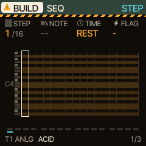
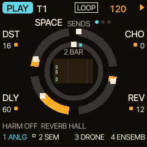

<!-- SPDX-License-Identifier: GPL-3.0-only -->
<!-- Copyright (C) 2026 bonszaimusic -->

# Notes, sequencer, ARP and CAPTURE

Caravel **1.0.0 candidate** · BUILD / PLAY controls.

> **In 60 seconds** BUILD holds the step sequencer. In PLAY, run transport, play keys or MIDI, then REC captures the recent notes.

## 1. Sequence in BUILD

Tap SEQ to reach the step pages. STEP, DETAIL and AUTOMATION use the familiar grid. Select a step and play keys to enter notes; use DETAIL for gate, chance, conditions and ratchets. SEQ + REC selects step recording. PLAY controls transport. Song and Chain are absent in 1.0.

## 2. Use ARP

Tap ARP and choose a mode, rate, octave span and gate. Hold some keys or send MIDI notes to provide anchors. ARP generates notes from those anchors. LATCH can keep the input after release; panic clears stuck performance state.

## 3. Capture what you played

In PLAY, start transport and play notes on the keys or through **USB MIDI IN or TRS MIDI IN**. REC takes the last chosen 1, 2, 4 or 8 bars into the selected track's loop. Another REC overdubs new live input. The four tracks have independent loops; selecting another track does not erase them. For PAIR, the owner track holds the loop.

CAPTURE stores raw note, velocity, timing and physical key/note-off, before HARMONY and CHRD. It does not store audio, MIDI pedal/CC automation, ARP output or its own playback. The loop passes through the current ARP, LATCH and harmony settings when played. Changing harmony can therefore change the same captured gesture.

## 4. Pause, clear and capacity

Tap SEQ in PLAY to pause/resume the loop; hold SEQ to wipe it. Stop transport to pause clock-driven playback. There are at most 64 events per loop, including note-offs. A take that cannot fit is refused as FULL, keeping the previous loop. Loops live in RAM and disappear after power-off: they are not saved or backed up.

[Detailed CAPTURE walkthrough](capture.md) · [MIDI routing](midi-sync.md) · [HARMONY and CHORD EXT](harmony-live.md)
