<!-- SPDX-License-Identifier: GPL-3.0-only -->
# Start here: your first ten minutes

Caravel is free firmware for the M-VAVE FM-1. This page takes you from a stock FM-1 to your own first sound, your first sequence and a saved project, and shows you the way back to the stock firmware if you ever want it. You need an FM-1, a USB data cable and a computer with Chrome or Edge.

> **In 60 seconds**
>
> 1. **Back up** what is on the FM-1 (`caravel_backup.py save`, or the web editor's *Complete backup*).
> 2. **Install**: open the web installer in Chrome or Edge, connect the FM-1 over USB, press Install.
> 3. **Play**: press keys, turn `PRESETS` for another sound, turn `KNOB 1` to `KNOB 4` to change it.
> 4. **Sequence**: `SEQ`, then `REC`, play four keys, `REC` again, `PLAY`.
> 5. **Save**: press `SAVE` four times (PROJECT), `KNOB 4` to SAVE, `OCT+` twice.
> 6. **Way back**: the installer's *Return to official V15* with M-VAVE's own `FM-1.fwsc`.

The screens on this page come from the actual Caravel firmware renderer (a host build, not a photo of a device). Figures with the FM-1 are drawings; the highlighted controls are the ones to use.

## 1. Back up first

Caravel and the stock firmware do not share projects: a project saved by Caravel does not open in the official V15. So before you change anything, save what is on the FM-1.

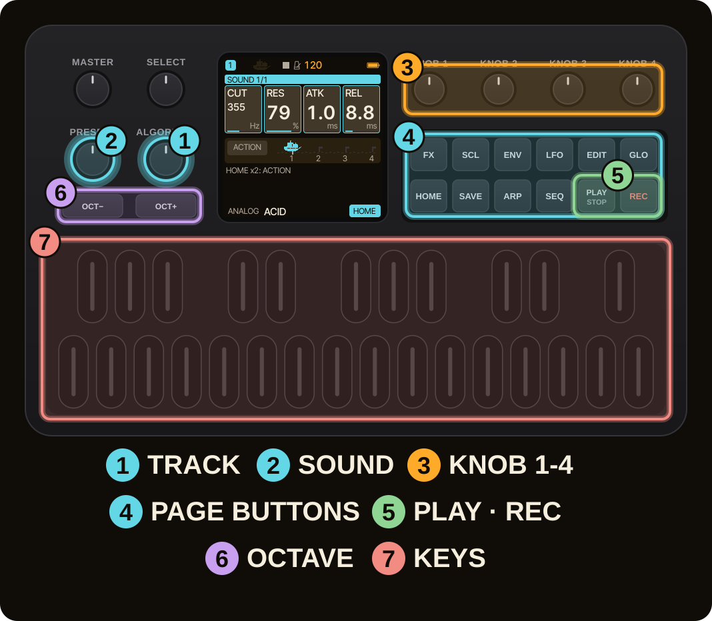

Two ways to save a **complete backup** (the current project, the saved projects A to D, sound banks, user samples and settings) of a device that runs Caravel:

- the [web editor](https://bonszaimusic.github.io/caravel/webapp/editor/): *Complete backup*, then *Save backup*;
- or in a terminal: `python3 tools/caravel_backup.py save session.zip` (needs Python 3 with `mido` and `python-rtmidi`; close other MIDI programs first).

The backup button is greyed out when the connected firmware does not report backup support. Keep the backup file on your computer, not on the FM-1, and keep M-VAVE's official `FM-1.fwsc` (download page: [m-vave.com/download](https://www.m-vave.com/download)) next to it: it is your way back.

> [!WARNING]
> Installing custom firmware is at your own risk. A failed update can leave the FM-1 unusable. Do not unplug the USB cable or switch the FM-1 off while it is writing. [Installing Caravel](../installing.md) lists the risks in full.

## 2. Install Caravel

1. Open the [web installer](https://bonszaimusic.github.io/caravel/webapp/installer/) in **Chrome or Edge** (it needs Web MIDI). Allow MIDI access when the browser asks.
2. Connect the FM-1 with a USB **data** cable and close other programs that use MIDI.
3. The page checks the package (size, SHA-256) and the device before it enables **Install**. Press it and wait: the page switches the FM-1 to update mode, writes, restarts it and checks the installed identity.

The installer shows what to do when a step fails. If the FM-1 is not found, or an update stops, read the [Troubleshooting & FAQ](../faq.md) before trying again: it covers USB detection, interrupted updates and the stock-return error -5.

> [!NOTE]
> A command-line installer exists too (`python3 tools/fm1_install.py caravel-X.Y.Z.fwsc`). Unlike the web installer's way back to the stock firmware, it makes no backup.

## 3. Play a sound

After the restart the FM-1 shows the HOME page. The number at the top left is the selected **track** (1 to 4). Press keys: the 27 keys play the selected track. Turn `PRESETS` to move to another sound of the same engine.

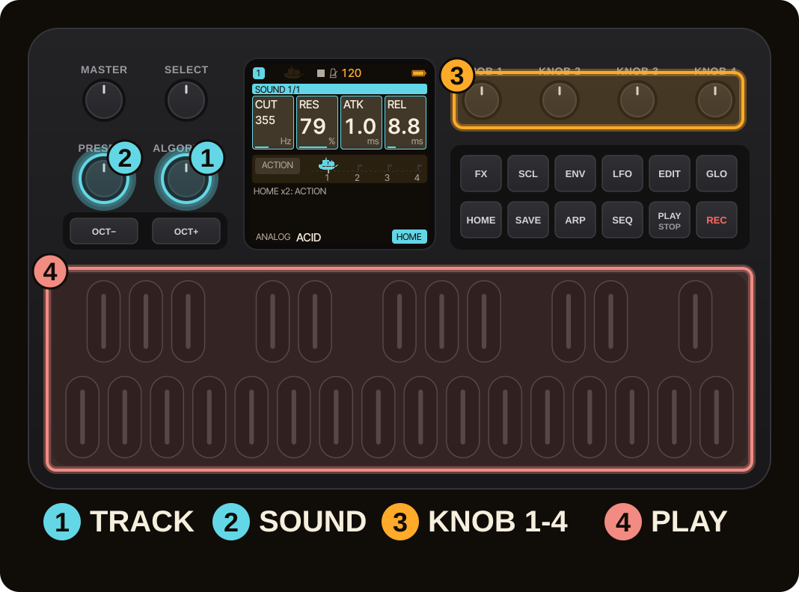

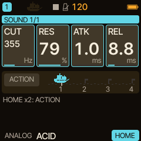

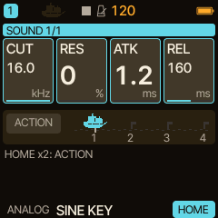

- The four large cards are **KNOB 1 to KNOB 4**. In this screen they are CUT, RES, ATK and REL: turn them while you play a key and listen.
- `ALGORITHM` chooses the track. Every track has its own engine, preset and sequence.
- `MASTER` is the volume.

> [!TIP]
> **Try the engines.** Hold `EDIT` and press a white key (or turn `KNOB 1` while holding it): the engine picker opens. Release `EDIT` to leave it. Your four HOME cards belong to parameters of the previous engine; a card whose parameter the new engine does not have shows UNAVAIL (each track has its own HOME cards, which you can rearrange: see HOME performance).

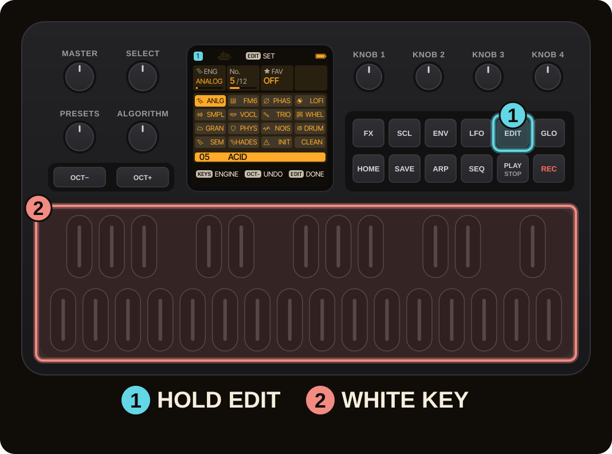

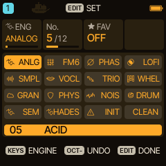

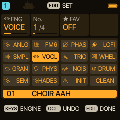

The whole sound library is on **SAVE, second page** (PRESETS): `KNOB 1` is the sound number, `KNOB 2` jumps from engine to engine, and the list shows what you hear. The [engine tutorials](README.md) explain what each engine is good for.

## 4. Play a first sequence

1. Press `SEQ`. The STEP page of the selected track opens: 16 steps, a piano roll below.
2. Press `REC`. A red dot next to the track number says that step entry is armed.
3. Press four keys, one after the other. Every key press **writes a note at the cursor and moves one step on**; the step counter runs from 1/16 to 5/16.
4. Press `REC` again to switch step entry off.
5. Press `PLAY`. The playhead runs through the pattern; press `PLAY` again to stop.

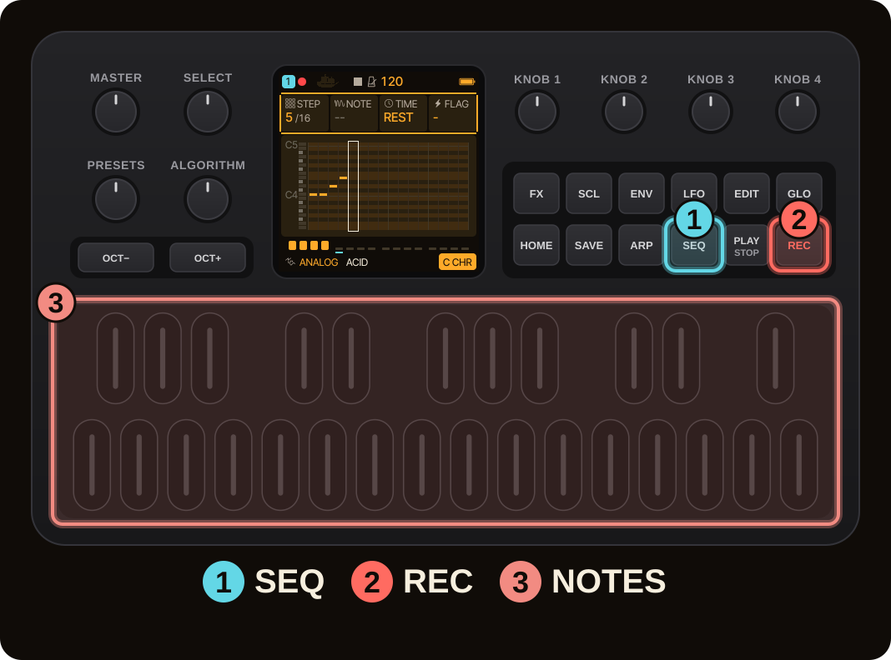

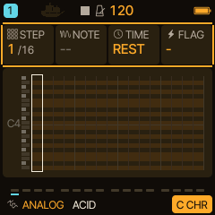

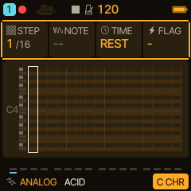

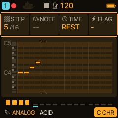

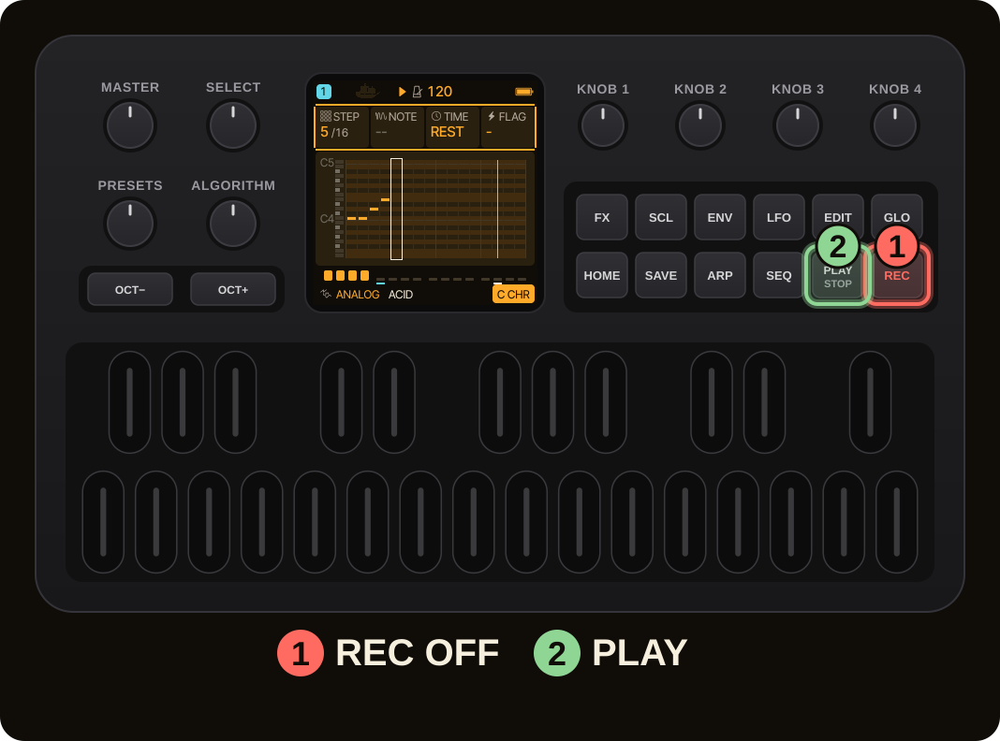

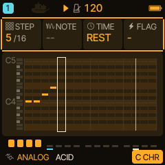

> [!NOTE]
> This is the entry for a melodic track. A drum track shows a step grid instead. The [sequencer and arpeggiator tutorial](README.md) covers rests, timing, chords and recording while the pattern plays.

## 5. Save your work

**SAVE** stores your work in a slot you can load again. It has five pages; every press steps on to the next one (the footer names it: USER, PRESETS, PHRASES, PROJECT, TOOLS). A **project** holds your four tracks: sounds, sequences, timing, automation and effects.

1. Press `SAVE` until the footer reads **PROJECT 4/5** (four presses from HOME).
2. `KNOB 1` chooses the slot **A to D**.
3. `KNOB 4`: turn it to SAVE. The chip **OCT+ SAVE** appears.
4. Press `OCT+`. A name dialog opens with a default name (for example PROJECT_A). Keep it or type another one with the keys.
5. Press `OCT+` again. The slot now reads **USED** and the header shows its letter.

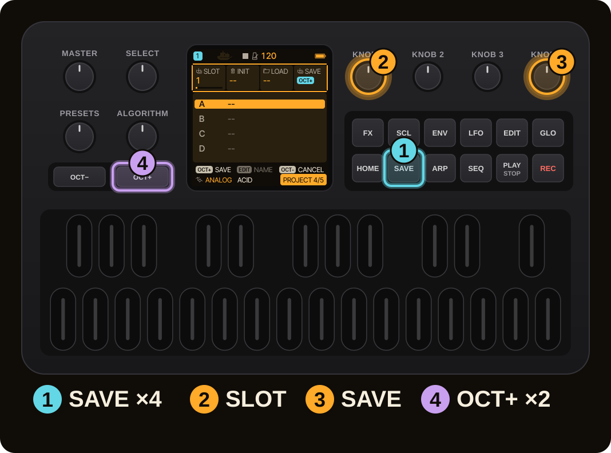

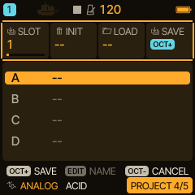

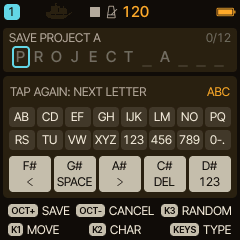

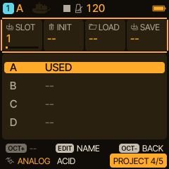

To load a project later, open the same page, choose the slot and turn `KNOB 3` to LOAD, then press `OCT+`.

> [!TIP]
> Saving while the sequence plays keeps the project in memory first; the display says RAM ONLY and then STOP TO SAVE. Stop the sequencer to write it to flash. [Live parts and step recording](../sequencer/LIVE_PATTERNS.md) explains this.

## 6. The way back

You can return to the stock firmware at any time.

1. Download the official **FM-1.fwsc** from M-VAVE ([m-vave.com/download](https://www.m-vave.com/download)). Do not modify it.
2. Open the web installer, expand **Return to official V15** and choose the file. The browser checks it against the known V15 file and does not upload it anywhere.
3. Press **Back up and return to official V15**. The installer first exports a complete backup (your browser saves it as a `Caravel-backup-…` file); confirm that the file is on your computer, then it installs V15.

Caravel projects do not open in V15, and reinstalling the official firmware does not guarantee the factory state, your data or your warranty. If the update reports error -5, read [the FAQ](../faq.md#stock-return-error--5).

## 7. Where next

- **Understand the pages and saving:** the basics, in the [tutorial overview](README.md).
- **Sounds:** [SEM, HADES, DRONE and ENSEMBLE](README.md), each with what to turn first.
- **Perform:** [HOME performance functions](README.md) and [HARMONY](harmony-live.md).
- **Listen:** the [sound examples](https://bonszaimusic.github.io/caravel/sounds/) are native firmware DSP renders (not device recordings); the videos [DRONE engine](https://www.youtube.com/watch?v=N08Vx3x7fLE) and [SEM and HADES](https://youtu.be/rfY23zoBgzQ) are on YouTube.
- **Try it first:** the [browser emulator](https://bonszaimusic.github.io/caravel/emulator/) runs the same code in your browser.
