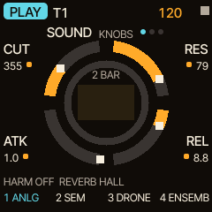
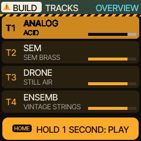

<!-- SPDX-License-Identifier: GPL-3.0-only -->
<!-- Copyright (C) 2026 bonszaimusic -->

# Start here: Caravel 1.0

Caravel **1.0.0 candidate** · BUILD / PLAY controls.

> **In 60 seconds** Back up with the old matching tool. Start in PLAY, hold HOME one second for BUILD, and tap SAVE for PROJECT.

## 1. Back up before updating

1.0 starts a new data generation. Save a backup with the firmware and backup tool that currently read your device. Keep that firmware and backup together: 1.0 does not import pre-1.0 projects, user presets or backups. It reports **OLD DATA FOUND** rather than silently converting them. See [installation](../installing.md).

## 2. Start in PLAY

A fresh device starts in PLAY with a one-time LEVELS introduction. Dismiss that explanation, then tap GLO for MIX / LEVEL to balance the four tracks with K1–K4. Tap EDIT for SOUND, play a key and turn its four arcs. ALGO chooses a track. HOME tapped opens the LEVELS explanation; EDIT returns to SOUND.

## 3. Build a sound

Hold HOME for one second to enter BUILD. Tap EDIT to browse the engine controls; hold EDIT to choose an engine and sound. The six engines are ANALOG, PHYS, SEM, HADES, DRONE and ENSEMBLE. ENV shapes the envelope; FX opens sends and effects. A short HOME tap returns to the track overview.

## 4. Keep your work

Tap SAVE to open PROJECT. Choose a slot and use the displayed SAVE action; confirm replacement when asked. While the clock runs, a save can be kept in RAM until transport stops. Wait for the flash commit before switching off. CAPTURE loops are temporary and are not saved with the project.

[Controls](basics.md) · [Notes, ARP and CAPTURE](seq-arp.md) · [Help](help.md)
